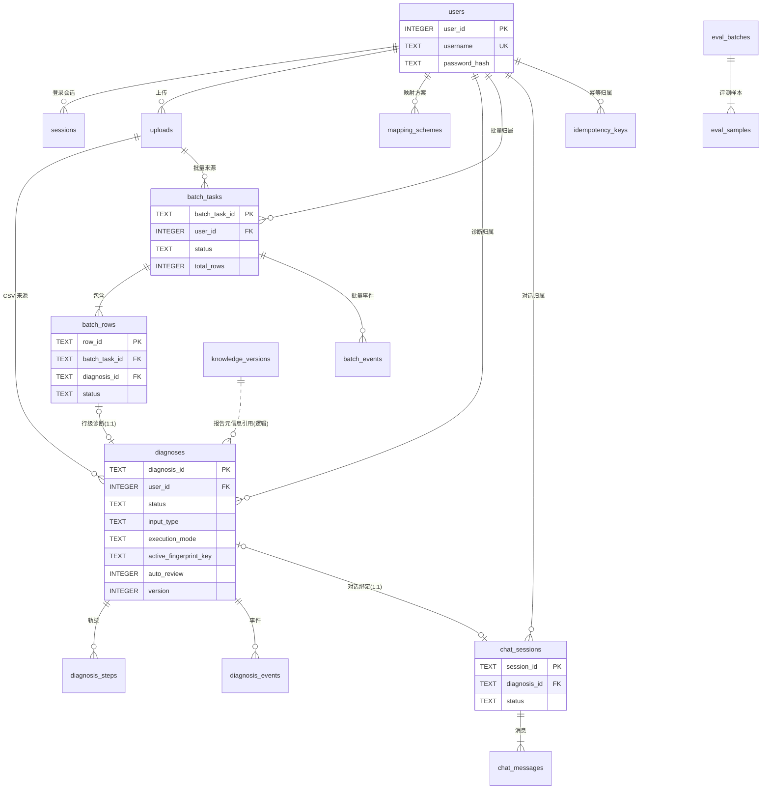

# 数据库设计文档（Database Design）

| 项目 | 内容 |
| --- | --- |
| 文档版本 | **V1.1.0**（V1.0.0 冷启动验收驳回后返修；P0×2、P1×5、P2×9 全部闭环；未修改 PRD/ARCH/UIUX/HANDOFF） |
| 适用基线 | PRD V3.0.0（冻结）、ARCH V1.2.0（冻结）、UIUX V1.2.0（冻结）、HANDOFF V1.2.2 |
| 返修依据 | `docs/log/DB验收日志.md`（V1.0.0 冷启动验收：P0×2、P1×5、P2×9） |
| 上游权威 | 业务行为 → PRD；接口/报文/SSE/技术选型 → ARCH；界面 → UIUX；物理 DDL/索引/迁移/备份 → **本文** |
| 存储引擎 | SQLite 3（WAL）；业务库 `storage/app.db`；检查点库 `storage/checkpoints.sqlite3` |
| 依赖能力 | 部分索引（3.8.0+）、`json_valid/json_type`（JSON1，3.9+）、`UPDATE … FROM`（3.33+）、`RETURNING`（3.35+） |
| 交接对象 | 后端 Agent、测试 Agent、部署运维 |
| 原则 | 本文只承接物理表、字段、类型、约束、索引、触发器、迁移与备份；**不复述 API 路径、报文、SSE 字段明细** |

> 本文所有表名、字段名、枚举值、状态语义均来自 ARCH §7.2/§7.3 与 PRD §4.5，不新增业务枚举、不改变状态机。任何与上游不一致处集中在 §9 登记，不静默择一。

**修订记录**

| 版本 | 变更 |
| --- | --- |
| V1.0.0 | 初稿（冷启动验收驳回） |
| V1.1.0 | 按 `docs/log/DB验收日志.md` 修复 P0×2、P1×5、P2×9：终态清中断字段、会话删除改为 `ON DELETE SET NULL`（保持 ARCH §5.4.6）、懒判定补事件、`chat_messages` 不可变落地、指纹必填性登记、进度口径拆分、`manifest_path` 唯一、置信度/报告/输入模式一致性约束、`upload_id` 严格 GLOB、批量指纹承载登记、批量创建初值、对账事务措辞统一、补充 D-06/D-08 登记 |

---

## 0. 覆盖核对（ARCH §7.2 逻辑表 → 物理表）

| # | ARCH 逻辑表 | 物理表 | 承接要点 | 章节 |
| --- | --- | --- | --- | --- |
| 1 | `users` | `users` | 账户、失败次数、锁定时间 | §5.1 |
| 2 | `sessions` | `sessions` | 登录会话、`token_hash` 唯一、24h 过期 | §5.2 |
| 3 | `uploads` | `uploads` | CSV 元数据、表头签名、行数上限 | §5.3 |
| 4 | `mapping_schemes` | `mapping_schemes` | 映射方案复用 | §5.4 |
| 5 | `diagnoses` | `diagnoses` | 诊断投影 + 8 项架构补充字段 + 指纹部分唯一 | §5.5 |
| 6 | `diagnosis_steps` | `diagnosis_steps` | 轨迹追加写 | §5.6 |
| 7 | `diagnosis_events` | `diagnosis_events` | 事件追加写、`(diagnosis_id, seq)` 唯一 | §5.7 |
| 8 | `batch_tasks` | `batch_tasks` | 八项计数守恒 | §5.8 |
| 9 | `batch_rows` | `batch_rows` | 行状态封闭集（无 `waiting_human`/`expired`） | §5.9 |
| 10 | `batch_events` | `batch_events` | 批量事件独立序列 | §5.10 |
| 11 | `chat_sessions` | `chat_sessions` | 会话 1:1 诊断、`draft/active/terminal` | §5.11 |
| 12 | `chat_messages` | `chat_messages` | 消息与卡片载荷追加写 | §5.12 |
| 13 | `knowledge_versions` | `knowledge_versions` | 至多一个 `active` | §5.13 |
| 14 | `eval_batches` | `eval_batches` | 指标与版本冻结 | §5.14 |
| 15 | `eval_samples` | `eval_samples` | 无 `degraded_review`（DEV-01） | §5.15 |
| 16 | `idempotency_keys` | `idempotency_keys` | `(user_id, endpoint, key)` 唯一、10 分钟 TTL | §5.16 |
| — | 运维表（本文补充） | `schema_migrations` | schema 版本检查与迁移审计 | §5.0 |

---

## 1. 设计边界与原则

### 1.1 投影与事实源

| 数据 | 事实源 | 落库位置 | 说明 |
| --- | --- | --- | --- |
| 运行期完整状态（`features`、`retrieval`、`raw_input`、`intake_draft`、`human_review` 等） | 检查点 | `storage/checkpoints.sqlite3`（库自管理表） | 业务代码**禁止**手工写检查点表 |
| 诊断业务投影（列表/详情/历史/报告） | 业务库 | `diagnoses` + `diagnosis_steps` + `diagnosis_events` | 投影随状态变化同步更新 |
| 报告正文 | 业务库 | `diagnoses.report_md` | 只在 finalize 系节点写入；不存文件二进制 |
| 批量汇总 | 业务库 | `batch_tasks` 计数列 | 由 `batch_rows` 聚合，**不持久化 `progress`/`success_rate`** |
| 评测结果 | 业务库 | `eval_batches` / `eval_samples` | 训练/评测不写 `diagnoses` |

**不落库的运行期字段**（由检查点或查询时派生）：`features`、`retrieval`、`trace_steps`（查询时由 `diagnosis_steps` 组装）、`timings.nodes`、`deadline_at`、`progress`、`completed_rows`、`success_rate`、`latency_sample_count`（由 samples 统计）。

### 1.2 物理设计红线

1. 所有查询路径必须带 `user_id`；越权在 API 层返回 404，DB 不提供跨用户视图。
2. 时间统一 UTC、ISO 8601 文本（`YYYY-MM-DDTHH:MM:SS.sssZ`），字符串比较即时间比较。
3. 布尔用 `INTEGER 0/1`；浮点仅 `confidence`/误差率/时延用 `REAL`/`INTEGER`。
4. JSON 列统一 `TEXT` + `json_valid()` 校验；禁止把报告正文塞进 JSON 列。
5. 枚举用 `CHECK` 固化封闭集合；新增枚举属契约变更，必须先走 ARCH §10.4。
6. `diagnosis_events.type` / `batch_events.type` **不建 CHECK**：事件类型是 SSE 契约（ARCH §5.5），DB 复制枚举会漂移；结构由 `seq`/`payload_json` 保证。
7. 检查点库与业务库**物理分离**，备份成对；业务库不存 LangGraph 表。

---

## 2. HANDOFF 硬约束承接表

| 约束（HANDOFF §2/§6/§7） | 物理承接 | 位置 |
| --- | --- | --- |
| `diagnoses` 增 `auto_review`、`report_title`、`report_meta_json`、`interrupt_expires_at`、`active_fingerprint_key`、`execution_mode`、`batch_task_id`、`row_id` | 8 列全部落地；`auto_review` 独立布尔列 | §5.5 |
| `(user_id, active_fingerprint_key)` 部分唯一（仅非空） | `ux_diagnoses_active_fp` 部分唯一索引 | §6 |
| 终态/expired/启动对账置 failed 时必须同事务清空指纹 | `CHECK`：active 键仅允许 `running/waiting_human`；任一 UPDATE 未清空即报错 | §5.5 / §7.2 |
| `diagnosis_events`、`batch_events` 追加写；`(…, seq)` 唯一 | 唯一索引 + 禁止 UPDATE 触发器 | §5.7 / §5.10 / §6 |
| `batch_tasks` 八项计数之和 = `total_rows` | 表级 `CHECK`（单行内恒成立） | §5.8 |
| 行状态不含 `waiting_human`/`expired` | `batch_rows.status` CHECK 封闭 8 值 | §5.9 |
| `chat_sessions` 1:1 诊断；`diagnosis_id` 初始 `null`，确认/复用同事务写入 | `CHECK` + `diagnosis_id` 部分唯一 + `draft→active→terminal` 触发器 | §5.11 |
| `knowledge_versions` 至多一个 `active` | 部分唯一索引 `ux_knowledge_active` | §5.13 |
| `idempotency_keys` 唯一 `(user_id, endpoint, key)`、10 分钟 TTL | 复合主键 + `expires_at` 索引；TTL 由写入方计算 | §5.16 |
| TTL 扫描索引 `(status, interrupt_expires_at)` | `ix_diagnoses_ttl` 部分索引 | §6 |
| 索引 `(user_id, started_at DESC)`、`(user_id,status)`、`(user_id,primary_type)`、`(user_id,confidence_level)`、`(batch_task_id)`、`(upload_id)` | 全部落地 | §6 |
| SQLite：WAL、`busy_timeout=5000`、`foreign_keys=ON`；业务库与检查点库分开 | PRAGMA 初始化脚本 + 目录约定 | §4.4 / §8 |
| 批量行必须保存 `input_fingerprint`（`fingerprint_scope=trace`），不写 active 键；eval 不计算指纹 | `CHECK`：`execution_mode='batch'` ⇒ 指纹非空且 scope=`trace`；active 键仅 `single` | §5.5 |
| 批量/eval 不进入人工中断；`clarify` 仅 `single + nl/chat` | `CHECK`：非 `single` 禁止 `waiting_human`/`expired`；`clarification` 仅允许 `single` 且 `nl/chat` | §5.5 |
| 禁止单独删除批量来源诊断 | `BEFORE DELETE` 触发器 | §6 |
| 删除非批量诊断时对话会话保留、`diagnosis_id` 置空（ARCH §5.4.6） | `chat_sessions.diagnosis_id ON DELETE SET NULL`；会话与消息保留 | §5.11 / §8.4 |
| 批量行指纹承载位置 | 批量行指纹落在其 1:1 诊断（`fingerprint_scope='trace'`）；失败行不创建诊断，故无指纹 | §5.9 / §9 D-10 |
| DEV-01 评测样本不产生 `degraded_review` | `eval_samples.status` CHECK 仅 4 值 | §5.15 |
| DEV-02 `progress` 不持久化 | 无 `progress` 列；由八项计数派生 | §5.8 |
| DEV-03/04 对话确认时才建诊断、`device_id` 必填 | `chat_sessions.draft` 时 `diagnosis_id` 必须空；`diagnoses.device_id NOT NULL` + 长度约束 | §5.5 / §5.11 |
| TBD-B 架构补充字段 | `auto_review` / `report_title` / `report_meta_json` 登记为架构补充字段（PRD 字典未列） | §9 |

---

## 3. ER 图



> `knowledge_versions` 与诊断之间**没有物理外键**：报告元信息只记录 `kb_version` 字符串（快照/审计用途），版本删除不在本期范围内。

---

## 4. 通用约定

### 4.1 ID 与类型

| 实体 | 存储类型 | 形态约束 | 来源 |
| --- | --- | --- | --- |
| `user_id` | `INTEGER` | 自增 | PRD §4.5.2 `user_id int`（见 §9 D-01） |
| `username` | `TEXT` | 1–64，大小写不敏感唯一 | ARCH §7.2 |
| `diagnosis_id` | `TEXT` | `dx_` + 10–40 位 | ARCH §5.1.5 |
| `row_id` | `TEXT` | `row_` + 10–40 位 | ARCH §5.1.5 |
| `batch_task_id` | `TEXT` | `bch_` + 10–40 位 | ARCH §5.1.5 |
| `upload_id` | `TEXT` | `^up_[0-9A-Za-z]{10,40}$`（路径安全；DDL 用 `substr(upload_id,4)` 分段强制） | ARCH §7.7 / §5.1.5 |
| `mapping_id` | `TEXT` | `map_` 前缀 | ARCH §5.1.5 |
| `chat session_id` | `TEXT` | `cht_` 前缀 | ARCH §5.1.5 |
| `message_id` | `TEXT` | `msg_` 前缀 | ARCH §5.1.5 |
| `eval_batch_id` / `eval_sample_id` | `TEXT` | `evb_` / `evs_` 前缀 | ARCH §5.1.5 |
| `event_id` / `step_id` | `TEXT` | 实现生成的全局唯一串 | ARCH 未规定前缀，DB 不约束格式 |

### 4.2 JSON 列清单

| 表.列 | JSON 形态 | 用途 |
| --- | --- | --- |
| `diagnoses.input_summary_json` | object | 文件名/行号/文本摘要 |
| `diagnoses.secondary_types_json` | array | 鉴别候选 |
| `diagnoses.confidence_breakdown_json` | object | 四因子与扣分 |
| `diagnoses.evidence_refs_json` | array | 证据引用 |
| `diagnoses.report_meta_json` | object | 模板/提示词/知识库版本、`auto_review`、`degraded_reasons` 等 |
| `diagnoses.report_elements_check_json` | object | 8 要素自检结果（`passed/present/missing/report_retry_count`） |
| `diagnoses.interrupt_payload_json` | object | 中断载荷（澄清/复核） |
| `uploads.headers_json` | array | 表头原文 |
| `mapping_schemes.mapping_json` | object | 7 个标准键 → 列名 |
| `*_events.payload_json` | object | 事件载荷 |
| `chat_messages.payload_json` | object/null | 抽取确认卡/补充卡 |
| `idempotency_keys.response_json` | object | 首次响应快照 |

### 4.3 时间与空值

- `created_at`/`started_at`/`finished_at`/`expires_at` 等一律 UTC 文本；默认值 `strftime('%Y-%m-%dT%H:%M:%fZ','now')`。
- 诊断预算起点：`diagnoses.started_at`（即 ARCH §4.6 的 `execution_started_at`，创建即写入）；`created_at` 为记录创建审计列。
- `finished_at IS NULL OR finished_at >= started_at` 由 CHECK 保证。

### 4.4 连接初始化（每个连接必须执行）

```sql
PRAGMA journal_mode = WAL;
PRAGMA busy_timeout = 5000;
PRAGMA foreign_keys = ON;
PRAGMA synchronous = NORMAL;
```

- WAL 为库级持久设置；`busy_timeout`/`foreign_keys` 为连接级，必须在连接池每次取连接时设置。
- `checkpoints.sqlite3` 使用同样 PRAGMA，但表由 LangGraph 管理，业务代码不建表、不写表。
- 事务模式：应用连接使用 `isolation_level=None`（或等价自动提交）；业务事务显式 `BEGIN IMMEDIATE`/`COMMIT`，禁止在已开启隐式事务的连接上再执行 `BEGIN`（否则 `cannot start a transaction within a transaction`）。
- 不使用 `PRAGMA writable_schema`、不关闭 `foreign_keys` 做“临时修复”。

---

## 5. 表设计明细

### 5.0 `schema_migrations`（运维表，本文补充）

| 字段 | 类型 | 空 | 说明 |
| --- | --- | --- | --- |
| `version` | INTEGER | 否 | 迁移版本号，主键，从 1 递增 |
| `applied_at` | TEXT | 否 | 应用时间（UTC） |
| `checksum` | TEXT | 否 | 迁移文件 SHA-256 |
| `note` | TEXT | 是 | 备注 |

**约束**：启动时读取 `MAX(version)`；大于代码期望 → 拒绝启动；小于 → 顺序执行缺失迁移；失败不提交并打印修复项（ARCH §7.8）。

---

### 5.1 `users`

| 字段 | 类型 | 空 | 默认 | 说明 |
| --- | --- | --- | --- | --- |
| `user_id` | INTEGER | 否 | 自增 | 主键 |
| `username` | TEXT | 否 | — | 1–64，`NOCASE` 唯一 |
| `password_hash` | TEXT | 否 | — | bcrypt（cost 12），不存明文 |
| `failed_attempts` | INTEGER | 否 | 0 | ≥0；登录失败计数 |
| `locked_until` | TEXT | 是 | — | 锁定截止（UTC）；5 次失败锁 5 分钟由应用写入 |
| `created_at` | TEXT | 否 | now | 创建时间 |
| `last_login_at` | TEXT | 是 | — | 最近登录 |

**约束/索引**：`ux_users_username(username)`；`password_hash` 以 `$2` 开头；`locked_until >= created_at`。

---

### 5.2 `sessions`

| 字段 | 类型 | 空 | 说明 |
| --- | --- | --- | --- |
| `session_id` | TEXT | 否 | 主键 |
| `user_id` | INTEGER | 否 | 外键 `users`，删用户级联 |
| `token_hash` | TEXT | 否 | Cookie 令牌哈希，唯一 |
| `created_at` | TEXT | 否 | 创建 |
| `expires_at` | TEXT | 否 | 创建 + 24h |
| `revoked_at` | TEXT | 是 | 退出/失效时间 |

**约束/索引**：`ux_sessions_token_hash`；`ix_sessions_expires(expires_at)`；`expires_at > created_at`；`revoked_at IS NULL OR revoked_at >= created_at`。

---

### 5.3 `uploads`

| 字段 | 类型 | 空 | 说明 |
| --- | --- | --- | --- |
| `upload_id` | TEXT | 否 | 主键，`^up_[0-9A-Za-z]{10,40}$` |
| `user_id` | INTEGER | 否 | 外键 |
| `original_name` | TEXT | 否 | 原始文件名（仅元数据） |
| `stored_path` | TEXT | 否 | 相对根目录路径，唯一 |
| `size_bytes` | INTEGER | 否 | `1 .. 5242880` |
| `encoding` | TEXT | 否 | `utf-8` / `gbk` |
| `row_count` | INTEGER | 否 | `1 .. 500` |
| `headers_json` | TEXT | 否 | 表头数组 |
| `header_signature` | TEXT | 否 | `sha256:` + 64 hex |
| `created_at` | TEXT | 否 | 创建时间 |

**约束/索引**：`ux_uploads_stored_path`；`ix_uploads_user_created(user_id, created_at DESC)`；`ix_uploads_user_sig(user_id, header_signature)`。
> ARCH §7.2 的 `(user_id, upload_id)` 由“全局唯一主键 + 用户索引”等价满足；用户隔离由查询条件保证。

---

### 5.4 `mapping_schemes`

| 字段 | 类型 | 空 | 说明 |
| --- | --- | --- | --- |
| `mapping_id` | TEXT | 否 | 主键 |
| `user_id` | INTEGER | 否 | 外键 |
| `name` | TEXT | 否 | 1–64 |
| `header_signature` | TEXT | 否 | 表头签名 |
| `mapping_json` | TEXT | 否 | 7 标准键映射 |
| `default_device_id` | TEXT | 是 | 批次统一设备标识，1–64 |
| `updated_at` | TEXT | 否 | 更新时间 |

**约束/索引**：`ux_mapping_user_name(user_id, name)`；`ix_mapping_user_sig(user_id, header_signature)`；`mapping_json` 必须为 object。

---

### 5.5 `diagnoses`（核心表）

| 字段 | 类型 | 空 | 默认 | 说明 |
| --- | --- | --- | --- | --- |
| `diagnosis_id` | TEXT | 否 | — | 主键 |
| `user_id` | INTEGER | 否 | — | 归属；所有查询必带 |
| `device_id` | TEXT | 否 | — | 1–64（DEV-04：全入口必填） |
| `input_type` | TEXT | 否 | — | `csv_single/csv_batch/form/nl/chat` |
| `input_summary_json` | TEXT | 否 | — | 文件名/行号/文本摘要 |
| `status` | TEXT | 否 | `running` | 9 值封闭集 |
| `primary_type` | TEXT | 是 | — | `正常/TWF/HDF/PWF/OSF/RNF/未覆盖` |
| `secondary_types_json` | TEXT | 是 | — | 鉴别候选数组 |
| `confidence` | REAL | 是 | — | `[0,1]` |
| `confidence_level` | TEXT | 是 | — | `high/medium/low`，与 `confidence` 联动 |
| `confidence_breakdown_json` | TEXT | 是 | — | 四因子明细 |
| `knowledge_status` | TEXT | 是 | — | `supported/missing` |
| `evidence_refs_json` | TEXT | 是 | — | 证据引用数组 |
| `retry_count` | INTEGER | 否 | 0 | `0..1` |
| `review_round` | INTEGER | 否 | 0 | `0..2` |
| `report_retry_count` | INTEGER | 否 | 0 | `0..1` |
| `diagnosis_revision` | INTEGER | 否 | 1 | `≥1`；review 补充重建 +1 |
| `input_fingerprint` | TEXT | 是 | — | `sha256:` + 64 hex；完整单条/批量有值，部分 nl/chat 为空（PRD 与 ARCH 差异见 §9 D-08） |
| `fingerprint_scope` | TEXT | 是 | — | `dedupe`（参与去重）/`trace`（仅追溯） |
| `active_fingerprint_key` | TEXT | 是 | — | `"{user_id}:{fingerprint}"`；仅活跃单条非空 |
| `execution_mode` | TEXT | 否 | `single` | `single/batch/eval` |
| `batch_task_id` | TEXT | 是 | — | 批量来源任务 |
| `row_id` | TEXT | 是 | — | 批量来源行（1:1） |
| `upload_id` | TEXT | 是 | — | CSV 来源上传 |
| `auto_review` | INTEGER | 否 | 0 | 批量低置信自动复核标志（独立列，不得由状态反推） |
| `report_title` | TEXT | 是 | — | 报告标题；默认 `{device_id} {primary_type} 诊断报告` |
| `report_md` | TEXT | 是 | — | 报告 Markdown；仅 finalize 写入 |
| `report_meta_json` | TEXT | 是 | — | 报告元信息（模板/提示词/KB/模型/`auto_review`/`degraded_reasons`） |
| `report_elements_check_json` | TEXT | 是 | — | 8 要素自检结果 |
| `human_decision` | TEXT | 是 | — | `confirm/supplement/abort` |
| `interrupt_type` | TEXT | 是 | — | `clarification/review` |
| `interrupt_payload_json` | TEXT | 是 | — | 中断载荷 |
| `interrupt_expires_at` | TEXT | 是 | — | 中断过期时间（TTL 30 分钟由应用写入） |
| `error_code` | TEXT | 是 | — | 失败/降级原因码 |
| `duration_ms` | INTEGER | 是 | — | 端到端耗时 |
| `started_at` | TEXT | 否 | — | 创建即执行起点（= `execution_started_at`） |
| `created_at` | TEXT | 否 | now | 记录创建审计 |
| `finished_at` | TEXT | 是 | — | 终态时间 |
| `version` | INTEGER | 否 | 1 | 乐观锁，单调递增 |

**关键 CHECK（语义级）**

1. 指纹三元组（PRD §4.5.2 的“单条必填”与 ARCH §4.1.2 的“部分 NL/chat 可空”差异登记见 §9 D-08）：
   - `csv_single/form` ⇒ `input_fingerprint` 非空且 `fingerprint_scope='dedupe'`（`execution_mode='eval'` 除外，评测不计算指纹）；
   - `csv_batch` ⇒ 指纹非空且 `fingerprint_scope='trace'`（批量仍计算、仅追溯）；
   - `nl/chat` ⇒ 指纹可空；非空时 scope=`dedupe`；
   - 指纹与 scope 必须同时为空或同时非空；`execution_mode='eval'` ⇒ 两者全空且 active 键为空；
   - `active_fingerprint_key` 非空 ⇒ `execution_mode='single'` 且指纹非空且 `status IN ('running','waiting_human')`。
2. `auto_review ∈ {0,1}`；为 1 时 `execution_mode='batch'` 且 `status` 不得为 `succeeded`；`status='degraded_review'` ⇒ `auto_review=1`。
3. 报告一致：`report_md` 非空 ⇒ `status IN ('succeeded','degraded','degraded_review')` 且 `report_title`/`report_meta_json`/`report_elements_check_json` 非空；反向要求报告态（`succeeded/degraded/degraded_review`）必须有 `report_md` ⇒ 共同保证 `failed_timeout/failed/aborted/expired` 无报告。
4. 中断一致：`waiting_human` 与 `expired` 三者（`interrupt_type`/`interrupt_payload_json`/`interrupt_expires_at`）非空；其余状态三者全空（`running` 无中断）。批量/eval 永不进入 `waiting_human`/`expired`；`clarification` 仅允许 `execution_mode='single'` 且 `input_type IN ('nl','chat')`。
5. 置信度联动：`confidence_level = high` 当且仅当 `confidence >= 0.8`，`medium` 当 `[0.5,0.8)`，`low` 当 `<0.5`（0.8 归 high）；`confidence` 与 `confidence_level` 必须同时为空或同时非空。
6. 批量来源：`execution_mode='batch'` ⇔ `batch_task_id` 与 `row_id` 同时非空；其他模式两者全空。
7. CSV 来源：`input_type IN ('csv_single','csv_batch')` ⇒ `upload_id` 非空（`execution_mode='eval'` 除外）。
8. 输入模式一致性：`csv_batch` ⇔ `execution_mode='batch'`；`csv_single/form` 仅 `single/eval`；`nl/chat` 仅 `single`。
9. `upload_id` 必须匹配 `^up_[0-9A-Za-z]{10,40}$`（DDL 以 `substr` 分段强制，前缀后不允许下划线）。
10. `finished_at >= started_at`；`version >= 1`；计数范围 `retry_count/report_retry_count ∈ [0,1]`、`review_round ∈ [0,2]`。

**索引**

| 索引 | 定义 | 用途 |
| --- | --- | --- |
| `ix_diagnoses_user_started` | `(user_id, started_at DESC, diagnosis_id DESC)` | 历史列表默认排序 |
| `ix_diagnoses_user_status` | `(user_id, status)` | 状态筛选 |
| `ix_diagnoses_user_primary` | `(user_id, primary_type)` | 类型筛选 |
| `ix_diagnoses_user_confidence` | `(user_id, confidence_level)` | 置信度筛选 |
| `ix_diagnoses_batch` | `(batch_task_id)`（部分：非空） | 批量明细/导出 |
| `ix_diagnoses_upload` | `(upload_id)`（部分：非空） | 上传引用检查 |
| `ix_diagnoses_ttl` | `(status, interrupt_expires_at)`（部分：`waiting_human`） | TTL 扫描 |
| `ux_diagnoses_active_fp` | `(user_id, active_fingerprint_key)`（部分：非空） | RT-17 原子去重最后防线 |
| `ux_diagnoses_row` | `(row_id)`（部分：非空） | 行 ↔ 诊断 1:1 |

**触发器**：版本单调（状态变更必须 `version+1`）、终态不可逆、批量来源诊断禁止删除。

---

### 5.6 `diagnosis_steps`

| 字段 | 类型 | 空 | 说明 |
| --- | --- | --- | --- |
| `step_id` | TEXT | 否 | 主键 |
| `diagnosis_id` | TEXT | 否 | 外键，级联删除 |
| `revision` | INTEGER | 否 | 所属修订号，≥1 |
| `node` | TEXT | 否 | 节点名（ARCH §3.3） |
| `event` | TEXT | 否 | `start/end/retry/rebuild/interrupt/resume/degrade/timeout/auto_degrade/user_correct` |
| `rule_id` | TEXT | 是 | 路由规则号（如 RT-18） |
| `summary` | TEXT | 是 | 摘要（`user_correct` 记录字段原值 → 新值） |
| `duration_ms` | INTEGER | 是 | ≥0 |
| `error_code` | TEXT | 是 | 错误码 |
| `created_at` | TEXT | 否 | 发生时间 |

**索引**：`ix_steps_diag_rev_time(diagnosis_id, revision, created_at, step_id)`。**追加写**：UPDATE 触发器拒绝；仓储层不提供单条删除入口。

---

### 5.7 `diagnosis_events`

| 字段 | 类型 | 空 | 说明 |
| --- | --- | --- | --- |
| `event_id` | TEXT | 否 | 主键 |
| `diagnosis_id` | TEXT | 否 | 外键，级联删除 |
| `seq` | INTEGER | 否 | 每诊断内自增，≥1 |
| `type` | TEXT | 否 | 事件类型（由 ARCH §5.5 定义，DB 不枚举） |
| `revision` | INTEGER | 否 | 事件所属诊断修订号 |
| `payload_json` | TEXT | 否 | 事件载荷 |
| `created_at` | TEXT | 否 | 写库时间（先落库再广播） |

**索引**：`ux_events_diag_seq(diagnosis_id, seq)`。**追加写**：禁止 UPDATE。

---

### 5.8 `batch_tasks`

| 字段 | 类型 | 空 | 默认 | 说明 |
| --- | --- | --- | --- | --- |
| `batch_task_id` | TEXT | 否 | — | 主键 |
| `user_id` | INTEGER | 否 | — | 归属 |
| `file_name` | TEXT | 否 | — | 源文件名 |
| `upload_id` | TEXT | 否 | — | 外键 `uploads` |
| `total_rows` | INTEGER | 否 | — | `1..500`，创建时固定 |
| `status` | TEXT | 否 | `queued` | `queued/running/completed/partially_failed/failed/cancelled/timed_out`（无 `waiting_human`） |
| `default_device_id` | TEXT | 是 | — | 批次统一设备标识 |
| `pending_rows` | INTEGER | 否 | 0 | 计数（别名 `counts.pending`） |
| `running_rows` | INTEGER | 否 | 0 | 计数 |
| `succeeded_rows` | INTEGER | 否 | 0 | = PRD `success_rows` |
| `degraded_rows` | INTEGER | 否 | 0 | 计数 |
| `degraded_review_rows` | INTEGER | 否 | 0 | 计数 |
| `failed_rows` | INTEGER | 否 | 0 | 计数 |
| `failed_timeout_rows` | INTEGER | 否 | 0 | 计数 |
| `cancelled_rows` | INTEGER | 否 | 0 | 计数 |
| `timeout_deadline` | TEXT | 否 | — | 创建 + 60 分钟 |
| `cancel_requested_at` | TEXT | 是 | — | 用户取消请求时间 |
| `error_code` | TEXT | 是 | — | 任务级错误码 |
| `created_at` | TEXT | 否 | now | 创建 |
| `started_at` | TEXT | 是 | — | 开始调度 |
| `finished_at` | TEXT | 是 | — | 结束 |

**CHECK**：八项计数之和 `= total_rows`（每行 UPDATE 均校验守恒）；所有计数 `>=0`；`total_rows ∈ [1,500]`；`timeout_deadline >= created_at`；`finished_at IS NULL OR finished_at >= created_at`。
**创建不变量**：创建任务与全部 `pending` 行必须在同一事务；`INSERT` 必须显式写 `pending_rows=total_rows`（列默认 0，仅写 `total_rows` 会被守恒 CHECK 拒绝，示例见 §7.14）。
**索引**：`ix_batch_user_created(user_id, created_at DESC)`、`ix_batch_status(status)`、`ix_batch_upload(upload_id)`。
**不持久化**：`progress`、`completed_rows`、`success_rate`、`counts` 对象本身（DEV-02：由八列派生；`terminal_rows = total_rows - pending_rows - running_rows` 含取消，进度分子不含 `cancelled`，见 §7.5）。

---

### 5.9 `batch_rows`

| 字段 | 类型 | 空 | 默认 | 说明 |
| --- | --- | --- | --- | --- |
| `row_id` | TEXT | 否 | — | 主键 |
| `batch_task_id` | TEXT | 否 | — | 外键，级联删除 |
| `row_no` | INTEGER | 否 | — | 文件数据行号，≥1 |
| `device_id` | TEXT | 是 | — | 行级设备标识；解析失败可空并记 `error_field` |
| `status` | TEXT | 否 | `pending` | 8 值：`pending/running/succeeded/degraded/degraded_review/failed/failed_timeout/cancelled` |
| `diagnosis_id` | TEXT | 是 | — | 行级诊断；部分唯一（1:1） |
| `report_summary` | TEXT | 是 | — | 有报告行摘要；`failed/failed_timeout/cancelled` 必须为空 |
| `auto_review` | INTEGER | 否 | 0 | 冗余列；**事实源是 `diagnoses.auto_review`** |
| `duration_ms` | INTEGER | 是 | — | 行级耗时 |
| `error_field` | TEXT | 是 | — | 失败字段 |
| `error_code` | TEXT | 是 | — | `FIELD_INVALID`/`TIMEOUT`/`TASK_TIMEOUT`/`PROCESS_RESTART` 等 |
| `created_at` | TEXT | 否 | now | 创建 |
| `updated_at` | TEXT | 否 | now | 最近更新 |

**约束/索引**：`ux_rows_task_no(batch_task_id, row_no)`；`ux_rows_diagnosis(diagnosis_id)`（部分非空，保证 1:1）；`ix_rows_task_status(batch_task_id, status)`；`device_id` 非空时 1–64；`status` 不含 `waiting_human`/`expired`；`degraded_review` 行摘要必须以“待人工复核（批量模式）”开头（应用层与导出校验）。
> 指纹承载：批量行不存 `input_fingerprint`，指纹落在其 1:1 `diagnoses`（`fingerprint_scope='trace'`）；行校验失败的行不创建诊断，因而没有指纹（见 §9 D-10）。

---

### 5.10 `batch_events`

| 字段 | 类型 | 空 | 说明 |
| --- | --- | --- | --- |
| `event_id` | TEXT | 否 | 主键 |
| `batch_task_id` | TEXT | 否 | 外键，级联删除 |
| `seq` | INTEGER | 否 | 每任务内自增 |
| `type` | TEXT | 否 | 事件类型（ARCH §5.5，DB 不枚举） |
| `payload_json` | TEXT | 否 | 载荷 |
| `created_at` | TEXT | 否 | 写库时间 |

**索引**：`ux_batch_events_seq(batch_task_id, seq)`。**追加写**：禁止 UPDATE。

---

### 5.11 `chat_sessions`

| 字段 | 类型 | 空 | 默认 | 说明 |
| --- | --- | --- | --- | --- |
| `session_id` | TEXT | 否 | — | 主键 |
| `user_id` | INTEGER | 否 | — | 归属 |
| `diagnosis_id` | TEXT | 是 | — | 1:1 绑定；`draft` 必须空；`terminal` 删除诊断后可为空 |
| `status` | TEXT | 否 | `draft` | `draft/active/terminal` |
| `created_at` | TEXT | 否 | now | 创建 |
| `updated_at` | TEXT | 否 | now | 更新 |

**约束/索引**：`ux_chat_diagnosis(diagnosis_id)` 部分唯一（一个诊断至多绑定一个会话，TBD-I 的冲突判定依据；错误码按 ARCH §5.2 映射）；`ix_chat_user_created(user_id, created_at DESC)`；
CHECK（三态）：`draft ⇒ diagnosis_id IS NULL`、`active ⇒ diagnosis_id IS NOT NULL`、`terminal ⇒ diagnosis_id 可空或非空`。
**触发器**：状态迁移仅 `draft→active`、`active→terminal`、同态保持；`terminal` 不可回退；`no_rebind` 仅禁止“已绑定 → 另一非空诊断”，**允许置空**（删除诊断 `ON DELETE SET NULL`）。
> 删除语义（保持 ARCH §5.4.6）：删除非批量诊断时，`diagnosis_steps`/`diagnosis_events` 级联删除；**对话会话与消息保留**，`chat_sessions.diagnosis_id` 置空，会话维持 `terminal`（删除前诊断已终态、会话已同步 `terminal`）。示例见 §7.13。
> 应用不变量：诊断进入终态时，绑定会话必须在**同一事务**置 `terminal`；DB 不建跨表自动触发器，避免把业务时点固化在存储层。

---

### 5.12 `chat_messages`

| 字段 | 类型 | 空 | 说明 |
| --- | --- | --- | --- |
| `message_id` | TEXT | 否 | 主键 |
| `session_id` | TEXT | 否 | 外键，级联删除 |
| `role` | TEXT | 否 | `user/agent` |
| `text` | TEXT | 否 | 消息文本（可为空串） |
| `payload_json` | TEXT | 是 | 抽取确认卡/补充卡载荷 |
| `created_at` | TEXT | 否 | 创建 |

**索引**：`ix_messages_session_time(session_id, created_at, message_id)`。**追加写**：`trg_chat_messages_no_update` 拒绝 UPDATE（未确认的补充不落状态，只落消息）；仓储层不提供单条删除入口。

---

### 5.13 `knowledge_versions`

| 字段 | 类型 | 空 | 说明 |
| --- | --- | --- | --- |
| `kb_version` | TEXT | 否 | 主键（如 `KB-v1`） |
| `entry_count` | INTEGER | 否 | 条目数 ≥1 |
| `chunk_size` | INTEGER | 否 | 分块大小 >0 |
| `overlap` | INTEGER | 否 | `0 ≤ overlap < chunk_size` |
| `model_name` | TEXT | 否 | 如 `BGE-M3` |
| `model_version` | TEXT | 否 | 模型版本 |
| `built_at` | TEXT | 否 | 构建时间 |
| `status` | TEXT | 否 | `active/archived` |
| `manifest_path` | TEXT | 否 | 版本目录内 `manifest.json` 路径，唯一 |

**索引**：`ux_knowledge_active(status) WHERE status='active'`（至多一个 active）；`ux_knowledge_manifest(manifest_path)`（防同一清单重复登记）；`ix_knowledge_status_built(status, built_at DESC)`。
**约束**：`manifest_path` 必须以 `KB-` 版本目录开头且不含 `..`（应用校验；DB 唯一索引防重复登记）。

---

### 5.14 `eval_batches`

| 字段 | 类型 | 空 | 默认 | 说明 |
| --- | --- | --- | --- | --- |
| `eval_batch_id` | TEXT | 否 | — | 主键 |
| `dataset_version` | TEXT | 否 | — | 冻结数据集版本 |
| `prompt_version` | TEXT | 否 | — | 提示词版本 |
| `kb_version` | TEXT | 否 | — | 知识库版本 |
| `model_name` | TEXT | 否 | — | 模型名 |
| `sample_total` | INTEGER | 否 | — | 样本数（基线 120） |
| `edge_sample_total` | INTEGER | 否 | — | 边界集（基线 20） |
| `report_count` | INTEGER | 否 | 0 | 实际产出报告数；KPI-02 分母 |
| `failed_timeout_count` | INTEGER | 否 | 0 | 超时样本数 |
| `latency_sample_count` | INTEGER | 否 | 0 | 成功时延样本数（succeeded+degraded） |
| `accuracy` | REAL | 是 | — | `[0,1]` |
| `completeness_rate` | REAL | 是 | — | `[0,1]` |
| `fabrication_rate` | REAL | 是 | — | `[0,1]` |
| `timeout_rate` | REAL | 是 | — | `[0,1]` |
| `latency_avg_ms` | INTEGER | 是 | — | ≥0 |
| `latency_p50_ms` | INTEGER | 是 | — | ≥0 |
| `latency_p95_ms` | INTEGER | 是 | — | ≥0 |
| `latency_max_ms` | INTEGER | 是 | — | ≥0 |
| `artifact_path` | TEXT | 是 | — | 评测产物目录 |
| `created_at` | TEXT | 否 | now | 生成时间 |

**CHECK**：`report_count ≤ sample_total`、`failed_timeout_count ≤ sample_total`、`latency_sample_count ≤ sample_total`；`latency_p50_ms ≤ latency_p95_ms ≤ latency_max_ms`（非空时）；率值 `[0,1]`。
**索引**：`ix_eval_created(created_at DESC)`。

---

### 5.15 `eval_samples`

| 字段 | 类型 | 空 | 说明 |
| --- | --- | --- | --- |
| `eval_sample_id` | TEXT | 否 | 主键 |
| `eval_batch_id` | TEXT | 否 | 外键，级联删除 |
| `sample_no` | INTEGER | 否 | 序号 ≥1 |
| `sample_id` | TEXT | 否 | UDI / `EDGE-xx` |
| `dataset_split` | TEXT | 否 | `eval/tuning/edge` |
| `expected_primary` | TEXT | 否 | 7 类之一 |
| `predicted_primary` | TEXT | 是 | 7 类之一 |
| `correct` | INTEGER | 是 | 0/1 |
| `confidence` | REAL | 是 | `[0,1]` |
| `elements_present` | INTEGER | 是 | `0..8` |
| `latency_ms` | INTEGER | 是 | ≥0 |
| `status` | TEXT | 否 | **仅** `succeeded/degraded/failed/failed_timeout`（DEV-01：无 `degraded_review`） |
| `error_category` | TEXT | 是 | `feature_missing/retrieval_miss/rule_misjudge/llm_misjudge/report_missing_element/latency_exceeded` |

**索引**：`ux_samples_batch_no(eval_batch_id, sample_no)`；`ix_samples_batch_status(eval_batch_id, status)`；`ix_samples_split(eval_batch_id, dataset_split, sample_id)`（用于校验 tuning/eval 行级互斥）。

---

### 5.16 `idempotency_keys`

| 字段 | 类型 | 空 | 说明 |
| --- | --- | --- | --- |
| `user_id` | INTEGER | 否 | 归属，复合主键之一 |
| `endpoint` | TEXT | 否 | **逻辑操作名**（如 `diagnosis.resume`、`batch.create`、`chat.message`、`chat.confirm`） |
| `key` | TEXT | 否 | 客户端 `Idempotency-Key` |
| `request_hash` | TEXT | 否 | 请求体规范化哈希（`sha256:`） |
| `response_json` | TEXT | 否 | 首次响应快照 |
| `status_code` | INTEGER | 否 | 首次 HTTP 状态码（200–599） |
| `created_at` | TEXT | 否 | 写入时间 |
| `expires_at` | TEXT | 否 | `created_at + 10 分钟` |

**约束/索引**：`PRIMARY KEY (user_id, endpoint, key)`；`ix_idem_expires(expires_at)`；`expires_at > created_at`；同 key 不同 `request_hash` 由应用按 ARCH §5.2 映射冲突错误（DB 仅保存首次）。

---

## 6. 完整 SQLite DDL

```sql
-- ============================================================
-- app.db schema v1
-- 所有时间均为 UTC ISO8601 文本
-- ============================================================
PRAGMA journal_mode = WAL;
PRAGMA busy_timeout = 5000;
PRAGMA foreign_keys = ON;
PRAGMA synchronous = NORMAL;

-- 0) 迁移版本
CREATE TABLE schema_migrations (
    version     INTEGER PRIMARY KEY,
    applied_at  TEXT    NOT NULL,
    checksum    TEXT    NOT NULL,
    note        TEXT
);

-- 1) 用户
CREATE TABLE users (
    user_id         INTEGER PRIMARY KEY AUTOINCREMENT,
    username        TEXT    NOT NULL COLLATE NOCASE,
    password_hash   TEXT    NOT NULL,
    failed_attempts INTEGER NOT NULL DEFAULT 0,
    locked_until    TEXT,
    created_at      TEXT    NOT NULL DEFAULT (strftime('%Y-%m-%dT%H:%M:%fZ','now')),
    last_login_at   TEXT,
    CHECK (length(username) BETWEEN 1 AND 64),
    CHECK (password_hash LIKE '$2%'),
    CHECK (failed_attempts >= 0),
    CHECK (locked_until IS NULL OR locked_until >= created_at)
);
CREATE UNIQUE INDEX ux_users_username ON users (username);

-- 2) 登录会话
CREATE TABLE sessions (
    session_id  TEXT PRIMARY KEY,
    user_id     INTEGER NOT NULL REFERENCES users(user_id) ON DELETE CASCADE,
    token_hash  TEXT NOT NULL,
    created_at  TEXT NOT NULL DEFAULT (strftime('%Y-%m-%dT%H:%M:%fZ','now')),
    expires_at  TEXT NOT NULL,
    revoked_at  TEXT,
    CHECK (expires_at > created_at),
    CHECK (length(token_hash) >= 32),
    CHECK (revoked_at IS NULL OR revoked_at >= created_at)
);
CREATE UNIQUE INDEX ux_sessions_token_hash ON sessions (token_hash);
CREATE INDEX ix_sessions_expires ON sessions (expires_at);

-- 3) CSV 上传
CREATE TABLE uploads (
    upload_id        TEXT PRIMARY KEY,
    user_id          INTEGER NOT NULL REFERENCES users(user_id) ON DELETE CASCADE,
    original_name    TEXT NOT NULL,
    stored_path      TEXT NOT NULL,
    size_bytes       INTEGER NOT NULL,
    encoding         TEXT NOT NULL,
    row_count        INTEGER NOT NULL,
    headers_json     TEXT NOT NULL,
    header_signature TEXT NOT NULL,
    created_at       TEXT NOT NULL DEFAULT (strftime('%Y-%m-%dT%H:%M:%fZ','now')),
    CHECK (upload_id GLOB 'up_*'
           AND length(upload_id) BETWEEN 13 AND 43
           AND substr(upload_id, 4) NOT GLOB '*[^0-9A-Za-z]*'),
    CHECK (length(original_name) BETWEEN 1 AND 255),
    CHECK (length(stored_path) > 0 AND stored_path NOT LIKE '%..%'),
    CHECK (size_bytes BETWEEN 1 AND 5242880),
    CHECK (encoding IN ('utf-8','gbk')),
    CHECK (row_count BETWEEN 1 AND 500),
    CHECK (json_valid(headers_json) AND json_type(headers_json) = 'array'),
    CHECK (header_signature LIKE 'sha256:%' AND length(header_signature) = 71)
);
CREATE UNIQUE INDEX ux_uploads_stored_path ON uploads (stored_path);
CREATE INDEX ix_uploads_user_created ON uploads (user_id, created_at DESC);
CREATE INDEX ix_uploads_user_sig ON uploads (user_id, header_signature);

-- 4) 映射方案
CREATE TABLE mapping_schemes (
    mapping_id       TEXT PRIMARY KEY,
    user_id          INTEGER NOT NULL REFERENCES users(user_id) ON DELETE CASCADE,
    name             TEXT NOT NULL,
    header_signature TEXT NOT NULL,
    mapping_json     TEXT NOT NULL,
    default_device_id TEXT,
    updated_at       TEXT NOT NULL DEFAULT (strftime('%Y-%m-%dT%H:%M:%fZ','now')),
    CHECK (mapping_id GLOB 'map_*'),
    CHECK (length(name) BETWEEN 1 AND 64),
    CHECK (json_valid(mapping_json) AND json_type(mapping_json) = 'object'),
    CHECK (default_device_id IS NULL OR length(default_device_id) BETWEEN 1 AND 64)
);
CREATE UNIQUE INDEX ux_mapping_user_name ON mapping_schemes (user_id, name);
CREATE INDEX ix_mapping_user_sig ON mapping_schemes (user_id, header_signature);

-- 5) 批量任务
CREATE TABLE batch_tasks (
    batch_task_id        TEXT PRIMARY KEY,
    user_id              INTEGER NOT NULL REFERENCES users(user_id),
    file_name            TEXT NOT NULL,
    upload_id            TEXT NOT NULL REFERENCES uploads(upload_id),
    total_rows           INTEGER NOT NULL,
    status               TEXT NOT NULL DEFAULT 'queued',
    default_device_id    TEXT,
    pending_rows         INTEGER NOT NULL DEFAULT 0,
    running_rows         INTEGER NOT NULL DEFAULT 0,
    succeeded_rows       INTEGER NOT NULL DEFAULT 0,
    degraded_rows        INTEGER NOT NULL DEFAULT 0,
    degraded_review_rows INTEGER NOT NULL DEFAULT 0,
    failed_rows          INTEGER NOT NULL DEFAULT 0,
    failed_timeout_rows  INTEGER NOT NULL DEFAULT 0,
    cancelled_rows       INTEGER NOT NULL DEFAULT 0,
    timeout_deadline     TEXT NOT NULL,
    cancel_requested_at  TEXT,
    error_code           TEXT,
    created_at           TEXT NOT NULL DEFAULT (strftime('%Y-%m-%dT%H:%M:%fZ','now')),
    started_at           TEXT,
    finished_at          TEXT,
    CHECK (batch_task_id GLOB 'bch_*'),
    CHECK (total_rows BETWEEN 1 AND 500),
    CHECK (status IN ('queued','running','completed','partially_failed','failed','cancelled','timed_out')),
    CHECK (pending_rows >= 0 AND running_rows >= 0 AND succeeded_rows >= 0
           AND degraded_rows >= 0 AND degraded_review_rows >= 0
           AND failed_rows >= 0 AND failed_timeout_rows >= 0 AND cancelled_rows >= 0),
    CHECK (pending_rows + running_rows + succeeded_rows + degraded_rows
           + degraded_review_rows + failed_rows + failed_timeout_rows
           + cancelled_rows = total_rows),
    CHECK (timeout_deadline >= created_at),
    CHECK (started_at IS NULL OR started_at >= created_at),
    CHECK (finished_at IS NULL OR finished_at >= created_at)
);
CREATE INDEX ix_batch_user_created ON batch_tasks (user_id, created_at DESC);
CREATE INDEX ix_batch_status ON batch_tasks (status);
CREATE INDEX ix_batch_upload ON batch_tasks (upload_id);

-- 6) 批量行（先建，便于 diagnoses 引用；诊断侧外键在运行期解析）
CREATE TABLE batch_rows (
    row_id         TEXT PRIMARY KEY,
    batch_task_id  TEXT NOT NULL REFERENCES batch_tasks(batch_task_id) ON DELETE CASCADE,
    row_no         INTEGER NOT NULL,
    device_id      TEXT,
    status         TEXT NOT NULL DEFAULT 'pending',
    diagnosis_id   TEXT REFERENCES diagnoses(diagnosis_id),
    report_summary TEXT,
    auto_review    INTEGER NOT NULL DEFAULT 0,
    duration_ms    INTEGER,
    error_field    TEXT,
    error_code     TEXT,
    created_at     TEXT NOT NULL DEFAULT (strftime('%Y-%m-%dT%H:%M:%fZ','now')),
    updated_at     TEXT NOT NULL DEFAULT (strftime('%Y-%m-%dT%H:%M:%fZ','now')),
    CHECK (row_id GLOB 'row_*'),
    CHECK (row_no >= 1),
    CHECK (device_id IS NULL OR length(device_id) BETWEEN 1 AND 64),
    CHECK (status IN ('pending','running','succeeded','degraded','degraded_review',
                      'failed','failed_timeout','cancelled')),
    CHECK (auto_review IN (0,1)),
    CHECK (duration_ms IS NULL OR duration_ms >= 0),
    CHECK (status NOT IN ('failed','failed_timeout','cancelled') OR report_summary IS NULL)
);
CREATE UNIQUE INDEX ux_rows_task_no ON batch_rows (batch_task_id, row_no);
CREATE UNIQUE INDEX ux_rows_diagnosis ON batch_rows (diagnosis_id) WHERE diagnosis_id IS NOT NULL;
CREATE INDEX ix_rows_task_status ON batch_rows (batch_task_id, status);

-- 7) 诊断投影
CREATE TABLE diagnoses (
    diagnosis_id               TEXT PRIMARY KEY,
    user_id                    INTEGER NOT NULL REFERENCES users(user_id),
    device_id                  TEXT NOT NULL,
    input_type                 TEXT NOT NULL,
    input_summary_json         TEXT NOT NULL,
    status                     TEXT NOT NULL DEFAULT 'running',
    primary_type               TEXT,
    secondary_types_json       TEXT,
    confidence                 REAL,
    confidence_level           TEXT,
    confidence_breakdown_json  TEXT,
    knowledge_status           TEXT,
    evidence_refs_json         TEXT,
    retry_count                INTEGER NOT NULL DEFAULT 0,
    review_round               INTEGER NOT NULL DEFAULT 0,
    report_retry_count         INTEGER NOT NULL DEFAULT 0,
    diagnosis_revision         INTEGER NOT NULL DEFAULT 1,
    input_fingerprint          TEXT,
    fingerprint_scope          TEXT,
    active_fingerprint_key     TEXT,
    execution_mode             TEXT NOT NULL DEFAULT 'single',
    batch_task_id              TEXT REFERENCES batch_tasks(batch_task_id),
    row_id                     TEXT REFERENCES batch_rows(row_id),
    upload_id                  TEXT REFERENCES uploads(upload_id),
    auto_review                INTEGER NOT NULL DEFAULT 0,
    report_title               TEXT,
    report_md                  TEXT,
    report_meta_json           TEXT,
    report_elements_check_json TEXT,
    human_decision             TEXT,
    interrupt_type             TEXT,
    interrupt_payload_json     TEXT,
    interrupt_expires_at       TEXT,
    error_code                 TEXT,
    duration_ms                INTEGER,
    started_at                 TEXT NOT NULL DEFAULT (strftime('%Y-%m-%dT%H:%M:%fZ','now')),
    created_at                 TEXT NOT NULL DEFAULT (strftime('%Y-%m-%dT%H:%M:%fZ','now')),
    finished_at                TEXT,
    version                    INTEGER NOT NULL DEFAULT 1,

    CHECK (diagnosis_id GLOB 'dx_*' AND length(diagnosis_id) BETWEEN 13 AND 43),
    CHECK (length(device_id) BETWEEN 1 AND 64),
    CHECK (input_type IN ('csv_single','csv_batch','form','nl','chat')),
    CHECK (execution_mode IN ('single','batch','eval')),
    CHECK (execution_mode = 'single' OR status NOT IN ('waiting_human','expired')),
    CHECK (interrupt_type IS NULL OR interrupt_type <> 'clarification'
           OR (execution_mode = 'single' AND input_type IN ('nl','chat'))),
    CHECK (json_valid(input_summary_json) AND json_type(input_summary_json) = 'object'),

    CHECK (status IN ('running','waiting_human','succeeded','degraded','degraded_review',
                      'aborted','failed','failed_timeout','expired')),
    CHECK (primary_type IS NULL OR primary_type IN ('正常','TWF','HDF','PWF','OSF','RNF','未覆盖')),
    CHECK (secondary_types_json IS NULL
           OR (json_valid(secondary_types_json) AND json_type(secondary_types_json) = 'array')),
    CHECK (confidence IS NULL OR (confidence >= 0 AND confidence <= 1)),
    CHECK (confidence_level IS NULL OR confidence_level IN ('high','medium','low')),
    CHECK ((confidence IS NULL) = (confidence_level IS NULL)),
    CHECK (confidence IS NULL OR confidence_level IS NULL
           OR confidence_level = CASE
                WHEN confidence >= 0.8 THEN 'high'
                WHEN confidence >= 0.5 THEN 'medium'
                ELSE 'low' END),
    CHECK (confidence_breakdown_json IS NULL
           OR (json_valid(confidence_breakdown_json) AND json_type(confidence_breakdown_json) = 'object')),
    CHECK (knowledge_status IS NULL OR knowledge_status IN ('supported','missing')),
    CHECK (evidence_refs_json IS NULL
           OR (json_valid(evidence_refs_json) AND json_type(evidence_refs_json) = 'array')),

    CHECK (retry_count BETWEEN 0 AND 1),
    CHECK (report_retry_count BETWEEN 0 AND 1),
    CHECK (review_round BETWEEN 0 AND 2),
    CHECK (diagnosis_revision >= 1),

    CHECK (input_fingerprint IS NULL
           OR (input_fingerprint LIKE 'sha256:%' AND length(input_fingerprint) = 71)),
    CHECK (fingerprint_scope IS NULL OR fingerprint_scope IN ('dedupe','trace')),
    CHECK ((input_fingerprint IS NULL) = (fingerprint_scope IS NULL)),
    CHECK (execution_mode = 'eval'
           OR input_type NOT IN ('csv_single','form')
           OR (input_fingerprint IS NOT NULL AND fingerprint_scope = 'dedupe')),
    CHECK (input_type NOT IN ('nl','chat') OR input_fingerprint IS NULL
           OR fingerprint_scope = 'dedupe'),
    CHECK (execution_mode <> 'batch'
           OR (input_fingerprint IS NOT NULL AND fingerprint_scope = 'trace')),
    CHECK (execution_mode <> 'eval'
           OR (input_fingerprint IS NULL AND fingerprint_scope IS NULL
               AND active_fingerprint_key IS NULL)),
    CHECK (active_fingerprint_key IS NULL
           OR (execution_mode = 'single' AND input_fingerprint IS NOT NULL
               AND status IN ('running','waiting_human'))),
    CHECK (active_fingerprint_key IS NULL
           OR active_fingerprint_key = CAST(user_id AS TEXT) || ':' || input_fingerprint),

    CHECK (execution_mode <> 'batch'
           OR (batch_task_id IS NOT NULL AND row_id IS NOT NULL)),
    CHECK (execution_mode = 'batch'
           OR (batch_task_id IS NULL AND row_id IS NULL)),
    CHECK (input_type NOT IN ('csv_single','csv_batch') OR upload_id IS NOT NULL
           OR execution_mode = 'eval'),
    CHECK (input_type <> 'csv_batch' OR execution_mode = 'batch'),
    CHECK (input_type NOT IN ('csv_single','form') OR execution_mode IN ('single','eval')),
    CHECK (input_type NOT IN ('nl','chat') OR execution_mode = 'single'),

    CHECK (auto_review IN (0,1)),
    CHECK (auto_review = 0 OR execution_mode = 'batch'),
    CHECK (auto_review = 0 OR status <> 'succeeded'),
    CHECK (status <> 'degraded_review' OR auto_review = 1),

    CHECK (human_decision IS NULL OR human_decision IN ('confirm','supplement','abort')),

    CHECK (interrupt_type IS NULL OR interrupt_type IN ('clarification','review')),
    CHECK (interrupt_payload_json IS NULL
           OR (json_valid(interrupt_payload_json) AND json_type(interrupt_payload_json) = 'object')),
    CHECK (
        (status IN ('waiting_human','expired')
         AND interrupt_type IS NOT NULL
         AND interrupt_payload_json IS NOT NULL
         AND interrupt_expires_at IS NOT NULL)
        OR
        (status NOT IN ('waiting_human','expired')
         AND interrupt_type IS NULL
         AND interrupt_payload_json IS NULL
         AND interrupt_expires_at IS NULL)
    ),

    CHECK (report_meta_json IS NULL OR (json_valid(report_meta_json) AND json_type(report_meta_json) = 'object')),
    CHECK (report_elements_check_json IS NULL
           OR (json_valid(report_elements_check_json)
               AND json_type(report_elements_check_json) = 'object')),
    CHECK (report_md IS NULL
           OR (status IN ('succeeded','degraded','degraded_review')
               AND report_title IS NOT NULL
               AND report_meta_json IS NOT NULL
               AND report_elements_check_json IS NOT NULL)),
    CHECK (status NOT IN ('succeeded','degraded','degraded_review')
           OR report_md IS NOT NULL),

    CHECK (duration_ms IS NULL OR duration_ms >= 0),
    CHECK (finished_at IS NULL OR finished_at >= started_at),
    CHECK (version >= 1)
);

CREATE INDEX ix_diagnoses_user_started
    ON diagnoses (user_id, started_at DESC, diagnosis_id DESC);
CREATE INDEX ix_diagnoses_user_status ON diagnoses (user_id, status);
CREATE INDEX ix_diagnoses_user_primary ON diagnoses (user_id, primary_type);
CREATE INDEX ix_diagnoses_user_confidence ON diagnoses (user_id, confidence_level);
CREATE INDEX ix_diagnoses_batch ON diagnoses (batch_task_id) WHERE batch_task_id IS NOT NULL;
CREATE INDEX ix_diagnoses_upload ON diagnoses (upload_id) WHERE upload_id IS NOT NULL;
CREATE INDEX ix_diagnoses_ttl
    ON diagnoses (status, interrupt_expires_at)
    WHERE status = 'waiting_human' AND interrupt_expires_at IS NOT NULL;
CREATE UNIQUE INDEX ux_diagnoses_active_fp
    ON diagnoses (user_id, active_fingerprint_key)
    WHERE active_fingerprint_key IS NOT NULL;
CREATE UNIQUE INDEX ux_diagnoses_row
    ON diagnoses (row_id) WHERE row_id IS NOT NULL;

-- 8) 诊断轨迹
CREATE TABLE diagnosis_steps (
    step_id      TEXT PRIMARY KEY,
    diagnosis_id TEXT NOT NULL REFERENCES diagnoses(diagnosis_id) ON DELETE CASCADE,
    revision     INTEGER NOT NULL,
    node         TEXT NOT NULL,
    event        TEXT NOT NULL,
    rule_id      TEXT,
    summary      TEXT,
    duration_ms  INTEGER,
    error_code   TEXT,
    created_at   TEXT NOT NULL DEFAULT (strftime('%Y-%m-%dT%H:%M:%fZ','now')),
    CHECK (revision >= 1),
    CHECK (event IN ('start','end','retry','rebuild','interrupt','resume',
                     'degrade','timeout','auto_degrade','user_correct')),
    CHECK (duration_ms IS NULL OR duration_ms >= 0)
);
CREATE INDEX ix_steps_diag_rev_time
    ON diagnosis_steps (diagnosis_id, revision, created_at, step_id);

-- 9) 诊断事件（SSE 回放源）
CREATE TABLE diagnosis_events (
    event_id     TEXT PRIMARY KEY,
    diagnosis_id TEXT NOT NULL REFERENCES diagnoses(diagnosis_id) ON DELETE CASCADE,
    seq          INTEGER NOT NULL,
    type         TEXT NOT NULL,
    revision     INTEGER NOT NULL,
    payload_json TEXT NOT NULL,
    created_at   TEXT NOT NULL DEFAULT (strftime('%Y-%m-%dT%H:%M:%fZ','now')),
    CHECK (seq >= 1),
    CHECK (revision >= 1),
    CHECK (json_valid(payload_json) AND json_type(payload_json) = 'object')
);
CREATE UNIQUE INDEX ux_events_diag_seq ON diagnosis_events (diagnosis_id, seq);

-- 10) 批量事件
CREATE TABLE batch_events (
    event_id      TEXT PRIMARY KEY,
    batch_task_id TEXT NOT NULL REFERENCES batch_tasks(batch_task_id) ON DELETE CASCADE,
    seq           INTEGER NOT NULL,
    type          TEXT NOT NULL,
    payload_json  TEXT NOT NULL,
    created_at    TEXT NOT NULL DEFAULT (strftime('%Y-%m-%dT%H:%M:%fZ','now')),
    CHECK (seq >= 1),
    CHECK (json_valid(payload_json) AND json_type(payload_json) = 'object')
);
CREATE UNIQUE INDEX ux_batch_events_seq ON batch_events (batch_task_id, seq);

-- 11) 对话会话（1:1 诊断；删除诊断保留会话，仅置空 diagnosis_id）
CREATE TABLE chat_sessions (
    session_id   TEXT PRIMARY KEY,
    user_id      INTEGER NOT NULL REFERENCES users(user_id) ON DELETE CASCADE,
    diagnosis_id TEXT REFERENCES diagnoses(diagnosis_id) ON DELETE SET NULL,
    status       TEXT NOT NULL DEFAULT 'draft',
    created_at   TEXT NOT NULL DEFAULT (strftime('%Y-%m-%dT%H:%M:%fZ','now')),
    updated_at   TEXT NOT NULL DEFAULT (strftime('%Y-%m-%dT%H:%M:%fZ','now')),
    CHECK (session_id GLOB 'cht_*'),
    CHECK (status IN ('draft','active','terminal')),
    CHECK ((status = 'draft'   AND diagnosis_id IS NULL)
        OR (status = 'active'  AND diagnosis_id IS NOT NULL)
        OR (status = 'terminal'))
);
CREATE UNIQUE INDEX ux_chat_diagnosis
    ON chat_sessions (diagnosis_id) WHERE diagnosis_id IS NOT NULL;
CREATE INDEX ix_chat_user_created ON chat_sessions (user_id, created_at DESC);

-- 12) 对话消息
CREATE TABLE chat_messages (
    message_id  TEXT PRIMARY KEY,
    session_id  TEXT NOT NULL REFERENCES chat_sessions(session_id) ON DELETE CASCADE,
    role        TEXT NOT NULL,
    text        TEXT NOT NULL,
    payload_json TEXT,
    created_at  TEXT NOT NULL DEFAULT (strftime('%Y-%m-%dT%H:%M:%fZ','now')),
    CHECK (message_id GLOB 'msg_*'),
    CHECK (role IN ('user','agent')),
    CHECK (payload_json IS NULL OR (json_valid(payload_json) AND json_type(payload_json) = 'object'))
);
CREATE INDEX ix_messages_session_time ON chat_messages (session_id, created_at, message_id);

-- 13) 知识库版本
CREATE TABLE knowledge_versions (
    kb_version    TEXT PRIMARY KEY,
    entry_count   INTEGER NOT NULL,
    chunk_size    INTEGER NOT NULL,
    overlap       INTEGER NOT NULL,
    model_name    TEXT NOT NULL,
    model_version TEXT NOT NULL,
    built_at      TEXT NOT NULL,
    status        TEXT NOT NULL,
    manifest_path TEXT NOT NULL,
    CHECK (entry_count >= 1),
    CHECK (chunk_size > 0),
    CHECK (overlap >= 0 AND overlap < chunk_size),
    CHECK (status IN ('active','archived')),
    CHECK (length(manifest_path) > 0 AND manifest_path NOT LIKE '%..%')
);
CREATE UNIQUE INDEX ux_knowledge_active
    ON knowledge_versions (status) WHERE status = 'active';
CREATE UNIQUE INDEX ux_knowledge_manifest ON knowledge_versions (manifest_path);
CREATE INDEX ix_knowledge_status_built ON knowledge_versions (status, built_at DESC);

-- 14) 评测批次
CREATE TABLE eval_batches (
    eval_batch_id         TEXT PRIMARY KEY,
    dataset_version       TEXT NOT NULL,
    prompt_version        TEXT NOT NULL,
    kb_version            TEXT NOT NULL,
    model_name            TEXT NOT NULL,
    sample_total          INTEGER NOT NULL,
    edge_sample_total     INTEGER NOT NULL,
    report_count          INTEGER NOT NULL DEFAULT 0,
    failed_timeout_count  INTEGER NOT NULL DEFAULT 0,
    latency_sample_count  INTEGER NOT NULL DEFAULT 0,
    accuracy              REAL,
    completeness_rate     REAL,
    fabrication_rate      REAL,
    timeout_rate          REAL,
    latency_avg_ms        INTEGER,
    latency_p50_ms        INTEGER,
    latency_p95_ms        INTEGER,
    latency_max_ms        INTEGER,
    artifact_path         TEXT,
    created_at            TEXT NOT NULL DEFAULT (strftime('%Y-%m-%dT%H:%M:%fZ','now')),
    CHECK (eval_batch_id GLOB 'evb_*'),
    CHECK (sample_total >= 1),
    CHECK (edge_sample_total >= 0 AND edge_sample_total <= sample_total),
    CHECK (report_count BETWEEN 0 AND sample_total),
    CHECK (failed_timeout_count BETWEEN 0 AND sample_total),
    CHECK (latency_sample_count BETWEEN 0 AND sample_total),
    CHECK (accuracy IS NULL OR (accuracy >= 0 AND accuracy <= 1)),
    CHECK (completeness_rate IS NULL OR (completeness_rate >= 0 AND completeness_rate <= 1)),
    CHECK (fabrication_rate IS NULL OR (fabrication_rate >= 0 AND fabrication_rate <= 1)),
    CHECK (timeout_rate IS NULL OR (timeout_rate >= 0 AND timeout_rate <= 1)),
    CHECK (latency_avg_ms IS NULL OR latency_avg_ms >= 0),
    CHECK (latency_p50_ms IS NULL OR latency_p50_ms >= 0),
    CHECK (latency_p95_ms IS NULL OR latency_p95_ms >= 0),
    CHECK (latency_max_ms IS NULL OR latency_max_ms >= 0),
    CHECK (latency_p50_ms IS NULL OR latency_p95_ms IS NULL OR latency_p50_ms <= latency_p95_ms),
    CHECK (latency_p95_ms IS NULL OR latency_max_ms IS NULL OR latency_p95_ms <= latency_max_ms)
);
CREATE INDEX ix_eval_created ON eval_batches (created_at DESC);

-- 15) 评测样本
CREATE TABLE eval_samples (
    eval_sample_id   TEXT PRIMARY KEY,
    eval_batch_id    TEXT NOT NULL REFERENCES eval_batches(eval_batch_id) ON DELETE CASCADE,
    sample_no        INTEGER NOT NULL,
    sample_id        TEXT NOT NULL,
    dataset_split    TEXT NOT NULL,
    expected_primary TEXT NOT NULL,
    predicted_primary TEXT,
    correct          INTEGER,
    confidence       REAL,
    elements_present INTEGER,
    latency_ms       INTEGER,
    status           TEXT NOT NULL,
    error_category   TEXT,
    CHECK (eval_sample_id GLOB 'evs_*'),
    CHECK (sample_no >= 1),
    CHECK (dataset_split IN ('eval','tuning','edge')),
    CHECK (expected_primary IN ('正常','TWF','HDF','PWF','OSF','RNF','未覆盖')),
    CHECK (predicted_primary IS NULL
           OR predicted_primary IN ('正常','TWF','HDF','PWF','OSF','RNF','未覆盖')),
    CHECK (correct IS NULL OR correct IN (0,1)),
    CHECK (confidence IS NULL OR (confidence >= 0 AND confidence <= 1)),
    CHECK (elements_present IS NULL OR elements_present BETWEEN 0 AND 8),
    CHECK (latency_ms IS NULL OR latency_ms >= 0),
    -- DEV-01：评测样本不产生 degraded_review
    CHECK (status IN ('succeeded','degraded','failed','failed_timeout')),
    CHECK (error_category IS NULL OR error_category IN
           ('feature_missing','retrieval_miss','rule_misjudge','llm_misjudge',
            'report_missing_element','latency_exceeded'))
);
CREATE UNIQUE INDEX ux_samples_batch_no ON eval_samples (eval_batch_id, sample_no);
CREATE INDEX ix_samples_batch_status ON eval_samples (eval_batch_id, status);
CREATE INDEX ix_samples_split ON eval_samples (eval_batch_id, dataset_split, sample_id);

-- 16) 幂等键
CREATE TABLE idempotency_keys (
    user_id       INTEGER NOT NULL REFERENCES users(user_id) ON DELETE CASCADE,
    endpoint      TEXT NOT NULL,
    key           TEXT NOT NULL,
    request_hash  TEXT NOT NULL,
    response_json TEXT NOT NULL,
    status_code   INTEGER NOT NULL,
    created_at    TEXT NOT NULL DEFAULT (strftime('%Y-%m-%dT%H:%M:%fZ','now')),
    expires_at    TEXT NOT NULL,
    PRIMARY KEY (user_id, endpoint, key),
    CHECK (length(endpoint) BETWEEN 1 AND 64),
    CHECK (length(key) BETWEEN 1 AND 128),
    CHECK (request_hash LIKE 'sha256:%'),
    CHECK (json_valid(response_json) AND json_type(response_json) = 'object'),
    CHECK (status_code BETWEEN 200 AND 599),
    CHECK (expires_at > created_at)
);
CREATE INDEX ix_idem_expires ON idempotency_keys (expires_at);

-- 17) 诊断版本单调：状态变更必须 version+1
CREATE TRIGGER trg_diagnoses_version_monotonic
BEFORE UPDATE ON diagnoses
WHEN NEW.version < OLD.version
   OR (NEW.version = OLD.version AND NEW.status <> OLD.status)
BEGIN
    SELECT RAISE(ABORT, 'DIAGNOSIS_VERSION_MUST_INCREASE_WITH_STATUS_CHANGE');
END;

-- 18) 终态不可逆
CREATE TRIGGER trg_diagnoses_terminal_immutable
BEFORE UPDATE OF status ON diagnoses
WHEN OLD.status IN ('succeeded','degraded','degraded_review','aborted',
                    'failed','failed_timeout','expired')
 AND NEW.status <> OLD.status
BEGIN
    SELECT RAISE(ABORT, 'DIAGNOSIS_TERMINAL_IMMUTABLE');
END;

-- 19) 批量来源诊断禁止单条删除（保护 batch_tasks 计数与导出）
CREATE TRIGGER trg_diagnoses_no_delete_batch
BEFORE DELETE ON diagnoses
WHEN OLD.execution_mode = 'batch'
BEGIN
    SELECT RAISE(ABORT, 'BATCH_DIAGNOSIS_DELETE_FORBIDDEN');
END;

-- 20) 对话会话状态迁移与绑定不可变
CREATE TRIGGER trg_chat_sessions_status_transition
BEFORE UPDATE OF status ON chat_sessions
WHEN NOT (
    (OLD.status = 'draft' AND NEW.status IN ('draft','active'))
 OR (OLD.status = 'active' AND NEW.status IN ('active','terminal'))
 OR (OLD.status = 'terminal' AND NEW.status = 'terminal')
)
BEGIN
    SELECT RAISE(ABORT, 'CHAT_SESSION_STATUS_INVALID');
END;

CREATE TRIGGER trg_chat_sessions_no_rebind
BEFORE UPDATE OF diagnosis_id ON chat_sessions
WHEN OLD.diagnosis_id IS NOT NULL
 AND NEW.diagnosis_id IS NOT NULL
 AND NEW.diagnosis_id <> OLD.diagnosis_id
BEGIN
    SELECT RAISE(ABORT, 'CHAT_SESSION_REBIND_FORBIDDEN');
END;

-- 21) 追加写表禁止 UPDATE
CREATE TRIGGER trg_diagnosis_steps_no_update
BEFORE UPDATE ON diagnosis_steps
BEGIN
    SELECT RAISE(ABORT, 'DIAGNOSIS_STEPS_APPEND_ONLY');
END;

CREATE TRIGGER trg_diagnosis_events_no_update
BEFORE UPDATE ON diagnosis_events
BEGIN
    SELECT RAISE(ABORT, 'DIAGNOSIS_EVENTS_APPEND_ONLY');
END;

CREATE TRIGGER trg_batch_events_no_update
BEFORE UPDATE ON batch_events
BEGIN
    SELECT RAISE(ABORT, 'BATCH_EVENTS_APPEND_ONLY');
END;

CREATE TRIGGER trg_chat_messages_no_update
BEFORE UPDATE ON chat_messages
BEGIN
    SELECT RAISE(ABORT, 'CHAT_MESSAGES_APPEND_ONLY');
END;
```

> 建表顺序说明：`batch_rows` 对 `diagnoses` 的外键在建表时先解析，SQLite 允许引用尚未创建的表，运行期再校验；`diagnoses` 反向引用 `batch_rows`，两表在 v1 中同时创建。迁移脚本按本文顺序整体执行。
>
> `substr(upload_id, 4) NOT GLOB '*[^0-9A-Za-z]*'` 等价于 ARCH §7.7 的 `^up_[0-9A-Za-z]{10,40}$`（前缀后仅字母数字，不含下划线），配合 `stored_path NOT LIKE '%..%'` 防路径穿越。

---

## 7. 关键 SQL 示例

> 以下 SQL 均为参数化示例（`:param`）；`endpoint` 是逻辑操作名，不是 URL。

### 7.1 RT-17 防重插入（原子去重）

```sql
BEGIN IMMEDIATE;

-- 1) 同指纹懒判定：与 §7.3 共用同一 expire 事务（置 expired、清 active 键、写 expired 事件）
UPDATE diagnoses
SET status = 'expired',
    version = version + 1,
    active_fingerprint_key = NULL,
    finished_at = :now
WHERE user_id = :user_id
  AND active_fingerprint_key = :active_key
  AND status = 'waiting_human'
  AND interrupt_expires_at <= :now
RETURNING diagnosis_id, diagnosis_revision;

-- 1.1) 对返回行写入 expired 事件（同一事务、seq 自增）；提交后再广播 expired
INSERT INTO diagnosis_events (event_id, diagnosis_id, seq, type, revision, payload_json, created_at)
SELECT :event_id, :expired_diagnosis_id,
       COALESCE((SELECT MAX(seq) FROM diagnosis_events WHERE diagnosis_id = :expired_diagnosis_id), 0) + 1,
       'expired', :revision, :payload_json, :now;

-- 2) 插入新诊断；active 键冲突时不插入
INSERT INTO diagnoses (
    diagnosis_id, user_id, device_id, input_type, input_summary_json,
    status, input_fingerprint, fingerprint_scope, active_fingerprint_key,
    execution_mode, upload_id, started_at, created_at, version
) VALUES (
    :diagnosis_id, :user_id, :device_id, :input_type, :input_summary_json,
    'running', :fingerprint, 'dedupe', :active_key,
    'single', :upload_id, :now, :now, 1
)
ON CONFLICT (user_id, active_fingerprint_key)
    WHERE active_fingerprint_key IS NOT NULL
DO NOTHING;

-- 3) changes()/rowcount = 0 表示命中部分唯一索引：回读活跃记录
SELECT diagnosis_id, status, version
FROM diagnoses
WHERE user_id = :user_id
  AND active_fingerprint_key = :active_key
  AND status IN ('running','waiting_human')
LIMIT 1;

COMMIT;
```

- 若第 3 步无结果（并发终态清理刚发生），**重试一次插入**；仍冲突 → 按 ARCH §5.2 错误码映射（幂等冲突）。
- 第 1 步与 §7.3 扫描器必须调用同一 `expire` 仓储方法（置状态 + 清键 + 写 `expired` 事件 + 广播），不得只改状态不写事件。
- `:active_key` 必须是 `CAST(user_id AS TEXT) || ':' || :fingerprint`，否则 CHECK 拒绝。
- 部分索引的冲突目标必须带同样的 `WHERE` 子句，否则 SQLite 报 “no unique index matching”。

### 7.2 终态清空 active 指纹与中断字段（同一条 UPDATE，条件版本锁）

```sql
UPDATE diagnoses
SET status = :terminal_status,          -- succeeded/degraded/degraded_review/aborted/failed/failed_timeout
    version = version + 1,
    primary_type = :primary_type,
    confidence = :confidence,
    confidence_level = :confidence_level,
    knowledge_status = :knowledge_status,
    auto_review = :auto_review,
    report_title = :report_title,
    report_md = :report_md,
    report_meta_json = :report_meta_json,
    report_elements_check_json = :elements_check_json,
    duration_ms = :duration_ms,
    finished_at = :now,
    active_fingerprint_key = NULL,
    interrupt_type = NULL,
    interrupt_payload_json = NULL,
    interrupt_expires_at = NULL
WHERE diagnosis_id = :diagnosis_id
  AND user_id = :user_id
  AND version = :expected_version
  AND status IN ('running','waiting_human');
-- 受影响行数 != 1 → 按 ARCH §5.2 错误码映射（版本冲突或已被其他请求终结）
```

> 忘记清 `active_fingerprint_key` 会被 CHECK 直接拒绝（终态不允许非空 active 键），无需依赖代码自觉。
> 进入 `expired` 不走本语句：由 §7.1/§7.3 的 `expire` 事务处理，并**保留**中断三字段供只读展示（ARCH §7.3）。

### 7.3 `expire` 事务（TTL 扫描 60s；懒判定共用同一语义）

```sql
BEGIN IMMEDIATE;

UPDATE diagnoses
SET status = 'expired',
    version = version + 1,
    active_fingerprint_key = NULL,
    finished_at = :now
WHERE status = 'waiting_human'
  AND interrupt_expires_at IS NOT NULL
  AND interrupt_expires_at <= :now
RETURNING diagnosis_id, diagnosis_revision;

-- 对每个返回行写入 expired 事件（同一事务、seq 自增）
INSERT INTO diagnosis_events (event_id, diagnosis_id, seq, type, revision, payload_json, created_at)
SELECT :event_id, :diagnosis_id,
       COALESCE((SELECT MAX(seq) FROM diagnosis_events WHERE diagnosis_id = :diagnosis_id), 0) + 1,
       'expired', :revision, :payload_json, :now;

COMMIT;
-- 提交成功后广播 expired 事件（先落库、再广播）
```

- `ix_diagnoses_ttl` 为部分索引，仅覆盖 `waiting_human`；扫描器不处理 `running`。
- **懒判定（§7.1 第 1 步）与扫描器必须调用同一仓储方法**：同一事务内置状态、`version+1`、清 `active_fingerprint_key`、写 `diagnosis_events(type='expired')` 并广播；不得只改状态不写事件。
- `expired` 保留中断三字段（`interrupt_type`/`interrupt_payload_json`/`interrupt_expires_at`）供只读展示，故本语句不清空它们；其余终态由 §7.2 清空。

### 7.4 历史分页（用户隔离 + 筛选 + 关键词）

```sql
-- 列表
SELECT d.diagnosis_id, d.device_id, d.input_type, d.status, d.primary_type,
       d.confidence, d.confidence_level, d.report_title, d.auto_review,
       d.report_retry_count, d.review_round, d.retry_count,
       d.duration_ms, d.started_at, d.finished_at
FROM diagnoses d
WHERE d.user_id = :user_id
  AND (:status_filter_off = 1 OR d.status IN (:s1))
  AND (:from_ts IS NULL OR d.started_at >= :from_ts)
  AND (:to_ts IS NULL OR d.started_at <= :to_ts)
  AND (:keyword IS NULL
       OR d.device_id LIKE :keyword ESCAPE '\' COLLATE NOCASE
       OR d.report_title LIKE :keyword ESCAPE '\' COLLATE NOCASE)
ORDER BY d.started_at DESC, d.diagnosis_id DESC
LIMIT :page_size OFFSET :offset;

-- 总数（同 WHERE，用于 total/total_pages）
SELECT COUNT(*)
FROM diagnoses d
WHERE d.user_id = :user_id
  AND (:status_filter_off = 1 OR d.status IN (:s1))
  AND (:from_ts IS NULL OR d.started_at >= :from_ts)
  AND (:to_ts IS NULL OR d.started_at <= :to_ts)
  AND (:keyword IS NULL
       OR d.device_id LIKE :keyword ESCAPE '\' COLLATE NOCASE
       OR d.report_title LIKE :keyword ESCAPE '\' COLLATE NOCASE);
```

- `:keyword` 由服务端构造为 `%转义后关键词%`，必须转义 `%`、`_`、`\`，禁止字符串拼接。
- `:s1` 为占位示例；实际按筛选值数量展开 `:s1..:sn`（不得拼接 SQL）。
- 中文关键词走 `LIKE` 全扫描可接受（数据量级为单用户百条）；本期不引入 FTS5，避免新增索引维护与一致性风险。
- 深页可用游标替代 `OFFSET`（`started_at < :last_ts OR (started_at = :last_ts AND diagnosis_id < :last_id)`），索引 `ix_diagnoses_user_started` 直接覆盖。

### 7.5 批量计数重算（单一事实源）

```sql
UPDATE batch_tasks
SET pending_rows         = (SELECT COUNT(*) FROM batch_rows r
                            WHERE r.batch_task_id = batch_tasks.batch_task_id AND r.status = 'pending'),
    running_rows         = (SELECT COUNT(*) FROM batch_rows r
                            WHERE r.batch_task_id = batch_tasks.batch_task_id AND r.status = 'running'),
    succeeded_rows       = (SELECT COUNT(*) FROM batch_rows r
                            WHERE r.batch_task_id = batch_tasks.batch_task_id AND r.status = 'succeeded'),
    degraded_rows        = (SELECT COUNT(*) FROM batch_rows r
                            WHERE r.batch_task_id = batch_tasks.batch_task_id AND r.status = 'degraded'),
    degraded_review_rows = (SELECT COUNT(*) FROM batch_rows r
                            WHERE r.batch_task_id = batch_tasks.batch_task_id AND r.status = 'degraded_review'),
    failed_rows          = (SELECT COUNT(*) FROM batch_rows r
                            WHERE r.batch_task_id = batch_tasks.batch_task_id AND r.status = 'failed'),
    failed_timeout_rows  = (SELECT COUNT(*) FROM batch_rows r
                            WHERE r.batch_task_id = batch_tasks.batch_task_id AND r.status = 'failed_timeout'),
    cancelled_rows       = (SELECT COUNT(*) FROM batch_rows r
                            WHERE r.batch_task_id = batch_tasks.batch_task_id AND r.status = 'cancelled')
WHERE batch_task_id = :batch_task_id;
```

- 行结束与计数更新在**同一事务**内执行；`CHECK` 的守恒约束会在任一侧遗漏时立即失败。
- 派生展示值（不落库，两条口径分开，DEV-02）：
  - `terminal_rows = total_rows - pending_rows - running_rows`（ARCH 终态行数口径，**含 `cancelled`**；等价 ARCH `completed_rows`）
  - `progress_made = succeeded_rows + degraded_rows + degraded_review_rows + failed_rows + failed_timeout_rows`（**不含 `cancelled`**）
  - `progress = 1.0 * progress_made / total_rows`（UIUX §8.2；前端按 counts 计算，不读服务端 `progress`）
  - `success_rate = (succeeded_rows + degraded_rows + degraded_review_rows) / (total_rows - cancelled_rows)`（KPI-04）

### 7.6 批量行调度（原子领取）

```sql
UPDATE batch_rows
SET status = 'running',
    updated_at = :now
WHERE row_id = (
    SELECT row_id FROM batch_rows
    WHERE batch_task_id = :batch_task_id AND status = 'pending'
    ORDER BY row_no
    LIMIT 1
)
AND status = 'pending'
RETURNING row_id, row_no, device_id;
```

- 单进程两 worker + 条件更新保证同一行只被领取一次；无返回行表示无待调度行。

### 7.7 对话确认时绑定诊断（同事务）

```sql
BEGIN IMMEDIATE;

-- 新建诊断的 INSERT（略，同 7.1；RT-17 命中则跳过本步，复用已有 diagnosis_id）
-- 绑定会话：仅 draft 且未绑定可成功
UPDATE chat_sessions
SET diagnosis_id = :diagnosis_id,
    status = 'active',
    updated_at = :now
WHERE session_id = :session_id
  AND user_id = :user_id
  AND status = 'draft'
  AND diagnosis_id IS NULL;
-- changes() = 0 → 按 ARCH §5.2 错误码映射（已 active / 已 terminal / 越权）

COMMIT;
```

- 若 `:diagnosis_id` 已被其他会话绑定，`ux_chat_diagnosis` 抛 `SQLITE_CONSTRAINT_UNIQUE` → 按 ARCH §5.2 错误码映射（TBD-I 临时约定见 §9）。
- 命中 RT-17 复用时，绑定与“返回已有诊断”必须同事务；不得先返回成功再异步绑定。
- 诊断终态后会话置 `terminal` 由状态同步逻辑在同一事务内完成。
- 删除非批量诊断时 `diagnosis_id` 由 `ON DELETE SET NULL` 置空，会话与消息保留（§7.13）。

### 7.8 启动对账（进程重启；逐诊断同一事务）

```sql
-- 单条或批量运行中诊断：同一事务内完成“诊断 failed + 行 failed + 计数重算”
BEGIN IMMEDIATE;

UPDATE diagnoses
SET status = 'failed',
    error_code = 'PROCESS_RESTART',
    version = version + 1,
    active_fingerprint_key = NULL,
    finished_at = :now
WHERE diagnosis_id = :diagnosis_id
  AND status = 'running';           -- 单条需另加 execution_mode='single'

UPDATE batch_rows
SET status = 'failed',
    error_code = 'PROCESS_RESTART',
    report_summary = NULL,
    updated_at = :now
WHERE diagnosis_id = :diagnosis_id
  AND status = 'running';

-- 同一事务内执行 §7.5 计数重算，并裁决 batch_tasks.status
COMMIT;
```

- `waiting_human` 不参与对账；过期交给 TTL。
- 诊断置 `failed`、对应行置 `failed`、`batch_tasks` 计数重算与任务裁决必须在**同一事务**内完成，避免出现“诊断 failed、行仍 running”或计数守恒被破坏。
- 单条诊断先校验检查点存在；批量 `pending` 行继续调度。

### 7.9 知识库版本激活/回滚

```sql
BEGIN IMMEDIATE;
UPDATE knowledge_versions SET status = 'archived' WHERE status = 'active';
UPDATE knowledge_versions SET status = 'active'   WHERE kb_version = :target_version;
COMMIT;
```

- `ux_knowledge_active` 保证全库至多一个 active；回滚即把 active 切回上一版本，不删除新版本目录。
- 激活后健康检查需校验 `manifest_path`、`index.faiss` 与 `entry_count` 一致。

### 7.10 幂等键写入与清理

```sql
INSERT INTO idempotency_keys
    (user_id, endpoint, key, request_hash, response_json, status_code, created_at, expires_at)
VALUES
    (:user_id, :endpoint, :key, :request_hash, :response_json, :status_code, :now, :expires_at);

-- 清理（随请求机会式执行，无需定时任务）
DELETE FROM idempotency_keys WHERE expires_at <= :now;
```

- 同 `(user_id, endpoint, key)` 重复写入 → 主键冲突：回读首次 `request_hash`/`response_json`；`request_hash` 相同返回首次响应，不同按 ARCH §5.2 映射冲突错误。
- `expires_at = created_at + 10 分钟`（应用计算，DB 校验 `>`）。

### 7.11 报告一致性自检（运维校验）

```sql
SELECT diagnosis_id, status, report_title, report_md,
       report_meta_json, report_elements_check_json
FROM diagnoses
WHERE (report_md IS NOT NULL AND (report_title IS NULL
       OR report_meta_json IS NULL OR report_elements_check_json IS NULL))
   OR (status NOT IN ('succeeded','degraded','degraded_review') AND report_md IS NOT NULL)
   OR (status IN ('succeeded','degraded','degraded_review') AND report_md IS NULL);
```

> 预期恒为空集（CHECK 已保证）；作为迁移/恢复后的核对查询。

### 7.12 中断恢复（`waiting_human → running`）

```sql
BEGIN IMMEDIATE;

UPDATE diagnoses
SET status = 'running',
    version = version + 1,
    human_decision = :decision,          -- confirm / supplement / abort（abort 走终态，见 §7.2）
    interrupt_type = NULL,
    interrupt_payload_json = NULL,
    interrupt_expires_at = NULL
WHERE diagnosis_id = :diagnosis_id
  AND user_id = :user_id
  AND status = 'waiting_human'
  AND version = :expected_version
  AND interrupt_expires_at > :now;

COMMIT;
-- 0 行受影响 → 按 ARCH §5.2 错误码映射（版本冲突 / 已过期 / 状态冲突）
```

- 每次成功 resume 建立新的执行窗口：`deadline_at = now + 15s` 由 Runner 与检查点承担，**DB 不持久化 `deadline_at`**。
- `review_round=2` 禁止 `supplement` 属服务层决策，DB 只校验状态/版本/过期；`abort` 直接走 §7.2 的终态（`aborted`、无报告）。
- 本语句必须清空中断三字段，否则 `running` 会被 `diagnoses` 中断一致性 CHECK 拒绝。

### 7.13 删除非批量诊断（会话保留）

```sql
BEGIN IMMEDIATE;

-- 删除前确保绑定会话已是 terminal（诊断终态时已同步；此处幂等兜底）
UPDATE chat_sessions
SET status = 'terminal', updated_at = :now
WHERE diagnosis_id = :diagnosis_id AND user_id = :user_id AND status = 'active';

DELETE FROM diagnoses
WHERE diagnosis_id = :diagnosis_id
  AND user_id = :user_id
  AND execution_mode <> 'batch'
  AND status IN ('succeeded','degraded','degraded_review','aborted',
                 'failed','failed_timeout','expired');
-- diagnosis_steps / diagnosis_events 级联删除；
-- chat_sessions.diagnosis_id 由 ON DELETE SET NULL 置空，会话与 chat_messages 保留。

COMMIT;
```

- 批量来源诊断不可删除（`trg_diagnoses_no_delete_batch`），并且在 WHERE 中显式排除。
- 仅终态可删；`running`/`waiting_human` 的删除条件不命中，应按 ARCH §5.2 映射为状态冲突。
- 上传文件是否删除由应用判断“无其他诊断/批量任务引用”，不在本事务内处理。

### 7.14 批量任务创建（守恒初值）

```sql
BEGIN IMMEDIATE;

-- 必须显式写 pending_rows = total_rows；仅写 total_rows 会被守恒 CHECK 拒绝
INSERT INTO batch_tasks (
    batch_task_id, user_id, file_name, upload_id, total_rows, status,
    default_device_id, pending_rows, timeout_deadline, created_at
) VALUES (
    :batch_task_id, :user_id, :file_name, :upload_id, :total_rows, 'queued',
    :default_device_id, :total_rows, :timeout_deadline, :now
);

-- 同一事务插入 total_rows 条 pending 行（示例为一行；批量用 executemany / 多值 INSERT）
INSERT INTO batch_rows (
    row_id, batch_task_id, row_no, device_id, status, created_at, updated_at
) VALUES (
    :row_id, :batch_task_id, :row_no, :device_id, 'pending', :now, :now
);

COMMIT;
```

- `total_rows ∈ [1,500]`；八项计数之和必须恒等于 `total_rows`，创建时唯一满足的组合是 `pending_rows=total_rows`、其余为 0。
- 行级非法不阻断创建；运行期置 `failed` 并继续（ARCH §4.8.1）。

---

## 8. 迁移与备份

### 8.1 迁移

| 项 | 约定 |
| --- | --- |
| 版本载体 | `schema_migrations.version`（当前 v1） |
| 执行时机 | 应用启动、建立连接后、健康检查前 |
| 顺序 | 按版本号升序，单事务逐版本执行；DDL 与数据修复同版本内原子提交 |
| 失败处理 | 回滚该版本 → 拒绝启动 → 日志列出失败语句与修复项（ARCH §7.8） |
| 版本过高 | 代码期望 < 库内 `MAX(version)` → 拒绝启动，提示升级程序 |
| 校验 | `checksum` = 迁移文件 SHA-256；已应用迁移文件被改动 → 拒绝启动 |
| 检查点库 | 不参与业务迁移；LangGraph 自行管理表结构，禁止业务迁移脚本触碰 |
| 回滚 | 本期不提供自动降级；恢复依赖 §8.3 备份覆盖 |

**v1 迁移内容**：执行 §6 全量 DDL → 插入 `schema_migrations(1, now, checksum, 'initial schema')` → 可选：由部署脚本创建演示账户（密码取环境变量，禁止写死在迁移中）。本版为未发布的初始 schema，返修不新增迁移版本。

### 8.2 备份

| 对象 | 方式 | 要求 |
| --- | --- | --- |
| `storage/app.db` | `sqlite3 .backup` 或 Python `backup()` API；或先 `PRAGMA wal_checkpoint(TRUNCATE)` 后复制 | 与 `checkpoints.sqlite3` **成对**备份；不得只复制 `-wal`/`-shm` |
| `storage/checkpoints.sqlite3` | 同上 | 与业务库同一时间点，避免诊断状态与检查点错位 |
| `storage/uploads/` | 目录复制 | 与 DB 同批 |
| `storage/knowledge/` | 目录复制 | 必含 `manifest.json`、`entries.jsonl`、`chunks.jsonl`、`index.faiss` |
| `storage/eval/` | 目录复制 | 产物可手工清理（P2 不交付自动清理） |

```powershell
# 停服后执行；若必须在线备份，先 checkpoint
sqlite3 storage/app.db "PRAGMA wal_checkpoint(TRUNCATE);"
sqlite3 storage/app.db ".backup 'backup/app-20261023.db'"
sqlite3 storage/checkpoints.sqlite3 "PRAGMA wal_checkpoint(TRUNCATE);"
sqlite3 storage/checkpoints.sqlite3 ".backup 'backup/checkpoints-20261023.sqlite3'"
Copy-Item -Recurse storage/uploads   backup/uploads
Copy-Item -Recurse storage/knowledge backup/knowledge
Copy-Item -Recurse storage/eval      backup/eval
```

### 8.3 恢复

1. 停止服务（避免 WAL 写入）。
2. 覆盖 `storage/app.db`、`storage/checkpoints.sqlite3`、`uploads/`、`knowledge/`、`eval/`。
3. 启动 → schema 版本检查 → 启动对账（ARCH §4.9）。
4. 校验：`PRAGMA integrity_check`；`knowledge_versions` 中 active 版本的 `manifest_path` 与索引文件一致；`uq`/CHECK 无异常。
5. 校验报告一致性（§7.11）与批量计数守恒（`batch_tasks` 八列之和）。

### 8.4 数据保留与删除

- 诊断记录长期保留（PRD NFR-06）；不提供单条诊断取消，仅非批量终态诊断可删除（ARCH）。
- 删除非批量诊断（保持 ARCH §5.4.6）：级联删除 `diagnosis_steps`、`diagnosis_events`；**对话会话与消息保留**，`chat_sessions.diagnosis_id` 由 `ON DELETE SET NULL` 置空，会话保持 `terminal`；检查点由应用按 `thread_id` 清理。
- 批量来源诊断禁止删除（触发器），避免 `batch_tasks` 计数与导出失真。
- 上传文件：仅当无 `diagnoses`/`batch_tasks` 引用时删除；文件删除失败不回滚记录，记录告警并重试。
- 幂等键：10 分钟 TTL，机会式清理或启动清理。

---

## 9. 偏差与架构补充登记

> 本节为**必须回报上游**的登记项；未登记即视为本文擅自改契约。

| 编号 | 事项 | 上游来源 | 本文取值/处置 | 影响 |
| --- | --- | --- | --- | --- |
| D-01 | 用户 ID 类型：PRD §4.5.2 为 `int`，ARCH §5.1.5 列 `usr_` 前缀 | PRD vs ARCH | 采 PRD：`users.user_id INTEGER`；ARCH 前缀表当前不适用于用户，若需对外前缀由后端响应层格式化，**DB 不存双 ID** | 测试不得断言 `usr_` 前缀；如需统一，须 ARCH §10.4 登记后变更 |
| D-02 | 检查点库文件名：ARCH §7.1 写 `checkpoints.db`，§7.4/HANDOFF 写 `checkpoints.sqlite3` | ARCH 内部 | 采 `storage/checkpoints.sqlite3`（两处一致来源） | 部署脚本与备份清单按此命名；ARCH §7.1 需勘误 |
| D-03 | `execution_mode='eval'` 在 `diagnoses` 中的落库 | ARCH §3.6/§4.1.2 | 枚举保留，但**评测结果只落 `eval_samples`**，不写 `diagnoses`；若未来写诊断，CHECK 要求指纹/active 全空 | 评测脚本不得插入 `diagnoses`；否则报告与历史列表会被污染 |
| D-04 | `batch_tasks` 计数字段命名：PRD `success_rows` vs ARCH `counts.succeeded` | PRD vs ARCH | 物理列 `succeeded_rows` 等 8 列；文档登记别名映射（§5.8），API 层负责输出 `counts` | 后端不得直接返回列名 |
| D-05 | `diagnosis_events.type`/`batch_events.type` 枚举 | ARCH §5.5 | **DB 不建 CHECK**，避免复制 SSE 契约造成漂移 | 事件类型合法性由后端 Schema 校验；DB 仅保证结构 |
| D-06 | `interrupt_type` 与 `interrupt_payload_json` 未列在 ARCH §7.2 必需字段，但 §7.3 不变量要求 `waiting_human` 时存在 | ARCH 内部 | 增列 `interrupt_type`、`interrupt_payload_json`（补充字段，语义同 §7.3；`interrupt_expires_at` 已在 §7.2） | 无契约变更；快照 `interrupt.type`/`interrupt.payload` 由此读出 |
| D-07 | `diagnoses.created_at` 与 `started_at` 双列 | ARCH §4.6 / §5.6.4 | `created_at` 为记录创建审计，`started_at` 为预算起点（= `execution_started_at`），创建时同值 | 列表排序/预算统一用 `started_at` |
| D-08 | `fingerprint_scope` 列与 `input_fingerprint` 必填性 | ARCH §4.1.2/§4.1.4；PRD §4.5.2 写“单条入口必填” | 增列 `fingerprint_scope`（`dedupe`/`trace`）；指纹必填性采 ARCH：`csv_single/form` 必填、`csv_batch` 必填（`trace` 追溯）、`nl/chat` 部分特征缺失时为空、`eval` 不计算。PRD 字典下版需同步该放宽 | 后端按入口写入；测试不得对 `nl/chat` 部分输入断言“指纹必填” |
| D-09 | `mapping_schemes` 无 `created_at` | ARCH §7.2 | 严格按 ARCH 字段，仅保留 `updated_at` | 新建即视为更新；如需创建时间需补登记 |
| D-10 | 批量行指纹的物理承载位置 | ARCH §4.1.4/§7.2 | `batch_rows` **不设** `input_fingerprint` 列；批量行指纹存于其 1:1 `diagnoses`（`fingerprint_scope='trace'`）；行校验失败不创建诊断，故无指纹 | 测试与追溯按 `row_id → diagnosis_id` 查询，不在 `batch_rows` 上断言指纹 |
| TBD-B | `auto_review`/`report_title`/`report_meta_json` 未入 PRD 数据字典 | HANDOFF §7 | **登记为架构补充字段**：`auto_review` 独立布尔列（默认 0）、`report_title` 文本、`report_meta_json` JSON；均不由 `status` 反推 | PRD 字典后续修订需同步 |
| DEV-01 | 评测样本无 `degraded_review` | HANDOFF §6 | `eval_samples.status` CHECK 仅 4 值；不新增枚举 | 评测页展示 `0 / 120` 或 `N/A` |
| DEV-02 | `progress` 口径 | HANDOFF §6 | 不设 `progress` 列；由八项计数派生 | 前端按 counts 计算进度 |
| DEV-03 | 首条消息不建诊断 | HANDOFF §6 | `chat_sessions.status='draft'` ⇒ `diagnosis_id IS NULL`；确认时同事务绑定 | 任何“先建诊断再挂会话”的写法会被 CHECK/触发器拒绝 |
| DEV-04 | 仅 `device_id` 必填 | HANDOFF §6 | `diagnoses.device_id NOT NULL` + 1–64；其余 6 特征允许缺失（指纹为空） | 缺 `device_id` 在 API 层 422，DB 不创建行 |

**待架构确认（本文不阻塞实现）**

1. D-01 用户 ID 形态是否需要在 API 层统一前缀。
2. D-03 eval 是否需要在 `diagnoses` 留审计行；当前按“不落”实现。
3. 批量诊断是否允许在行校验**之后**才创建（本文 CHECK 要求批量诊断必有指纹，等价于该时序）。

---

## 10. 自查与交付验收清单

> 本地验证记录（V1.1.0）：§6 DDL 已在 SQLite **3.50.4** 完整执行；下列拒绝路径均已实测触发（唯一索引、CHECK、触发器），§7.1~§7.14 全部 SQL 示例（含懒判 `expire` 事件、终态清中断、resume、删除保留会话、批量创建）均可执行。

- [ ] §6 DDL 在 SQLite ≥3.35 可一次性执行成功（含部分索引、触发器、`RETURNING`）。
- [ ] 同一用户同一指纹并发双插入：第二次被 `ux_diagnoses_active_fp` 拒绝，仓储返回首次结果（`deduplicated`）。
- [ ] 终态 UPDATE 未清 `active_fingerprint_key` → CHECK 拒绝；未清中断三字段（`waiting_human` 直接终结）→ CHECK 拒绝；清空后同指纹可再次创建（重启场景）。
- [ ] §7.12 resume：`waiting_human → running` 同语句清三字段且 `version+1`；未清三字段 → CHECK 拒绝。
- [ ] §7.1 懒判定过期与 §7.3 扫描器行为一致：置 `expired`、清 active 键、写 `diagnosis_events(type='expired')`、提交后广播；缺事件视为不通过。
- [ ] `waiting_human` 缺任一中断字段 → CHECK 拒绝；`expired` 保留中断字段；`running` 有中断字段 → CHECK 拒绝。
- [ ] `report_md` 非空但缺 `report_title`/`report_meta_json`/自检 → CHECK 拒绝；`failed_timeout` 有报告 → 拒绝；`succeeded/degraded/degraded_review` 无报告 → 拒绝。
- [ ] `confidence` 与 `confidence_level` 一空一非空 → CHECK 拒绝；0.8 归 `high`。
- [ ] `input_type='csv_batch'` + `execution_mode='single'` → CHECK 拒绝；`nl/chat` + `batch/eval` → 拒绝；`csv_single` 无 `upload_id` → 拒绝。
- [ ] `upload_id='up_01J8_ABCDEF'`（前缀后含下划线）→ CHECK 拒绝。
- [ ] `batch_tasks` 八列之和 ≠ `total_rows` → CHECK 拒绝；创建仅写 `total_rows`（未写 `pending_rows=total_rows`）→ 拒绝（§7.14）；`batch_rows.status='expired'/'waiting_human'` → 拒绝。
- [ ] 进度口径：`progress` 分子不含 `cancelled`；`terminal_rows` 含 `cancelled`（§7.5）。
- [ ] `batch_rows` 同一 `diagnosis_id` 绑定两次 → 唯一索引拒绝；批量诊断 DELETE → 触发器拒绝。
- [ ] `chat_sessions`：`draft` 带 `diagnosis_id` → CHECK 拒绝；`terminal→active` → 触发器拒绝；同一诊断绑定两个会话 → 唯一索引拒绝。
- [ ] **删除非批量终态诊断后**：`chat_sessions` 与 `chat_messages` 保留、`diagnosis_id IS NULL`、会话仍 `terminal`；`diagnosis_steps`/`diagnosis_events` 已级联删除。
- [ ] `chat_messages` UPDATE → `trg_chat_messages_no_update` 拒绝。
- [ ] `knowledge_versions` 第二条 `active` → 唯一索引拒绝；同一 `manifest_path` 重复登记 → `ux_knowledge_manifest` 拒绝。
- [ ] `diagnosis_events`/`batch_events`/`diagnosis_steps` UPDATE → 触发器拒绝；`seq` 重复 → 唯一索引拒绝。
- [ ] `diagnoses` 状态回退/终态改状态 → 触发器拒绝；版本未增的状态变更 → 触发器拒绝。
- [ ] `eval_samples.status='degraded_review'` → CHECK 拒绝。
- [ ] TTL 部分索引被 `EXPLAIN QUERY PLAN` 命中；历史列表命中 `ix_diagnoses_user_started`。
- [ ] 迁移失败可回滚并拒绝启动；备份成对且恢复后 `integrity_check=ok`。
- [ ] `PRAGMA foreign_keys` 在每个连接开启（连接池初始化钩子有断言）。
