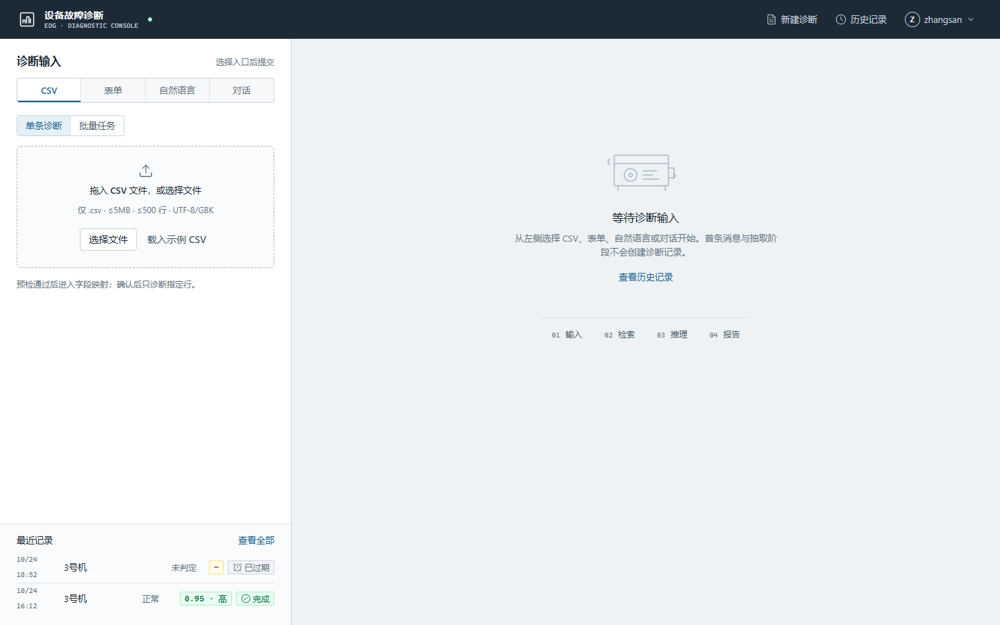
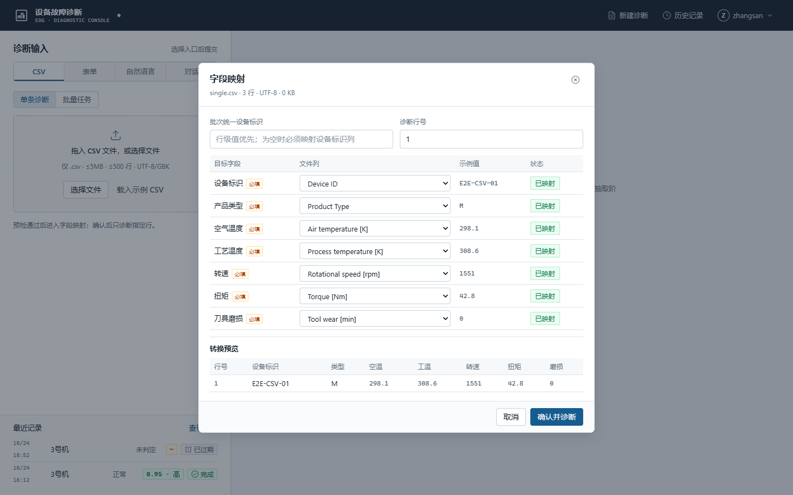
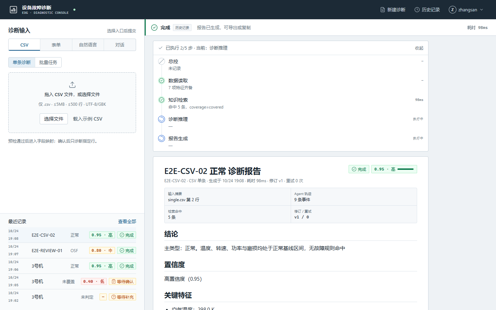

# E2E-UI 测试记录（4 条关键点击链路）

- 前端：`http://localhost:5173`（Vite）
- 后端：`http://127.0.0.1:8000`（FastAPI / uvicorn）
- 账号：`zhangsan / Abcd1234`
- 工具：`agent-browser`（Chrome/CDP），视口 `1440×900`
- 截图目录：`screenshots/e2e/`

## 0. 启动与登录

```powershell
cd e:\equipment_diag_agent\backend
python -m uvicorn app.main:app --host 127.0.0.1 --port 8000

cd e:\equipment_diag_agent\frontend
npm run dev
```

登录后工作台：



每条链路开始前均执行 `agent-browser console --clear`，结束后读取控制台；4 条链路的结束控制台均为空，无 `error`/未捕获异常。

## 1. CSV 单条：上传 → 映射 → 单条诊断 → SSE → 报告 → 导出

测试文件：`single.csv`（3 行）

| 步骤 | 操作 | 结果 |
| --- | --- | --- |
| 1 | 选择 `single.csv` | 上传成功，识别 3 行 / UTF-8 |
| 2 | 打开字段映射 | 7 个字段自动映射；预览只显示 **1 行** |
| 3 | 设置诊断行号 2 → 确认并诊断 | `POST /api/v1/diagnoses` 返回 202，随后建立 `/events` SSE |
| 4 | 观察步骤流与报告 | 实时 SSE 步骤完整；报告生成，置信度 0.95 高 |
| 5 | 点击“导出 Markdown” | `GET /api/v1/diagnoses/{id}/report.md` 200，Toast“报告已导出” |

关键截图：

- 映射预览：[01-csv-mapping.png](../screenshots/e2e/01-csv-mapping.png)
- SSE 完成态步骤流：[02-csv-running.png](../screenshots/e2e/02-csv-running.png)
- 最终报告头 + 状态：[03-csv-report.png](../screenshots/e2e/03-csv-report.png)
- 导出完成：[04-csv-export.png](../screenshots/e2e/04-csv-export.png)

初步结论：主链路通过（上传、映射、单条诊断、SSE、8 要素报告、导出 Markdown）。

### 失败项 1：单条模式映射预览只返回 1 行，验收要求固定 3 行

UI 文案为“映射后显示前 3 行转换结果”，但实际仅 1 行：



请求（`POST /api/v1/uploads/{upload_id}/mapping/preview`）：

```json
{"mapping":{"device_id":"Device ID","product_type":"Product Type","air_temp_k":"Air temperature [K]","process_temp_k":"Process temperature [K]","rotational_speed_rpm":"Rotational speed [rpm]","torque_nm":"Torque [Nm]","tool_wear_min":"Tool wear [min]"},"mode":"single","row_no":1,"default_device_id":null}
```

响应（节选）：

```json
{"valid":true,"missing_required":[],"errors":[],"preview":[{"row_no":1,"device_id":"E2E-CSV-01","features":{"..."}}],"row_summary":null}
```

同一文件在 `mode=batch` 时返回 3 行 + `row_summary`：

```json
{"preview":[{"row_no":1},{"row_no":2},{"row_no":3}],"row_summary":{"total":60,"valid":60,"invalid":0,"first_invalid":[]}}
```

定位：`backend/app/mapping.py` 单条分支仅处理 `data_rows[row_no - 1]` 并返回单行 `preview`；批量分支才截取 `PREVIEW_ROWS`。与 ARCH 的“preview 固定 3 行”不一致。前端按响应渲染，未伪造行。

### 失败项 2：历史/重开诊断时快照步骤顺序错乱，已完成仍显示“执行中”

在最近记录中重新打开已完成的 `E2E-CSV-02`（状态 `succeeded`），步骤流显示：

```text
已执行 2/5 步 · 诊断推理 执行中 · 报告生成 执行中
```



`GET /api/v1/diagnoses/dx_01M5PSJ4F5ZAAK78WWTAS08MBB` 的 `trace_steps` 顺序（节选）：

```json
[
 {"node":"diagnose","event":"end","summary":"主类型 正常，置信度 0.9500","created_at":"...11:08:30.669Z"},
 {"node":"diagnose","event":"start","created_at":"...11:08:30.669Z"},
 {"node":"report","event":"end","summary":"报告生成完成","created_at":"...11:08:30.672Z"},
 {"node":"report","event":"start","created_at":"...11:08:30.672Z"}
]
```

`end` 排在 `start` 之前。前端 `StepFlow` 以同节点最后一条事件判断状态，最后一条是 `start`，因此显示“执行中”。

定位：`backend/app/records.py:401` 使用 `ORDER BY created_at, step_id`；同一毫秒内的 start/end 由随机 `step_id` 决定先后。实时 SSE 顺序正确（截图 02 显示 4/5 步完成），仅快照回放受影响。

## 2. 批量：上传 → 映射 → 批量任务 → 进度 → 取消 → 导出汇总 CSV

测试文件：`batch-long.csv`（60 行）

| 步骤 | 操作 | 结果 |
| --- | --- | --- |
| 1 | 批量模式上传 60 行 CSV | 映射预览显示 3 行，`有效 60 / 总 60，非法 0` |
| 2 | 创建批量任务 | 进入进度面板，行状态实时推进 |
| 3 | 运行中点击“取消任务” → 确认取消 | 任务状态“已取消”，Toast“任务已取消，已完成结果已保留” |
| 4 | 读取行状态 | 仅 `成功` / `待人工复核` / `已取消`，无 `waiting_human`、无 `expired` |
| 5 | 点击“导出汇总 CSV” | `GET /api/v1/batches/{id}/export.csv` 200 |

关键截图：

- 批量映射（3 行预览）：[05-batch-mapping.png](../screenshots/e2e/05-batch-mapping.png)
- 运行中进度与取消入口：[06-batch-progress.png](../screenshots/e2e/06-batch-progress.png)
- 取消后计数与行状态：[07-batch-cancelled.png](../screenshots/e2e/07-batch-cancelled.png)
- 导出汇总 CSV：[08-batch-export.png](../screenshots/e2e/08-batch-export.png)

取消后计数（由 `counts` 派生，不读服务端 `progress`）：

```text
总行数 60 / 已完成 18 / 成功 10 / 缺项降级 0
待复核 8 / 失败 0 / 超时 0 / 已取消 42
已完成 18 / 60 行，30%
```

行状态抽样（DOM 文本，节选）：

```text
1  E2E-C-001  成功
3  E2E-C-003  待人工复核（批量模式）
19 —          已取消
50 —          已取消
```

结论：通过。未出现 `waiting_human` / `expired`。

## 3. 自然语言缺失：抽取卡 → 澄清 → 补 1 项 → 仍缺失 → 再补 → 继续诊断

输入：

```text
3号机 M型，空气温度298.1K，工艺温度308.6K，最近有异响和发热。
```

| 步骤 | 操作 | 结果 |
| --- | --- | --- |
| 1 | 点击“抽取数据” | 抽取确认卡：已识别 4 项，3 项待补充 |
| 2 | 点击“确认并诊断” | `POST /diagnoses` 202；进入 clarification，缺少转速/扭矩/磨损，倒计时 30:00 |
| 3 | 补“转速 1551” → 提交补充 | `POST /resume` 200；中断刷新为“2 项缺失”，TTL 重新计时 |
| 4 | 补“扭矩 42.8”“刀具磨损 0” → 提交补充 | `POST /resume` 200；继续检索/推理 |
| 5 | 等待完成 | 报告生成，置信度 0.95 高，状态“完成” |

关键截图：

- 抽取确认卡：[09-nl-extraction.png](../screenshots/e2e/09-nl-extraction.png)
- 第 1 次澄清（3 项缺失 + TTL）：[10-nl-clarification-1.png](../screenshots/e2e/10-nl-clarification-1.png)
- 第 2 次澄清（2 项缺失 + 已补转速）：[11-nl-clarification-2.png](../screenshots/e2e/11-nl-clarification-2.png)
- 最终报告：[12-nl-report.png](../screenshots/e2e/12-nl-report.png)

网络记录：

```text
POST /api/v1/diagnoses                         202
POST /api/v1/diagnoses/{id}/resume             200
POST /api/v1/diagnoses/{id}/resume             200
GET  /api/v1/diagnoses/{id}/events             EventSource 200
```

结论：通过。补充 1 项后仍缺失，第二次补充完成后继续诊断；未在首条消息阶段创建诊断。

## 4. review 两轮：中置信 → 第 1 轮补充 → 第 2 轮补充置灰 → 确认 → 人工确认报告

构造输入（表单）：

```text
设备 E2E-REVIEW-01 / M / 空温 298 / 工温 306 / 转速 1300 / 扭矩 55 / 磨损 240
```

规则命中 `OSF + HDF`（2 条），检索覆盖 5 条，置信度 0.795（界面显示 0.80 · 中）。

| 步骤 | 操作 | 结果 |
| --- | --- | --- |
| 1 | 开始诊断 | 进入“需要你确认”，第 1 轮，`补充数据` 可用 |
| 2 | 展开补充，空温改为 298.2 → 提交补充并重建 | 触发第 2 轮确认，置信度仍 0.80 中 |
| 3 | 检查按钮 | `补充数据` `disabled=true`；提示“第 2 轮确认仅保留确认与放弃；补充入口已关闭” |
| 4 | 点击“确认结论” | 状态完成；报告头出现“已人工确认”，正文置信度“已人工确认” |

关键截图：

- 第 1 轮复核：[13-review-round1.png](../screenshots/e2e/13-review-round1.png)
- 第 1 轮补充表单：[13b-review-supplement.png](../screenshots/e2e/13b-review-supplement.png)
- 第 2 轮复核（补充置灰）：[14-review-round2.png](../screenshots/e2e/14-review-round2.png)
- 人工确认后的报告：[15-review-confirmed-report.png](../screenshots/e2e/15-review-confirmed-report.png)

按钮状态（DOM）：

```text
放弃诊断:false | 补充数据:true | 确认结论:false
```

结论：通过。

## 5. 汇总

| 链路 | 结果 | 备注 |
| --- | --- | --- |
| 1. CSV 单条 | 部分通过 | 诊断/SSE/报告/导出通过；映射预览仅 1 行不满足“固定 3 行”；历史快照步骤顺序错误 |
| 2. 批量取消/导出 | 通过 | 取消后 18/60，行状态无 `waiting_human`/`expired`；导出 200 |
| 3. NL 两次澄清 | 通过 | 3 项缺失 → 2 项缺失 → 完成；TTL 倒计时正常 |
| 4. review 两轮 | 通过 | 第 2 轮补充置灰；确认后“已人工确认” |

## 6. 待修复项

1. **单条映射预览固定 3 行**：`POST /uploads/{id}/mapping/preview` 在 `mode=single` 时仅返回所选行。需后端按 ARCH 统一返回前 3 行，或确认单条模式验收口径后同步修改 UI 文案；本次未改后端契约。
2. **快照步骤顺序**：`diagnosis_steps` 同毫秒 start/end 以随机 `step_id` 排序，`GET /diagnoses/{id}` 回放时 `end` 先于 `start`，导致已完成诊断在历史视图显示“执行中”。建议按数据库写入顺序（自增/时间戳+写入序号）排序，或前端对已终态节点做兜底；本次未改后端契约。

## 7. 约束核对

- 未手写 SSE 重连，依赖服务端 `retry` 与浏览器 `EventSource`。
- 未绕过 `/confirm` 或 `/resume` 建诊断；单条均通过 `POST /diagnoses`。
- 未修改 ARCH / UIUX / PRD / DB / 后端契约。
- 报告渲染未使用 `innerHTML`。

---

## 8. 补录：会话过期 401 与 review 刷新恢复

环境同 §0（前端 `http://localhost:5173`、后端 `http://127.0.0.1:8000`、账号 `zhangsan / Abcd1234`），工具 `agent-browser`（Chrome/CDP），视口 `1440×900`。本批为补充采集，用于 **AC-US-08**（会话过期 401 跳登录、`expires_at` 不续期）与 **AC-DG-11**（刷新后 review 快照恢复、确认后出报告）的浏览器侧证据。

| 序号 | 截图文件 | 场景 | 断言 | 归属 AC |
| --- | --- | --- | --- | --- |
| 19a | `e2e/19a-dg11-review-before-refresh.png` | 中置信 review 中断态（刷新前） | 复核面板可见：置信度 0.58、剩余 TTL、证据条目、补充/确认入口 | AC-DG-11 |
| 19b | `e2e/19b-dg11-after-refresh-before-fix.png` | 刷新后（修复前现场） | 复现“刷新后未按快照恢复复核面板”缺陷，作为修复前留痕 | AC-DG-11（缺陷留痕） |
| 20 | `e2e/20-review-refresh-confirm-report.png` | 刷新恢复后点击“确认结论” | 生成报告：PWF、置信度 0.58（高）、已人工确认、耗时约 6.1s | AC-DG-11 |
| 21 | `e2e/21-export-401-redirect-login.png` | 会话过期后发起导出 | 导出请求 401 → 跳登录页，Toast“登录已过期，请重新登录”，响应体无报告内容 | AC-US-08（兼作 AC-SE-04 前端侧佐证） |
| 18 | `e2e/18-401-redirect-login.png` | 过期会话访问受保护路由 | 401 `AUTH_SESSION_EXPIRED` → 跳登录页，同一 Toast；`expires_at` 不被续期由后端 pytest 用例断言 | AC-US-08 |
| 19 | `e2e/19-review-refresh-restored.png` | 修复后刷新同一 review 诊断 | 复核面板按快照恢复：置信度 0.58、剩余 TTL、证据、补充/确认入口齐全，无“执行中”错位 | AC-DG-11 |

补充说明：

- 本批 18/21 的触发场景为**会话过期**（`AUTH_SESSION_EXPIRED`），不是“无 Cookie”（`AUTH_REQUIRED`）；后者由后端 `AC-SE-04` 用例覆盖（401 且响应体不含报告内容）。
- AC-DG-11 的浏览器证据为截图级，**无网络日志/自动化断言**，与 V5 OBS 项一致；后端刷新链路由 `GET /diagnoses/{id}` 快照返回。
- `screenshots/20-batch-running.png`（根目录）为批量运行中进度面板，供 AC-IN-06 / AC-IN-08 佐证，非本批采集。
- §6 登记的两项待修复（单条映射预览固定 3 行、快照步骤顺序）已在后续轮次修复并补测，本批不再列。

