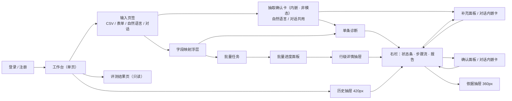
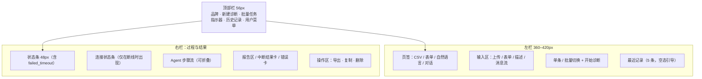
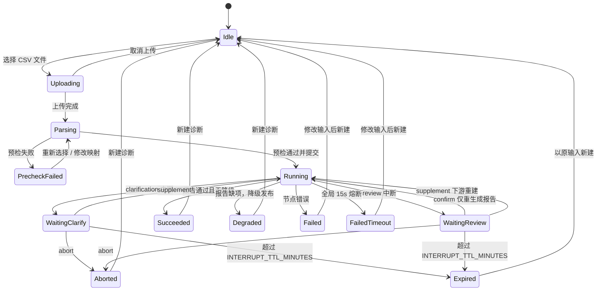
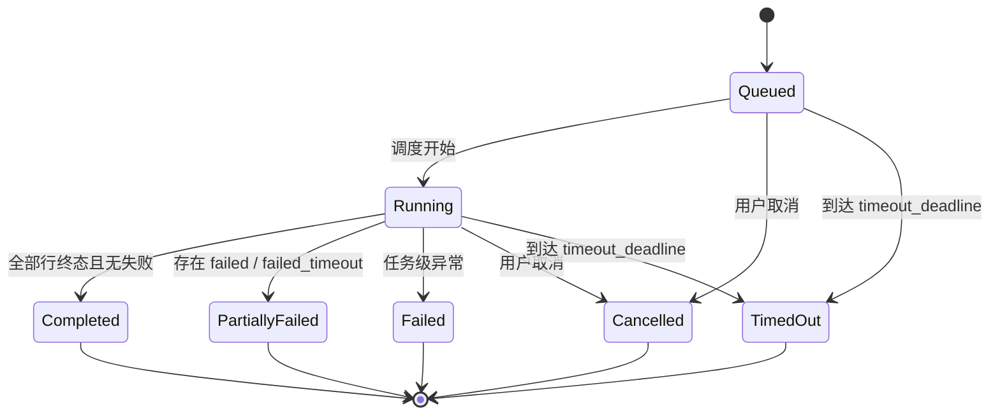
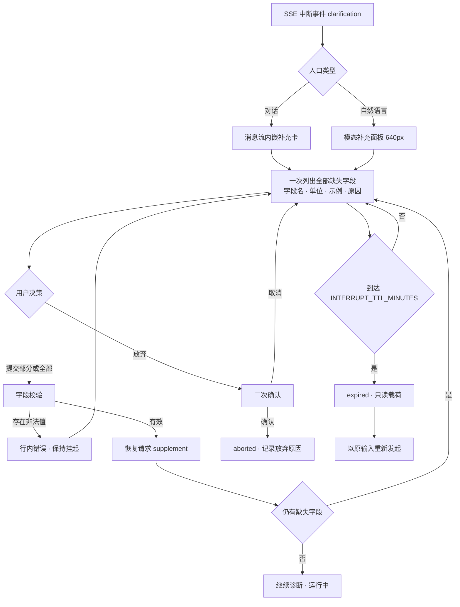
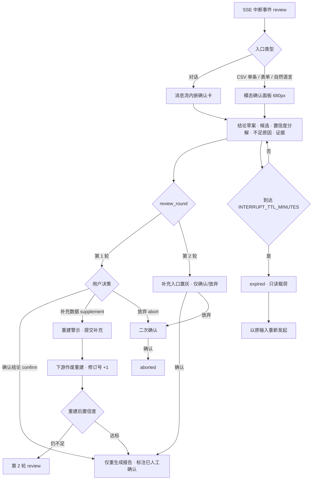

# UI/UX 交互设计文档 —— 设备故障诊断智能体

> 文档版本：V1.2.0  
> 设计基线：PRD V3.0.0（基线冻结，2026-10-23）  
> 契约基线：ARCH V1.2.0（冻结，2026-10-23）  
> 文档状态：设计基线（待复评）  
> 适用范围：设备故障诊断智能体 WebApp（React 18 + Vite + TypeScript + TailwindCSS + Ant Design 5）  
> 设计定位：工业控制台（Industrial Console），桌面优先，最小视口宽度 1024px

**修订记录**

| 版本 | 日期 | 修订说明 |
| --- | --- | --- |
| V1.0.0 | 2026-10-23 | 首版：状态机、中断闭环、批量交互、Design Tokens、评测页与 P1 补齐 |
| V1.1.0 | 2026-10-23 | 按《UIUX 冷启动验收日志》修复 P0-1（SSE 原生重连与 2s 轮询）、P0-2（`degraded+auto_review` 双标注）、P1-1（进度不使用服务端 `progress`）、P1-2（评测待复核计数）、P1-3（`row-hover` 令牌化）及 P2-1（对比度表述） |
| V1.2.0 | 2026-10-23 | 按第二轮复审修复 P0-3（对话 `draft` → 抽取确认卡 → `confirm` 建诊断）、P1-4（会话 409 错误态）、P1-5（澄清自由文本 → 补充卡 → `resume`）、P1-6（RT-17 去重命中），随修 P2-2/P2-3；新增 DEV-03/DEV-04 |

---

## 0. 文档信息

### 0.1 目的

本文档将 PRD 的业务规则转译为可实现、可验收的界面规范，覆盖：

1. 信息架构、页面布局与页面流转；
2. 单条诊断、批量任务、批量行的界面状态机与状态覆盖；
3. `clarification`、`review` 两类中断的弹窗/内嵌卡片交互闭环；
4. 工业级视觉基线、Design Tokens、组件规范与文案规范；
5. 无障碍、响应式、SSE 断线重连与浏览器兼容要求；
6. PRD 中 P1 遗留的界面缺口补齐。

### 0.2 与 PRD 的边界

| 项目 | 约定 |
| --- | --- |
| 业务规则 | 一律以 PRD 为准，本文档不新增、不改写任何业务规则 |
| 状态枚举 | 仅使用 PRD §4.5.1 的枚举值；本文档只定义显示名、颜色、图标与可用动作 |
| 视觉与交互 | PRD §4.9 明确将“UI 视觉稿与设计令牌”排除在 PRD 外，由本文档承接 |
| 不展开内容 | 物理表结构、索引、API 请求/响应报文、SSE 事件字段明细由数据库/API 文档承接；本文档仅在 SSE 降级行为中引用 ARCH 已冻结的 `GET /diagnoses/{id}`、`GET /batches/{batch_task_id}` 作为契约引用，不重新设计接口 |
| 冲突处理 | 业务口径冲突以 PRD §4.5.1 枚举与 FR 条目为准；接口/SSE 行为以 ARCH V1.2.0 为准；表现层冲突以本文档为准并登记偏差 |
| 新增状态 | 本文档不新增持久化状态；仅允许“取消中”“停止调度中”等不落库的过渡展示态，且必须标注 |

### 0.3 文档约定

| 约定 | 说明 |
| --- | --- |
| 必须 | 验收项，未实现即视为 UI 未完成 |
| 应当 | 默认实现；偏离需在设计评审中记录原因 |
| 可 | 可选增强，不进入本期验收 |
| 状态作用域 | `diagnosis` 单条诊断、`batch_task` 批量任务、`batch_row` 批量行、`global` 全局 |
| 状态命名 | 代码块内为 PRD 枚举值；中文为界面显示名 |
| 尺寸单位 | px；颜色使用 Design Token，禁止组件内写死十六进制值 |
| 图标 | Lucide，线性描边 1.5px；不使用 emoji 作为界面图标 |

### 0.4 设计交付物

| 交付物 | 内容 | 本文档位置 |
| --- | --- | --- |
| 信息架构与页面流转 | 页面、浮层、抽屉关系 | §3 |
| 界面状态机 | 单条诊断、批量任务、批量行 | §4 |
| 中断交互 | clarification、review | §5 |
| 过程与报告 | 步骤流、报告 8 要素、告警条 | §6 |
| 输入入口 | CSV、表单、自然语言、对话 | §7 |
| 批量交互 | 进度、超时、取消、行详情 | §8 |
| 评测结果页 | 指标卡、超时率、矩阵、bad case | §9 |
| Design Tokens | 色彩、字体、间距、圆角、动效 | §2、§2.12 |
| 组件规范 | 16 类核心组件 | §10 |
| 验收清单 | UI 验收项与 PRD 追踪 | §13 |

### 0.5 P1 遗留补齐对照

| 编号 | P1 遗留问题 | 补齐方式 | 位置 |
| --- | --- | --- | --- |
| SUP-01 | UI 状态条未列 `failed_timeout`，仅笼统写“失败”，易与 `failed` 混淆 | 状态条枚举补齐 `超时失败`，使用独立深红 token、`timer-off` 图标与“无报告”说明；批量行同步补齐 | §4.4、§4.7、§8.5 |
| SUP-02 | 评测页未展示超时率，与 FR-EV-03、§3.10.2、§3.10.3 的判定口径不一致 | 指标卡由 5 张调整为 6 张，新增“超时率”卡；增加“超时与执行质量”区与超时样本明细 | §9.3、§9.4 |
| SUP-03 | 批量任务只有“已超时/已取消”终态，缺少过程提示 | 增加任务级超时倒计时、临界预警、取消确认与“取消中/停止调度中”过渡展示 | §8.2、§8.3、§8.4 |
| SUP-04 | `expired` 只有终态，缺少倒计时与明确的下一步 | 补充中断倒计时、到期只读化、“以原输入重新发起”唯一出口 | §4.4、§5.2.5、§5.3.7 |
| SUP-05 | `degraded_review` 缺少独立视觉，易被当作普通完成 | 独立“待人工复核（批量模式）”状态与报告横幅；不提供确认动作 | §4.6、§6.3、§8.5 |
| SUP-06 | PRD FR-EV-06 要求 Web 只读展示“最新报告与趋势”，但 §2.5.9 未定义趋势区 | 增加只读“批次趋势”表，复用 `EvalBatch` 已有指标字段，不引入新业务数据 | §9.3.1 |

#### 0.5.1 跨文档偏差与基线矛盾登记

| 编号 | 类型 | 问题 | 本文件处理 | 待裁定/建议 |
| --- | --- | --- | --- | --- |
| DEV-01 | 基线矛盾 | PRD §4.5.1 `eval_sample.status` 仅含 `succeeded/degraded/failed/failed_timeout`，无 `degraded_review`；ARCH §4.2.1 规定 eval 低置信由夹具自动确认、不做待复核；但 PRD §3.10.3.6 又要求评测报告包含 `degraded_review` 计数 | 评测页“待复核”显示 `0 / 120` 或 `N/A`，并注明“评测样本不做待复核” | 建议 PRD §3.10.3.6、§4.5.1 与 ARCH §4.2.1 下版统一；当前不改冻结基线 |
| DEV-02 | 跨文档口径 | ARCH §8.7 `completed_rows` 为“终态行数（含失败/取消）”、`progress = completed_rows / total_rows`；PRD KPI-04 与本文“已完成”均不含 `cancelled` | 进度不使用服务端 `progress` 字段，由 `counts` 按本文口径计算 | 建议 ARCH §8.7 拆分“终态行数/已执行行数”或明确前端派生口径 |
| DEV-03 | 基线分歧 | PRD §2.5.8 写“首次发送消息时创建诊断记录并绑定会话”；ARCH V1.2.0 §8.8 规定首条消息只返回抽取确认卡、不创建诊断，用户确认后才创建 | 本文以 ARCH 为准：`draft` 会话 → 首条消息只抽取 → `/confirm` 创建诊断；PRD 旧措辞不改 | 建议 PRD §2.5.8 下版修订；当前冻结基线不改 |
| DEV-04 | 基线分歧 | PRD §2.5.8 写“任一必填缺失时确认按钮禁用”；ARCH §5.4.6 裁定 `device_id` 必填、其余 6 特征允许部分提交并进入 clarification | 抽取确认卡仅 `device_id` 缺失时禁用；其余字段缺失允许提交并按 RT-02 追问 | 建议 PRD §2.5.8 下版与 ARCH §5.4.6 对齐；当前以 ARCH 为准 |

> **偏差登记说明**：SUP-01、SUP-02、SUP-06 属于 PRD 表现层遗漏；DEV-01~DEV-04 为基线/跨文档矛盾。本文件按验收日志建议先落地表现层处理，不修改 PRD/ARCH 冻结基线；建议在下一版基线修订时统一。

### 0.6 关键设计决策

| 决策 | 内容 | 理由 |
| --- | --- | --- |
| D-UI-01 | 状态先行：右栏顶部固定状态条 | 用户首先要判断“现在能不能操作、下一步是什么” |
| D-UI-02 | 结论先行：报告首屏先给结论与置信度，再给证据与步骤 | 运维现场时间紧，P95 ≤10s 的感知依赖首屏信息密度 |
| D-UI-03 | 颜色只表达语义，不作为唯一指示 | WCAG AA；色觉障碍用户可依赖图标与文字 |
| D-UI-04 | 功能未定义的动作不渲染，临时不可用动作才置灰 | 避免“看起来能点但后端不支持”的假可供性 |
| D-UI-05 | 批量进度以“已完成（终态行，不含 `cancelled`）”口径对齐 KPI-04 | 避免 `failed_timeout`/`cancelled` 是否计入进度产生歧义；不使用服务端 `progress` |
| D-UI-06 | 客户端不自行判定超时/过期，只展示倒计时并等待服务端事件 | 避免与服务端懒判定、后台扫描产生状态分叉 |

---

## 1. 设计目标与原则

### 1.1 用户与场景

| 角色 | 场景 | 界面诉求 | 设计响应 |
| --- | --- | --- | --- |
| 设备运维工程师 | 现场单条诊断、补充数据、确认结论 | 快速拿到结论、看清依据、失败可解释 | 右栏三段式：状态条 → 步骤流 → 报告；结论与置信度首屏可见 |
| 设备主管 | 班后批量巡检、导出汇总 | 一屏掌握进度、失败与待复核 | 分段进度条、失败行一键定位、汇总导出 |
| 演示评审者 | 验证多 Agent 过程、状态流转、评测指标 | 过程可追溯、指标可核对 | 步骤流可展开、评测页版本信息完整、超时率可见 |

### 1.2 设计原则

1. **状态先行**：任何时刻，用户都能在 1 秒内回答“当前处于什么状态、系统在做什么、我能做什么”。
2. **结论先行**：报告首屏呈现结论、置信度、知识边界；证据、候选、检索命中逐层展开。
3. **克制用色**：中性工业灰蓝构成 90% 以上的界面面积；红/橙/绿只用于故障等级、状态与置信度。
4. **可追溯但不打扰**：步骤流默认折叠为摘要，需要时展开；引用条目可点击查看 Top-5 检索依据。
5. **失败可解释、可退出**：错误卡片固定包含“发生了什么、影响是什么、下一步是什么”，不提供 PRD 未定义的重试按钮。
6. **不做假进度**：进度、倒计时、步骤状态均来自服务端事实或已确定的截止时间，不做本地伪造推进。

### 1.3 风格定位：工业控制台

| 维度 | 规范 |
| --- | --- |
| 关键词 | 冷静、紧凑、可信、低装饰、高信号密度 |
| 表面 | 平面为主；1px 边框划分层级；阴影仅用于浮层 |
| 密度 | 桌面紧凑型；表格行高 40px；正文 14px；说明文字 12–13px |
| 色彩 | 中性灰蓝底 + 单一工业蓝主色 + 语义色 |
| 字体 | 无衬线正文 + 等宽数字；关键数值使用 tabular-nums |
| 圆角 | 小圆角（2/4/6/8px），不使用大圆角“卡片化”风格 |
| 动效 | 120–300ms；只做透明度与位移；不使用弹跳、视差、炫光 |
| 图标 | Lucide 线性图标；状态图标与文案成对出现 |
| 空态 | 单色线稿 + 一句说明 + 一个动作；不使用卡通插画 |

### 1.4 反模式（禁止）

| 禁止项 | 原因 |
| --- | --- |
| 玻璃拟态、渐变主背景、霓虹光效 | 削弱工业工具的可信感与长时间阅读舒适度 |
| 仅用颜色区分状态/置信度 | 违反 WCAG AA 与色觉无障碍 |
| 单条诊断提供“取消”“重试” | PRD §2.5.7 明确不在需求范围 |
| 批量行出现“确认/补充”入口 | 批量行不进入 clarification/review |
| `expired` 提供“继续补充/确认” | 过期后仅允许以原输入重新发起 |
| 用 Toast 承载关键失败信息 | 关键失败必须持久展示，Toast 只用于轻量结果反馈 |
| 全屏 Loading 遮罩 | 使用局部骨架屏，保留上下文与可操作区域 |
| 自动刷新覆盖用户正在编辑的表单 | 断线重连只补拉状态，不覆盖本地输入 |

---

## 2. Design Tokens

### 2.1 命名规范

采用三级令牌：

| 层级 | 示例 | 约束 |
| --- | --- | --- |
| 基础色 | `--color-neutral-900`、`--color-primary-500` | 只定义色值，不直接用于组件 |
| 语义令牌 | `--color-text-primary`、`--color-bg-surface` | 组件优先引用语义令牌 |
| 组件令牌 | `--status-danger-bg`、`--table-row-height` | 仅在组件规范内定义，允许组合语义令牌 |

命名格式：`--{category}-{role}-{variant}`。组件内禁止直接写十六进制色值。

### 2.2 色彩

#### 2.2.1 基础色

| 令牌 | 色值 | 用途 |
| --- | --- | --- |
| `--color-neutral-0` | `#FFFFFF` | 卡片、面板、报告底 |
| `--color-neutral-25` | `#F9FBFC` | 极浅分区底 |
| `--color-neutral-50` | `#F6F8FA` | 表头、次级面板 |
| `--color-neutral-100` | `#EEF2F5` | 页面画布（工业灰蓝底） |
| `--color-neutral-200` | `#DDE4EA` | 细分隔线、进度轨道 |
| `--color-neutral-300` | `#C9D3DC` | 默认边框 |
| `--color-neutral-400` | `#A9B7C4` | 强边框、禁用边框 |
| `--color-neutral-500` | `#8A99A6` | 禁用文字、取消态图形 |
| `--color-neutral-600` | `#5F7180` | 三级文字（白底对比度 5.05:1） |
| `--color-neutral-700` | `#4A5A68` | 二级文字（白底对比度 7.11:1） |
| `--color-neutral-800` | `#2C3A47` | 深色悬浮、次级标题 |
| `--color-neutral-900` | `#16212B` | 主文字（白底对比度 16.32:1） |
| `--color-primary-50` | `#E6F0F7` | 主色浅底、选中行 |
| `--color-primary-100` | `#C9DFEF` | 主色浅边框 |
| `--color-primary-300` | `#6FA8CC` | 图表辅色 |
| `--color-primary-500` | `#175C8E` | 主色（白底对比度 7.10:1） |
| `--color-primary-600` | `#124B75` | 主色 Hover |
| `--color-primary-700` | `#0E3B5C` | 主色 Active |
| `--color-header` | `#1C2A36` | 顶部栏（白字对比度 14.65:1） |
| `--color-header-hover` | `#263746` | 顶部栏按钮 Hover |
| `--color-focus-ring` | `#2F80ED` | 焦点环（白底 3.87:1，画布 3.43:1） |

#### 2.2.2 语义别名

| 令牌 | 引用 | 用途 |
| --- | --- | --- |
| `--color-bg-canvas` | `--color-neutral-100` | 页面底色 |
| `--color-bg-surface` | `--color-neutral-0` | 面板、卡片 |
| `--color-bg-subtle` | `--color-neutral-50` | 表头、折叠区 |
| `--color-row-hover` | `#F2F7FB` | 表格行 Hover |
| `--color-bg-header` | `--color-header` | 顶部栏 |
| `--color-bg-overlay` | `rgba(16,24,40,0.45)` | 模态/抽屉遮罩 |
| `--color-border-subtle` | `--color-neutral-200` | 内部分隔 |
| `--color-border-default` | `--color-neutral-300` | 输入框、卡片边框 |
| `--color-border-strong` | `--color-neutral-400` | 强调边框 |
| `--color-text-primary` | `--color-neutral-900` | 标题、正文 |
| `--color-text-secondary` | `--color-neutral-700` | 辅助正文 |
| `--color-text-tertiary` | `--color-neutral-600` | 说明、时间、元信息 |
| `--color-text-disabled` | `--color-neutral-500` | 仅用于禁用态，不用于正文 |
| `--color-text-inverse` | `#FFFFFF` | 深色栏文字 |
| `--color-text-inverse-muted` | `#C3D0DA` | 深色栏次级文字 |
| `--color-primary` | `--color-primary-500` | 主按钮、链接、选中态 |
| `--color-primary-hover` | `--color-primary-600` | Hover |
| `--color-primary-active` | `--color-primary-700` | Active |
| `--color-primary-subtle` | `--color-primary-50` | 选中底、信息浅底 |

#### 2.2.3 状态色

| 语义 | 背景 | 文字 | 边框 | 适用状态 |
| --- | --- | --- | --- | --- |
| info | `#EFF8FF` | `#175CD3` | `#B2DDFF` | 上传中、解析中、运行中、排队中 |
| waiting | `#FFFAEB` | `#B54708` | `#FEDF89` | 等待补充、等待确认、缺项降级、待人工复核、部分失败、批量已超时 |
| success | `#ECFDF3` | `#067647` | `#ABEFC6` | 完成、成功 |
| danger | `#FEF3F2` | `#B42318` | `#FECDCA` | 失败、超时失败、任务失败 |
| danger-deep | `#FEF3F2` | `#7A271A` | `#FECDCA` | `failed_timeout` 专用文字，强化“不可恢复” |
| neutral | `#F2F4F7` | `#5F7180` | `#D0D5DD` | 已取消、已中止、已过期、待执行 |

> 所有状态徽标必须同时包含“图标 + 文字”，不得只靠底色传达状态。状态色的文字对比度均 ≥4.5:1（AA；neutral 组合 4.58:1，其余组合 ≥5.2:1）。

#### 2.2.4 故障等级与置信度

| 语义 | 等级 | 文字色 | 浅底/边框 | 显示要求 |
| --- | --- | --- | --- | --- |
| 高风险 / 低置信 | 高 / 低 | `#B42318` | `#FEF3F2` / `#FECDCA` | 必须带“高/低”文字与数值 |
| 中风险 / 中置信 | 中 | `#B54708` | `#FFFAEB` / `#FEDF89` | 必须带“中”文字与数值 |
| 低风险 / 高置信 | 低 / 高 | `#067647` | `#ECFDF3` / `#ABEFC6` | 必须带“低/高”文字与数值 |

置信度展示格式固定为：`0.62 · 中`。禁止只显示进度条或只显示颜色。

#### 2.2.5 表格与矩阵色

| 令牌 | 色值 | 用途 |
| --- | --- | --- |
| `--matrix-correct-0` | `#F3FBF6` | 混淆矩阵对角低计数 |
| `--matrix-correct-1` | `#D3F0DE` | 对角中低计数 |
| `--matrix-correct-2` | `#A6E0BD` | 对角中高计数 |
| `--matrix-correct-3` | `#6FCE95` | 对角高计数 |
| `--matrix-error-0` | `#FFF5F4` | 非对角低计数 |
| `--matrix-error-1` | `#FCD9D6` | 非对角中低计数 |
| `--matrix-error-2` | `#F5B0AA` | 非对角中高计数 |
| `--matrix-error-3` | `#E8837B` | 非对角高计数 |
| `--progress-success` | `#067647` | 进度：成功 |
| `--progress-degraded` | `#B45309` | 进度：缺项降级 |
| `--progress-review` | `#92400E` | 进度：待人工复核 |
| `--progress-failed` | `#B42318` | 进度：失败 |
| `--progress-timeout` | `#7A271A` | 进度：超时失败 |
| `--progress-cancelled` | `#6B7280` | 进度：已取消 |
| `--progress-pending` | `#DDE4EA` | 进度：待执行 |

矩阵单元格文字统一使用 `--color-text-primary`（深色）以保证浅/深底色均可读；计数必须显示数字。分段色与轨道 `#DDE4EA` 的对比度均 ≥3:1，相邻分段之间保留 1px 白色分隔，避免仅靠色相区分。

#### 2.2.6 对比度验证

| 前景 / 背景 | 对比度 | 结论 |
| --- | --- | --- |
| `#16212B` / `#FFFFFF` | 16.32:1 | AA 通过 |
| `#4A5A68` / `#FFFFFF` | 7.11:1 | AA 通过 |
| `#5F7180` / `#FFFFFF` | 5.05:1 | AA 通过 |
| `#5F7180` / `#F6F8FA` | 4.74:1 | AA 通过 |
| `#175C8E` / `#FFFFFF` | 7.10:1 | AA 通过 |
| `#FFFFFF` / `#175C8E` | 7.10:1 | AA 通过 |
| `#B42318` / `#FEF3F2` | 6.05:1 | AA 通过 |
| `#7A271A` / `#FEF3F2` | 9.06:1 | AA 通过（超时失败专用） |
| `#B54708` / `#FFFAEB` | 5.20:1 | AA 通过 |
| `#067647` / `#ECFDF3` | 5.40:1 | AA 通过 |
| `#175CD3` / `#EFF8FF` | 5.57:1 | AA 通过 |
| `#FFFFFF` / `#1C2A36` | 14.65:1 | AA 通过 |
| `#2F80ED` / `#FFFFFF` | 3.87:1 | 非文字焦点环 3:1 通过 |
| `#2F80ED` / `#EEF2F5` | 3.43:1 | 非文字焦点环 3:1 通过 |

### 2.3 字体

| 令牌 | 值 | 说明 |
| --- | --- | --- |
| `--font-sans` | `"Inter", "IBM Plex Sans", -apple-system, BlinkMacSystemFont, "Segoe UI", "PingFang SC", "Microsoft YaHei", sans-serif` | 正文与标题；优先本地/自托管，演示环境不依赖外部 CDN |
| `--font-mono` | `"JetBrains Mono", "Cascadia Mono", "SFMono-Regular", Consolas, monospace` | 数值、ID、耗时、任务号 |
| 数字特性 | `font-variant-numeric: tabular-nums` | 表格、置信度、时延、进度百分比 |
| 字重 | 400 / 500 / 600 | 不使用 700 以上，避免工业界面过重 |

### 2.4 字号与行高

| 令牌 | 字号/行高 | 字重 | 用途 |
| --- | --- | --- | --- |
| `--text-xs` | 12/18 | 400 | 时间、表头、元信息、徽标 |
| `--text-sm` | 13/20 | 400 | 表格正文、辅助说明、步骤摘要 |
| `--text-base` | 14/22 | 400 | 表单、正文、按钮 |
| `--text-md` | 16/24 | 500 | 卡片标题、模态标题 |
| `--text-lg` | 20/28 | 600 | 区块标题、报告二级标题 |
| `--text-xl` | 24/32 | 600 | 页面标题、报告标题 |
| `--text-2xl` | 28/36 | 600 | 评测指标数值 |
| `--text-reading` | 15/26 | 400 | 报告阅读区正文 |

排版约束：

- 报告正文每行 68–76 字符，最大宽度 `--layout-report-max: 800px`。
- 中文段落行高 1.6–1.75；标题与正文间距不小于 16px。
- 大字号标题字距 `-0.01em`；全大写英文标签字距 `0.04em`。
- 表格数字右对齐；文本左对齐；状态徽标居中。

### 2.5 间距与栅格

基础单位 4px，采用 8px 节奏。

| 令牌 | 值 | 典型用途 |
| --- | --- | --- |
| `--space-1` | 4px | 图标与文字、徽标内边距 |
| `--space-2` | 8px | 紧凑组件间距、表格单元格纵向 |
| `--space-3` | 12px | 表单控件间距、卡片内边距 |
| `--space-4` | 16px | 卡片内边距、区块内间距 |
| `--space-5` | 20px | 面板内边距、栏间距 |
| `--space-6` | 24px | 页面内边距、区块间距 |
| `--space-8` | 32px | 大区块间距 |
| `--space-10` | 40px | 页面顶部留白 |
| `--space-12` | 48px | 空态上下留白 |
| `--space-16` | 64px | 登录页大留白 |

| 布局令牌 | 值 | 说明 |
| --- | --- | --- |
| `--layout-topbar-h` | 56px | 顶部栏 |
| `--layout-page-pad` | 24px | 工作台外边距 |
| `--layout-gutter` | 20px | 左右栏间距 |
| `--layout-left-w-wide` | 420px | ≥1280px 左栏 |
| `--layout-left-w-narrow` | 360px | 1024–1279px 左栏 |
| `--layout-statusbar-h` | 48px | 右栏状态条 |
| `--layout-report-max` | 800px | 报告最大阅读宽度 |
| `--layout-drawer-w` | 420px | 历史抽屉 |
| `--layout-evidence-w` | 360px | 依据抽屉 |
| `--layout-modal-sm` | 480px | 二次确认 |
| `--layout-modal-md` | 640px | clarification |
| `--layout-modal-lg` | 680px | review |
| `--layout-control-sm` | 28px | 小号控件 |
| `--layout-control-md` | 32px | 默认控件 |
| `--layout-control-lg` | 40px | 主操作按钮 |

### 2.6 圆角、边框与阴影

| 令牌 | 值 | 用途 |
| --- | --- | --- |
| `--radius-xs` | 2px | 徽标、进度条端点 |
| `--radius-sm` | 4px | 输入框、按钮、卡片（默认） |
| `--radius-md` | 6px | 浮层面板 |
| `--radius-lg` | 8px | 模态、抽屉 |
| `--radius-pill` | 999px | 状态胶囊（仅短标签） |
| `--border-width` | 1px | 默认边框 |
| `--focus-width` | 2px | 焦点环 |
| `--shadow-xs` | `0 1px 2px rgba(16,24,40,0.06)` | 顶部栏下方、粘性元素 |
| `--shadow-sm` | `0 2px 6px rgba(16,24,40,0.08)` | 下拉菜单 |
| `--shadow-md` | `0 8px 24px rgba(16,24,40,0.12)` | 模态、抽屉、浮层 |
| `--shadow-focus` | `0 0 0 2px #FFFFFF, 0 0 0 4px #2F80ED` | 键盘焦点 |

> 普通卡片使用 1px 边框而非阴影；阴影只用于“浮于页面上方”的模态、抽屉、下拉。

### 2.7 动效

| 令牌 | 值 | 用途 |
| --- | --- | --- |
| `--motion-fast` | 120ms | Hover、按钮按压、徽标切换 |
| `--motion-base` | 200ms | 状态条变色、折叠展开、Toast |
| `--motion-slow` | 300ms | 抽屉滑入、模态淡入 |
| `--ease-standard` | `cubic-bezier(0.2, 0, 0, 1)` | 标准进入/状态变化 |
| `--ease-exit` | `cubic-bezier(0.4, 0, 1, 1)` | 退出 |

约束：

- 只动画 `transform` 与 `opacity`；进度条宽度变化除外。
- 运行中步骤脉冲周期 1.6s；`prefers-reduced-motion: reduce` 时改为静态圆点。
- 骨架屏闪烁 1.4s；减少动效时改为静态浅灰块。
- 状态变化不使用弹跳、缩放超过 1.02 的动画。

### 2.8 图标

| 用途 | Lucide 图标 | 尺寸 |
| --- | --- | --- |
| 运行中 | `loader-circle` | 16/20 |
| 排队中 | `clock` | 16/20 |
| 等待补充 | `circle-help` | 20 |
| 等待确认 | `clipboard-check` | 20 |
| 完成 | `circle-check` | 16/20 |
| 缺项降级 | `triangle-alert` | 16/20 |
| 待人工复核 | `clipboard-list` | 16/20 |
| 失败 | `circle-x` | 16/20 |
| 超时失败 | `timer-off` | 16/20 |
| 已中止 | `ban` | 16/20 |
| 已过期 | `alarm-clock` | 16/20 |
| 已取消 | `slash` | 16/20 |
| 导出 | `download` | 16 |
| 复制 | `copy` | 16 |
| 删除 | `trash-2` | 16 |
| 断线 | `wifi-off` | 16 |
| 重连 | `refresh-cw` | 16 |

规则：图标按钮必须有 `aria-label`；图标与文字并列时图标 `aria-hidden="true"`；同一按钮内不混用不同尺寸图标。

### 2.9 层级 z-index

| 令牌 | 值 | 层级 |
| --- | --- | --- |
| `--z-base` | 0 | 页面内容 |
| `--z-sticky` | 10 | 顶部栏、状态条、表头 |
| `--z-dropdown` | 20 | 下拉、Popover、Tooltip |
| `--z-drawer` | 30 | 历史抽屉、依据抽屉、行详情抽屉 |
| `--z-modal` | 40 | clarification/review/确认框 |
| `--z-toast` | 50 | 轻量反馈 |

同一层级不叠加两个模态；确认框可以叠加在中断面板之上，但最多两层。

### 2.10 断点与布局尺寸

| 视口宽度 | 左栏 | 右栏 | 依据抽屉 | 说明 |
| --- | --- | --- | --- | --- |
| ≥1440px | 420px | 自适应 | 360px 并排浮层 | 报告最大宽度 800px |
| 1280–1439px | 420px | 自适应 | 360px 覆盖 | 步骤流默认折叠 |
| 1024–1279px | 360px | 自适应 | 320px 覆盖 | 表格列可横向滚动 |
| <1024px | 不支持 | 不支持 | — | 顶部提示“请在 ≥1024px 桌面浏览器使用”，页面按 1024px 最小宽度横向滚动 |

### 2.11 Ant Design 5 主题映射

| AntD Token | 值 | 对应设计令牌 |
| --- | --- | --- |
| `colorPrimary` | `#175C8E` | `--color-primary` |
| `colorSuccess` | `#067647` | 成功 |
| `colorWarning` | `#B54708` | 等待/降级 |
| `colorError` | `#B42318` | 失败 |
| `colorInfo` | `#175CD3` | 运行/排队 |
| `colorTextBase` | `#16212B` | `--color-text-primary` |
| `colorBgBase` | `#FFFFFF` | `--color-bg-surface` |
| `colorBgLayout` | `#EEF2F5` | `--color-bg-canvas` |
| `colorBorder` | `#C9D3DC` | `--color-border-default` |
| `colorBorderSecondary` | `#DDE4EA` | `--color-border-subtle` |
| `borderRadius` | `4` | `--radius-sm` |
| `borderRadiusLG` | `8` | `--radius-lg` |
| `controlHeight` | `32` | `--layout-control-md` |
| `fontSize` | `14` | `--text-base` |
| `fontFamily` | `var(--font-sans)` | 字体令牌 |
| `lineHeight` | `1.5715` | 约 22px |
| `motionDurationFast` | `0.12s` | `--motion-fast` |
| `motionDurationMid` | `0.2s` | `--motion-base` |
| `wireframe` | `false` | 使用边框而非阴影构建层级 |

组件级覆盖：

| 组件 | Token | 值 |
| --- | --- | --- |
| Layout | `headerBg` / `headerHeight` / `bodyBg` | `#1C2A36` / `56` / `#EEF2F5` |
| Table | `headerBg` / `rowHoverBg` / `cellPaddingBlock` / `cellPaddingInline` / `fontSize` | `#F6F8FA`（`--color-bg-subtle`） / `#F2F7FB`（`--color-row-hover`） / `10` / `12` / `13` |
| Modal | `contentBg` / `headerBg` / `titleFontSize` | `#FFFFFF` / `#FFFFFF` / `16` |
| Progress | `defaultColor` / `remainingColor` | `#175C8E` / `#DDE4EA` |
| Tag | `defaultBg` / `defaultColor` | `#F2F4F7` / `#4A5A68` |
| Input / Select | `controlHeight` / `activeBorderColor` | `32` / `#175C8E` |
| Button | `primaryShadow` / `fontWeight` | `none` / `500` |

### 2.12 CSS 变量清单

```css
:root {
  /* Neutral */
  --color-neutral-0: #FFFFFF;
  --color-neutral-25: #F9FBFC;
  --color-neutral-50: #F6F8FA;
  --color-neutral-100: #EEF2F5;
  --color-neutral-200: #DDE4EA;
  --color-neutral-300: #C9D3DC;
  --color-neutral-400: #A9B7C4;
  --color-neutral-500: #8A99A6;
  --color-neutral-600: #5F7180;
  --color-neutral-700: #4A5A68;
  --color-neutral-800: #2C3A47;
  --color-neutral-900: #16212B;

  /* Primary */
  --color-primary-50: #E6F0F7;
  --color-primary-100: #C9DFEF;
  --color-primary-300: #6FA8CC;
  --color-primary-500: #175C8E;
  --color-primary-600: #124B75;
  --color-primary-700: #0E3B5C;

  /* Semantic */
  --color-success-50: #ECFDF3;
  --color-success-200: #ABEFC6;
  --color-success-600: #067647;
  --color-warning-50: #FFFAEB;
  --color-warning-200: #FEDF89;
  --color-warning-600: #B54708;
  --color-danger-50: #FEF3F2;
  --color-danger-200: #FECDCA;
  --color-danger-600: #B42318;
  --color-danger-800: #7A271A;
  --color-info-50: #EFF8FF;
  --color-info-200: #B2DDFF;
  --color-info-600: #175CD3;
  --color-neutral-status-50: #F2F4F7;
  --color-neutral-status-200: #D0D5DD;

  /* Semantic aliases */
  --color-bg-canvas: var(--color-neutral-100);
  --color-bg-surface: var(--color-neutral-0);
  --color-bg-subtle: var(--color-neutral-50);
  --color-row-hover: #F2F7FB;
  --color-bg-header: #1C2A36;
  --color-bg-header-hover: #263746;
  --color-bg-overlay: rgba(16, 24, 40, 0.45);
  --color-border-subtle: var(--color-neutral-200);
  --color-border-default: var(--color-neutral-300);
  --color-border-strong: var(--color-neutral-400);
  --color-text-primary: var(--color-neutral-900);
  --color-text-secondary: var(--color-neutral-700);
  --color-text-tertiary: var(--color-neutral-600);
  --color-text-disabled: var(--color-neutral-500);
  --color-text-inverse: #FFFFFF;
  --color-text-inverse-muted: #C3D0DA;
  --color-primary: var(--color-primary-500);
  --color-primary-hover: var(--color-primary-600);
  --color-primary-active: var(--color-primary-700);
  --color-primary-subtle: var(--color-primary-50);
  --color-focus-ring: #2F80ED;

  /* Fonts */
  --font-sans: "Inter", "IBM Plex Sans", -apple-system, BlinkMacSystemFont,
    "Segoe UI", "PingFang SC", "Microsoft YaHei", sans-serif;
  --font-mono: "JetBrains Mono", "Cascadia Mono", "SFMono-Regular",
    Consolas, monospace;

  /* Type scale */
  --text-xs: 12px;    --leading-xs: 18px;
  --text-sm: 13px;    --leading-sm: 20px;
  --text-base: 14px;  --leading-base: 22px;
  --text-md: 16px;    --leading-md: 24px;
  --text-lg: 20px;    --leading-lg: 28px;
  --text-xl: 24px;    --leading-xl: 32px;
  --text-2xl: 28px;   --leading-2xl: 36px;
  --text-reading: 15px; --leading-reading: 26px;

  /* Spacing */
  --space-1: 4px;
  --space-2: 8px;
  --space-3: 12px;
  --space-4: 16px;
  --space-5: 20px;
  --space-6: 24px;
  --space-8: 32px;
  --space-10: 40px;
  --space-12: 48px;
  --space-16: 64px;

  /* Layout */
  --layout-topbar-h: 56px;
  --layout-page-pad: 24px;
  --layout-gutter: 20px;
  --layout-left-w-wide: 420px;
  --layout-left-w-narrow: 360px;
  --layout-statusbar-h: 48px;
  --layout-report-max: 800px;
  --layout-drawer-w: 420px;
  --layout-evidence-w: 360px;
  --layout-modal-sm: 480px;
  --layout-modal-md: 640px;
  --layout-modal-lg: 680px;
  --layout-control-sm: 28px;
  --layout-control-md: 32px;
  --layout-control-lg: 40px;

  /* Radius */
  --radius-xs: 2px;
  --radius-sm: 4px;
  --radius-md: 6px;
  --radius-lg: 8px;
  --radius-pill: 999px;

  /* Elevation */
  --shadow-xs: 0 1px 2px rgba(16, 24, 40, 0.06);
  --shadow-sm: 0 2px 6px rgba(16, 24, 40, 0.08);
  --shadow-md: 0 8px 24px rgba(16, 24, 40, 0.12);
  --shadow-focus: 0 0 0 2px #FFFFFF, 0 0 0 4px #2F80ED;

  /* Motion */
  --motion-fast: 120ms;
  --motion-base: 200ms;
  --motion-slow: 300ms;
  --ease-standard: cubic-bezier(0.2, 0, 0, 1);
  --ease-exit: cubic-bezier(0.4, 0, 1, 1);

  /* Z-index */
  --z-base: 0;
  --z-sticky: 10;
  --z-dropdown: 20;
  --z-drawer: 30;
  --z-modal: 40;
  --z-toast: 50;
}
```

---

## 3. 信息架构与页面流转

### 3.1 信息架构

| 层级 | 页面/区域 | 职责 | 是否本期 |
| --- | --- | --- | --- |
| L0 | 登录 / 注册页 | 未登录唯一入口；注册、登录、锁定提示 | 是 |
| L1 | 单页工作台 | 输入、诊断过程、报告、历史入口 | 是 |
| L1 | 评测结果页 | 只读二级入口，展示最新离线评测结果 | 是（P1） |
| L2 | 历史抽屉 | 420px 右侧滑出；筛选、分页、加载详情、删除 | 是 |
| L2 | 字段映射浮层 | CSV 列映射、统一设备标识、预览、确认 | 是 |
| L2 | 批量进度面板 | 批量任务进度、超时、取消、行详情、导出 | 是 |
| L2 | 抽取确认卡（内嵌，非模态） | 自然语言与对话页签共用；对话首条消息仅抽取；确认后创建诊断 | 是 |
| L2 | 补充面板 / 内嵌卡 | `clarification` 决策 | 是 |
| L2 | 确认面板 / 内嵌卡 | `review` 决策 | 是 |
| L2 | 依据抽屉 | Top-5 检索命中与引用条目 | 是 |
| L2 | 行级详情抽屉 | 批量行状态、错误、报告入口 | 是 |
| L2 | 确认对话框 | 放弃、取消任务、删除、切换会话 | 是 |

### 3.2 页面流转图



页面流转约束：

- 登录成功 → 工作台；会话过期 → 顶部横幅 + 跳转登录页。
- 历史抽屉加载记录 → 关闭抽屉并把报告与轨迹载入右栏，不新建页面。
- 评测页只读，返回工作台不丢失当前右栏内容。
- 批量进度面板与单条诊断可并存：批量运行期间允许提交单条诊断（NFR-01）。
- 同一时刻最多一个 `clarification/review` 面板；对话入口使用内嵌卡，不叠加模态。

### 3.3 工作台布局



| 区域 | 规格 | 行为 |
| --- | --- | --- |
| 顶部栏 | 56px；`var(--color-bg-header)`；左右 24px 内边距 | 固定顶部；右侧动作区：新建诊断、批量指示器、历史、用户菜单 |
| 左栏 | 420px（≥1280）/ 360px（1024–1279）；白底；1px 右边框 | 独立滚动；输入区与最近记录之间 24px 间距 |
| 右栏 | 自适应；画布底 | 状态条粘性置顶；步骤流最大高度 280px 可滚动；报告区独立滚动 |
| 报告区 | 最大宽度 800px；左对齐；左右 24px 内边距 | 避免长行；不居中，保持工业化左对齐阅读节奏 |
| 操作区 | 报告末尾；按钮 32px；主次分明 | 导出、复制为主；删除收进“更多”菜单 |

顶部栏动作：

| 动作 | 可用条件 | 说明 |
| --- | --- | --- |
| 新建诊断 | 当前无单条运行中 | 运行中禁用并提示“当前诊断运行中”；等待中允许，但需确认收起当前面板 |
| 批量任务指示器 | 存在当前会话批量任务 | 运行中显示“批量 65%”，终态显示“批量完成/部分失败”；点击展开面板 |
| 历史记录 | 始终可用 | 打开 420px 抽屉 |
| 用户菜单 | 始终可用 | 退出登录（P1）、评测结果入口（P1） |

### 3.4 登录 / 注册页

| 区域 | 规范 |
| --- | --- |
| 背景 | `--color-bg-canvas`；可选 32px 浅色网格线（透明度 ≤4%），不使用图片 |
| 卡片 | 400px 宽；白底；1px 边框；`--radius-lg`；内边距 32px；无大阴影 |
| 品牌区 | 产品名 20/600；副标题 13/20 三级文字；下方 24px 间距 |
| 表单 | 用户名、密码；密码可见性切换；字段间距 16px；输入框 36px 高 |
| 错误 | 字段下方 12px 红字；登录失败统一“用户名或密码错误”，不区分账号是否存在 |
| 锁定 | 连续 5 次失败后显示“尝试次数过多，请在 04:59 后重试”；倒计时等宽数字；登录按钮禁用 |
| 提交 | 主按钮全宽 40px；提交中显示“登录中…”并禁用；回车提交 |
| 辅助 | “没有账号？注册”；注册页字段含确认密码；注册成功自动登录并进入工作台；无第三方登录 |
| 路由 | 未登录访问工作台 → 登录页；登录成功回工作台 |

### 3.5 历史抽屉

| 区域 | 规范 |
| --- | --- |
| 容器 | 右侧滑出 420px；白底；左侧 1px 边框；遮罩 `--color-bg-overlay` |
| 头部 | 标题“历史记录” + 关闭按钮；高度 56px |
| 筛选条 | 故障类型、置信度、状态、时间范围、关键词；两列排布；筛选变更后 300ms 防抖查询 |
| 状态选项 | 全部、等待补充、等待确认、完成、缺项降级、待人工复核、已中止、失败、超时失败、已过期 |
| 置信度选项 | 全部、高（≥0.8）、中（0.5–0.8）、低（<0.5） |
| 关键词 | 匹配设备标识与报告标题 |
| 列表项 | 按时间倒序；时间、设备标识、故障类型、置信度（数值+文字）、状态徽标、入口类型；点击加载右栏为只读查看态 |
| 查看态 | 右栏展示报告、输入摘要、Agent 轨迹、检索命中、重试次数、修订号、耗时；轨迹缺失显示“未记录” |
| 分页 | 每页 20 条；上一页/下一页 + 当前页；不提供跳页输入 |
| 空态 | 线稿 + “暂无符合筛选条件的记录” + “去诊断” |
| 删除 | 列表项更多菜单 → 删除；二次确认；删除后当前右栏若为该记录则清空 |
| 加载 | 首屏 3 条骨架；翻页保留旧列表并显示顶部细进度条，不整屏 Loading |

### 3.6 评测结果页入口与布局

- 入口：用户菜单 → “评测结果”（P1）。不占用顶部主导航。
- 页面顶部：返回工作台、标题“评测结果”、只读徽标、刷新按钮。
- 页面只读：不提供编辑、重跑、删除；刷新仅重新拉取已有结果。
- 详细规范见 §9。

---

## 4. 界面状态机

### 4.1 状态建模口径

| 作用域 | 数据来源 | 说明 |
| --- | --- | --- |
| `diagnosis` | PRD `status` 枚举 | 单条诊断记录；历史加载时直接渲染对应终态 |
| `batch_task` | PRD `batch_task.status` | 批量任务级状态 |
| `batch_row` | PRD `batch_row.status` | 批量行级状态；不出现 `waiting_human`/`expired` |
| `global` | 前端会话与连接 | 会话过期、SSE 断线、离线、空态 |

建模规则：

1. `waiting_human` 在界面上按 `interrupt_type` 拆分为“等待补充”和“等待确认”两个显示态，但枚举值仍为 `waiting_human`。
2. `failed` 与 `failed_timeout` 必须是两个独立显示态：前者为节点错误，后者为全局 15s 熔断且无报告。
3. `degraded` 与 `degraded_review` 必须是两个独立显示态：前者为报告缺项降级，后者为批量低置信自动复核。
4. `degraded_review` 只由批量行产生；单条诊断不进入该状态，但历史/行详情可以只读展示。
5. “取消中”“停止调度中”仅是不落库的过渡展示态，最终仍以服务端 `cancelled`/`timed_out` 为准。
6. 历史/最近记录加载为只读查看态，不改变后台诊断状态；若存在进行中的诊断，右栏显示“历史记录”徽标与“返回当前诊断”链接。

### 4.2 单条诊断 UI 状态机



补充说明：

- `review` 的 `supplement` 只能在第 1 轮发生；第 2 轮界面只保留确认/放弃。
- `review` 补充后可能再次挂起，形成 `WaitingReview` 第 2 轮；这不是新增状态，而是 `review_round=2`。
- `confirm` 只重新生成报告，不重跑解析、检索与诊断；步骤流只点亮报告节点。
- `degraded_review` 不在单条状态机中；批量行与历史详情按 §4.6 展示。

### 4.3 批量任务 UI 状态机



补充说明：

- 任务状态判定优先级：`timed_out` > `partially_failed` > `completed`；用户取消即时置 `cancelled`。
- `timed_out` 只从 `queued`/`running` 进入；终态不再转换。
- “取消中”“停止调度中”为展示过渡态，不改变服务端状态机。
- 批量任务不创建中断，不产生 `waiting_human`/`expired`。

### 4.4 单条诊断状态覆盖表（唯一显示口径）

| UI 状态 | 枚举/条件 | 状态条文案 | 右栏主体表现 | 可用动作 | PRD 依据 |
| --- | --- | --- | --- | --- | --- |
| 空闲 | 无进行中诊断 | 不显示状态条 | 引导卡 + 最近记录 | 切换入口、开始诊断 | §2.5.7 |
| 上传中 | 文件上传中 | 左栏局部“上传中 42%” | 右栏切换为“待提交”引导；上一份报告可从历史重新打开 | 取消上传（不创建记录） | §2.5.7 |
| 解析中 | 上传完成，预检/映射中 | 左栏局部“正在解析 N 行” | 左栏骨架屏；右栏保持“待提交”引导 | 等待 | §2.5.7 |
| 预检失败 | 超限/空文件/编码失败/关键列缺失 | 左栏错误卡“预检未通过” | 右栏保持“待提交”引导；左栏列出原因与缺失列；不创建记录 | 重新选择文件、修改映射 | FR-IN-01/02 |
| 运行中 | `running` | `运行中`（info） | 步骤流逐个点亮；报告区骨架屏 | 查看已完成步骤；**无取消** | §2.5.7 |
| 等待补充 | `waiting_human` + `clarification` | `等待补充`（waiting）+ 倒计时 | 补充面板或对话内嵌卡 | 补充、放弃 | FR-DG-05、§3.7 |
| 等待确认 | `waiting_human` + `review` | `等待确认`（waiting）+ 倒计时 | 确认面板或对话内嵌卡 | 确认、补充（仅第 1 轮）、放弃 | FR-DG-05、§3.7 |
| 完成 | `succeeded` | `完成`（success） | 完整报告 8 要素 | 导出、复制、删除、新建 | FR-RP-04、FR-HS-03 |
| 缺项降级 | `degraded` | `缺项降级`（waiting） | 报告 + 顶部缺项告警条 | 导出、查看缺项、新建 | FR-RP-08 |
| 待人工复核 | `degraded_review`（仅批量行/历史） | `待人工复核`（waiting）+“批量模式” | 报告 + 复核横幅 | 查看报告、导出；**无确认** | §2.5.7、§4.5.1 |
| 已中止 | `aborted` | `已中止`（neutral） | 放弃原因卡；无报告 | 查看原因、新建 | FR-DG-05 |
| 失败 | `failed` | `失败`（danger） | 错误卡：错误码、失败节点、可恢复说明；无报告 | 修改输入后新建（回填原输入）；**无重试** | §3.6、§4.5.1、§2.5.7 注 |
| 超时失败 | `failed_timeout` | `超时失败`（danger-deep）+“无报告” | 错误卡：全局 15s 熔断、已完成步骤、已得特征；**不渲染报告区** | 查看已完成步骤、修改输入后新建（回填原输入）；**无重试/无导出** | FR-DG-11、§2.5.7 |
| 已过期 | `expired` | `已过期`（neutral）+ 到期时间 | 只读展示最后中断载荷与到期时间 | 以原输入重新发起；**无补充/确认** | §3.7、FR-DG-05 |
| 会话过期 | 全局 401/会话失效 | 顶部横幅“登录已过期，请重新登录” | 右栏只读；禁止提交 | 重新登录 | FR-US-03 |
| SSE 断线 | 全局连接态 | 右栏连接横幅“更新中断，正在重连” | 保留最后状态与最后更新时间；不伪造推进 | EventSource 原生重连；连续 3 次失败转每 2s 轮询；手动刷新 | FR-RP-01、ARCH §8.3 |
| 空历史/空最近 | 查询为空 | 不显示状态条 | 空态线稿 + 引导 | 去诊断 | FR-HS-01 |

> 单条 `auto_review` 恒为 false；`degraded` 在单条不显示批量待复核双标注。批量行“缺项降级 + 自动复核”的组合口径见 §4.6。

### 4.5 批量任务状态覆盖表

| UI 状态 | 枚举 | 面板表现 | 可用动作 | PRD 依据 |
| --- | --- | --- | --- | --- |
| 排队中 | `queued` | 蓝色“排队中 · 队列第 N 位”；进度条仅显示轨道 | 取消任务 | FR-IN-04、§2.5.7 |
| 运行中 | `running` | 分段进度条、已完成/总数、预计剩余、超时倒计时 | 取消任务、导出已完成部分 | FR-IN-04、§2.5.7 |
| 已完成 | `completed` | 绿色“已完成”；进度 100%；成功/降级/待复核计数一致 | 查看行详情、导出汇总 CSV | FR-HS-04 |
| 部分失败 | `partially_failed` | 橙色“部分失败”；失败行标红、待复核行标橙 | 查看行详情、导出 | §2.5.7、FR-HS-04 |
| 任务失败 | `failed` | 红色“任务失败”；显示任务级原因 | 导出已完成行、重新上传；**无任务级重试** | §2.5.7 |
| 已取消 | `cancelled` | 灰色“已取消”；进度冻结；未开始行显示“已取消（未执行）” | 导出已完成部分 | FR-IN-04 |
| 已超时 | `timed_out` | 橙色“已超时”；倒计时 00:00；停止调度新行 | 导出已完成部分、重新上传 | FR-IN-04、RT-20 |
| 取消中（展示态） | 无枚举 | 蓝色“取消中…”；正在执行行显示“收尾中”；按钮禁用 | 等待服务端确认 | 本文档 |
| 停止调度中（展示态） | 无枚举 | 橙色“已到时限，正在停止调度…”；不再新增 running 行 | 等待服务端 `timed_out` | 本文档 |

### 4.6 批量行状态覆盖表

| UI 状态 | 枚举 | 徽标 | 行详情表现 | 可用动作 |
| --- | --- | --- | --- | --- |
| 待执行 | `pending` | neutral `待执行` | 显示行号、设备标识；无报告 | 无 |
| 执行中 | `running` | info `执行中` | 显示当前步骤摘要；无报告 | 无 |
| 成功 | `succeeded` | success `成功` | 主类型、置信度、摘要、耗时、报告入口 | 查看报告 |
| 缺项降级 | `degraded` | waiting `缺项降级` | 报告 + 缺项清单 | 查看报告、导出（任务级） |
| 缺项降级 + 自动复核 | `degraded` 且 `auto_review=true` | waiting `缺项降级` → waiting `待人工复核（批量模式）`（双徽标，顺序固定） | 报告 + 缺项清单 + “待人工复核（批量模式）”横幅 | 查看报告、导出；**无确认** |
| 待人工复核 | `degraded_review` | waiting `待人工复核` +“批量模式” | 报告 + “待人工复核（批量模式）”横幅 | 查看报告、导出；**无确认** |
| 失败 | `failed` | danger `失败` | `error_field`、`error_code`、耗时 | 查看错误；无行级重试 |
| 超时失败 | `failed_timeout` | danger-deep `超时失败` | “全局超时，无报告”、`TIMEOUT`、已完成步骤入口 | 查看步骤；无报告 |
| 已取消 | `cancelled` | neutral `已取消` | 原因：用户取消或 `TASK_TIMEOUT`；无报告 | 无 |

强约束：批量行不得渲染 `waiting_human`/`expired`；若数据中出现这两个值，按契约异常处理并在开发日志中记录，不在界面自行映射为其他状态。

### 4.7 状态条规范（含 failed_timeout）

状态条固定位于右栏顶部，高度 48px，粘性定位，底部 1px 分隔线，左侧 3px 状态色强调条。

**单条/历史查看状态条文案枚举**：运行中、等待补充、等待确认、完成、缺项降级、待人工复核、已中止、失败、超时失败、已过期。批量任务与批量行列表使用独立面板/行徽标，不共用该状态条；历史加载 `status=degraded_review` 的批量行诊断时按 `degraded_review` 显示，`degraded + auto_review=true` 按 §4.6 双标注显示。

| 区域 | 内容 | 规格 |
| --- | --- | --- |
| 左区 | 状态图标 + 状态文字 + 作用域徽标 | 图标 20px；文字 14/600；作用域 12px |
| 中区 | 当前上下文（当前步骤、缺项数、批量模式、错误码） | 13/20，三级文字；单行省略，悬浮显示全文 |
| 右区 | 耗时/倒计时/操作入口 | 等宽数字 12/18；操作入口为文字按钮 |

状态条右侧内容：

| 状态 | 右侧内容 | 交互 |
| --- | --- | --- |
| 运行中 | `已执行 2/5 步` | 点击展开步骤流 |
| 等待补充/等待确认 | `剩余 12:34` | 点击打开/收起中断面板 |
| 完成 | `耗时 8.4s` | 无 |
| 缺项降级 | `缺项 2 项`；`auto_review=true` 时追加 `待人工复核（批量模式）` | 点击定位到缺项告警条 |
| 待人工复核 | `批量模式` | 无 |
| 已中止 | `已放弃` | 点击查看原因 |
| 失败 | `错误码 {code}` | 点击展开错误详情 |
| 超时失败 | `15.0s · 无报告` | 点击展开已完成步骤 |
| 已过期 | `到期 10:24` | 点击查看只读载荷 |
| SSE 断线 | `最后更新 10:24:31` | 点击重连 |

强制要求：

- `failed_timeout` 必须显示为“超时失败”，不得简写为“失败”。
- `degraded + auto_review=true` 时，状态条主标签仍为“缺项降级”，右侧追加“待人工复核（批量模式）”，顺序固定，不得省略。
- 状态条文本与图标必须同时存在；颜色不是唯一识别方式。
- 状态条使用 `role="status"` 与 `aria-live="polite"`；错误态使用 `aria-live="assertive"`。
- 等待态倒计时每秒更新视觉，但屏幕阅读器只在 5 分钟、1 分钟、30 秒节点播报，避免噪声。

### 4.8 关键状态迁移与界面反馈

| 当前状态 | 事件 | 目标状态 | 界面反馈 |
| --- | --- | --- | --- |
| 空闲 | 提交单条诊断 | 运行中 | 开始按钮禁用；右栏切换为状态条 + 步骤骨架 |
| 空闲/草稿 | 提交命中 RT-17 去重 | 复用已有诊断状态 | 不新建流；直接载入已有诊断到右栏；Toast“已复用相同输入的诊断”；按已有状态渲染 |
| 运行中 | SSE 步骤事件 | 运行中 | 对应步骤点亮；自动滚动到当前步骤 |
| 运行中 | `clarification` 中断 | 等待补充 | 非对话入口弹模态；对话入口插入内嵌卡；开始倒计时 |
| 运行中 | `review` 中断 | 等待确认 | 展示结论草案、候选、置信度分解、原因 |
| 等待补充/确认 | 提交决策 | 运行中 | 决策按钮 loading；面板锁定；补充时显示“重建中” |
| 等待补充/确认 | 到达 TTL | 已过期 | 面板转只读；主按钮变为“以原输入重新发起” |
| 运行中 | 报告完成 | 完成/缺项降级 | 骨架替换为报告；缺项时插入告警条 |
| 运行中 | 全局超时事件 | 超时失败 | 步骤流当前节点标红“超时中断”；后续节点置灰“未执行”；不渲染报告 |
| 运行中 | 节点错误 | 失败 | 错误卡显示错误码与失败节点；无报告 |
| 等待中 | 用户放弃 | 已中止 | 关闭面板；右栏灰显；Toast“记录已保存为已中止” |
| 批量运行中 | 用户取消 | 取消中 → 已取消 | 确认框；进度冻结；未开始行置灰 |
| 批量运行中 | 到达任务时限 | 停止调度中 → 已超时 | 倒计时归零；停止新增行；已开始行收尾 |
| 任意 | 版本不匹配 | 状态不变 | 模态“状态已变更，请刷新”；不允许覆盖服务端状态 |
| 任意 | SSE 断线 | 状态不变 | 连接横幅；禁止基于过期快照提交决策 |
| 任意 | 重连成功 | 状态不变 | 补拉快照；横幅消失；保留用户未提交输入 |

> RT-17 仅适用于单条入口（`csv_single`/`form`/`nl`/对话 `/confirm`）；命中返回 200 + 已有 `diagnosis_id` + `deduplicated=true`；`csv_batch` 与 eval 不适用。

### 4.9 禁止出现的动作

| 场景 | 禁止动作 | 处理 |
| --- | --- | --- |
| 单条运行中 | 取消诊断 | 不渲染 |
| 单条失败/超时失败 | 一键重试 | 不渲染；只提供“修改输入后新建” |
| 批量行 | 确认/补充/放弃 | 不渲染；批次不进入人工中断 |
| `degraded_review` | 确认结论、重新生成报告 | 不渲染；仅查看与导出 |
| `expired` | 补充、确认、恢复 | 不渲染；仅“以原输入重新发起” |
| `review` 第 2 轮 | 补充数据 | 置灰 + Tooltip“本次诊断已补充过一次，请确认或放弃” |
| `failed_timeout` | 导出报告、复制报告 | 不渲染；无报告可导出 |
| `review` 补充后 | 导出旧修订报告 | 不渲染；旧版本不可导出 |
| 批量任务失败/超时 | 任务级重试 | 不渲染；仅“重新上传” |
| 客户端 | 本地强制置 `expired`/`timed_out` | 禁止；等待服务端事件 |
| 中断模态 | 通过关闭按钮等同放弃 | 禁止；关闭 = 收起，决策必须显式 |

### 4.10 全局异常态

| 场景 | 表现 | 动作 |
| --- | --- | --- |
| 会话过期 | 顶部固定横幅“登录已过期，请重新登录”；右栏只读 | “重新登录”跳转登录页 |
| SSE 断线 | 右栏状态条下方连接横幅“更新中断，正在重连…”；显示最后更新时间 | EventSource 原生重连（服务端 `retry: 3000`）；浏览器自动携带 `Last-Event-ID`；不手写重复建流；可手动刷新 |
| SSE 连续失败 | 连接横幅“已切换为轮询更新”；显示最后更新时间 | `onerror` 连续 3 次失败 → 关闭 SSE，改为每 2s `GET /diagnoses/{id}` 轮询；恢复后再建流 |
| SSE 终态 | 收到终态 `status.to` 后连接横幅消失 | 主动 `close()` EventSource，不再重连；补拉最终快照 |
| 浏览器离线 | 顶部横幅“网络已断开”；状态条保留最后快照 | 恢复网络后自动重连并补拉 |
| 快照版本冲突 | 模态“状态已变更，请刷新”；说明可能已被其他操作更新 | “刷新状态”；关闭后保留只读 |
| 对话会话终态 | 对话输入区禁用；提示“本对话已结束，请新建对话” | “新建对话”；历史详情仍在右栏可查 |
| 页面渲染异常 | 错误边界页“页面加载异常”，提供“重新加载” | 不丢失已保存的诊断记录 |
| 未知枚举/载荷异常 | 状态条或面板显示“状态数据异常，请刷新”；不猜测、不映射为其他状态 | 刷新状态；记录错误日志 |
| 视口 <1024px | 顶部提示条“请在 ≥1024px 的桌面浏览器使用” | 页面按 1024px 最小宽度横向滚动 |
| 空历史/空最近 | 线稿 + 说明 + 主行动 | “去诊断” |

---

## 5. 中断交互闭环

### 5.1 两类中断的呈现选择

| 中断类型 | 入口 | 呈现 | 可否收起 | 决策枚举 |
| --- | --- | --- | --- | --- |
| `clarification` | 自然语言 | 模态面板 640px | 可收起，状态保持等待补充 | `supplement`、`abort` |
| `clarification` | 对话 | 消息流内嵌卡片 | 卡片常驻，随消息流滚动 | `supplement`、`abort` |
| `review` | CSV 单条、表单、自然语言 | 模态面板 680px | 可收起，状态保持等待确认 | `confirm`、`supplement`（仅第 1 轮）、`abort` |
| `review` | 对话 | 消息流内嵌卡片 | 卡片常驻 | 同上 |

共用契约：两类中断共用同一中断载荷与决策枚举；对话内嵌卡与模态面板的字段、校验、文案保持一致，仅容器不同。

### 5.2 `clarification` 交互

#### 5.2.1 触发与信息结构

- 触发：单条自然语言/对话入口存在关键特征缺失，服务端创建 `clarification` 中断。
- 标题：“需要补充数据”。
- 副标题：“本次诊断缺少 N 项关键数据，补充后可继续。”
- 顶部信息：设备标识、到期时间、倒计时。
- 字段列表：一次列出全部缺失字段，不逐条追问。

字段行结构：

| 元素 | 内容 | 规格 |
| --- | --- | --- |
| 字段名 | 中文名 + 必填徽标 | 14/500 |
| 单位 | 如 K、rpm、Nm、min | 12px 三级文字 |
| 输入框 | 数值/文本；设备标识为文本 | 32px 高；错误时红色边框 |
| 示例 | 如“298.1” | 12px；占位符或下方说明 |
| 缺失原因 | 来自载荷 `reason` | 12px 三级文字 |
| 行内错误 | 非法值、超范围、单位不符 | 12px 红字，紧贴字段 |

字段清单与校验：

| 字段 | 单位 | 示例 | 校验 |
| --- | --- | --- | --- |
| 设备标识 | — | 3号机 | 1–64 字符；允许中文、字母、数字、`-`、`_` |
| 产品类型 | — | M | 仅 L/M/H |
| 空气温度 | K | 298.1 | 250–350 |
| 工艺温度 | K | 308.6 | 250–350 |
| 转速 | rpm | 1551 | 0–3000 |
| 扭矩 | Nm | 42.8 | 0–100 |
| 刀具磨损 | min | 0 | 0–300 |

#### 5.2.2 提交、部分补充与多轮

| 场景 | 规则 | 界面表现 |
| --- | --- | --- |
| 全部填写 | 校验通过后提交 | 按钮“提交补充”可用 |
| 部分填写 | 至少一个有效字段即可提交；未填字段保留 | 按钮可用；提交后已补字段转只读，剩余字段继续显示 |
| 任一字段非法 | 阻止提交 | 行内错误；焦点移到首个错误字段 |
| 提交中 | 禁止重复提交 | 按钮 loading“提交中…”；字段只读 |
| 提交成功且无剩余缺失 | 继续诊断 | 面板关闭；状态条回到“运行中”；Toast“已补充，继续诊断” |
| 提交成功但仍有缺失 | 多轮补充 | 面板保留；显示“仍有 N 项缺失”；已补字段不再出现输入框 |
| 提交失败（服务端拒绝） | 保持挂起 | 顶部错误条 + 行内错误；不关闭面板 |
| 版本冲突 | 不覆盖服务端 | 模态“状态已变更，请刷新”；提供“刷新状态” |

说明：

- `clarification` 补充不增加诊断修订号（PRD FR-DG-09）；界面不显示“修订号 +1”。
- 补充值合并后由服务端重跑解析与后续流程；界面只展示步骤流更新，不自行推断结果。
- 部分补充后再次挂起时，仍为 `clarification`，不增加 `review_round`。

#### 5.2.3 放弃

- 入口：面板左下角文字按钮“放弃诊断”。
- 二次确认：
  - 标题“放弃本次诊断？”
  - 说明“放弃后本次诊断将记录为「已中止」，不会生成报告。此操作不可撤销。”
  - 按钮“继续补充”（默认焦点）与“确认放弃”（danger）。
- 确认后：面板关闭；状态条“已中止”；右栏灰显放弃原因；Toast“记录已保存为已中止”。

#### 5.2.4 过期

| 时间点 | 表现 | 动作 |
| --- | --- | --- |
| 剩余 >5 分钟 | 倒计时中性色 | 正常补充 |
| 剩余 ≤5 分钟 | 倒计时转橙色 + “即将过期” | 仍可补充；提示尽快提交 |
| 剩余 0 | 显示“正在确认状态…”，禁用提交 | 等待服务端 `expired` 事件 |
| 已过期 | 面板只读；标题“已过期”；展示最后载荷与到期时间 | 唯一主按钮“以原输入重新发起” |

- 倒计时仅作视觉提示，不改变后端判定；客户端不得自行置 `expired`。
- “以原输入重新发起”会新建诊断：左栏回填原输入，用户确认后重新提交；不恢复旧会话。
- 对话入口过期后，内嵌卡转为只读卡，并出现“以原输入重新发起”按钮。

#### 5.2.5 对话内嵌卡

| 项目 | 规范 |
| --- | --- |
| 位置 | 消息流中，紧接 Agent 反问消息之后 |
| 宽度 | 最大 640px；与消息气泡同列 |
| 标题 | “需要补充数据” + 缺失项数 |
| 字段 | 与模态一致；逐项输入；已补字段转只读 |
| 自由文本回复 | `active + clarification` 下用户发送自由文本 → 服务端只返回补充卡，**不直接改状态**；卡片展示抽取值供确认 |
| 确认提交 | 用户点击确认 → `POST /diagnoses/{id}/resume`（`decision=supplement`，`version` 来自当前快照）；提交成功后才续跑解析 |
| 未确认边界 | 未点击确认前不提交 resume、不改变状态；关闭/切换会话/刷新均不写入 |
| 提交后 | 卡片显示“已补充”只读态；Agent 追加确认消息；剩余字段继续显示 |
| 过期 | 卡片只读 + “以原输入重新发起” |
| 可访问性 | 非模态，不锁定焦点；Tab 顺序自然；错误行内提示 |

#### 5.2.6 `clarification` 流程图



### 5.3 `review` 交互

#### 5.3.1 触发与信息结构

- 触发：单条入口首次置信度 <0.5，或重试后仍 <0.8（含中/低置信）。
- 标题：“需要你确认”。
- 副标题：“置信度 0.62（中）· 系统建议人工确认后发布。”
- 信息层级（从上到下）：

| 区块 | 内容 | 交互 |
| --- | --- | --- |
| 结论草案 | 主类型、置信度数值+等级、知识状态 | 只读 |
| 候选 | `secondary_types`；载荷提供置信度时显示数值，否则只显示类型与鉴别说明 | 只读；不伪造数值 |
| 置信度分解 | 四因子权重、取值、加权结果、扣分明细 | 可展开；默认展开 |
| 不足原因 | `reason`；如“刀具磨损值缺失，检索仅 1 条弱相关” | 只读 |
| 证据 | `evidence_refs` 条目 ID、标题、关键特征数值 | 点击打开依据抽屉 |
| 可选补充 | `missing_fields`（若有） | 仅第 1 轮显示补充入口 |
| 倒计时 | 到期时间与剩余时间 | 过期后转只读 |

#### 5.3.2 置信度分解

| 因子 | 权重 | 取值来源 | 展示 |
| --- | --- | --- | --- |
| 规则证据 | 0.35 | 规则命中唯一/冲突/纯 LLM | 数值 + 加权值 |
| 知识覆盖 | 0.20 | ≥2 条 / 1 条 / 未覆盖 | 数值 + 加权值 |
| LLM 自评 | 0.25 | 模型自评 | 数值 + 加权值 |
| 数据完整度 | 0.20 | `feature_completeness` | 数值 + 加权值 |
| 扣分 | — | 假设、数据异常、引用剔除 | 逐项列出负值 |

公式展示：`0.35×规则证据 + 0.20×知识覆盖 + 0.25×LLM自评 + 0.20×数据完整度 − 扣分`。

展示要求：

- 每个因子以“名称 + 权重 + 取值 + 加权”四列呈现；扣分单独列出原因。
- 置信度数值保留 2 位小数；等级文字必须同时出现。
- 分解数据缺失时显示“分解数据缺失”，不得用估算值补齐。

#### 5.3.3 第 1 轮动作

| 动作 | 按钮层级 | 行为 | 结果 |
| --- | --- | --- | --- |
| 确认结论 | Primary | 提交 `confirm` | 仅重新生成报告；报告标注“已人工确认” |
| 补充数据 | Secondary | 展开补充字段 | 提交后下游重建，`diagnosis_revision+1` |
| 放弃 | 文字按钮 danger | 二次确认后提交 `abort` | 状态 `aborted`，不生成报告 |

#### 5.3.4 第 2 轮动作

- 标题下方显示“第 2 轮确认”。
- “补充数据”按钮置灰，Tooltip：“本次诊断已补充过一次，请确认或放弃。”
- 仅保留“确认结论”和“放弃”。
- 第 2 轮仍是 `review`，不是新枚举；界面不提供第三次补充。

#### 5.3.5 确认后的报告

- 报告头部增加绿色描边徽标“已人工确认”。
- 报告内容按当前结论生成；不重新解析、不重新检索、不重新诊断。
- 步骤流只新增/点亮“报告生成”节点，历史节点保持完成状态。
- 若报告仍缺要素，按 `degraded` 处理并显示缺项告警；人工确认不豁免 8 要素自检。

#### 5.3.6 补充后的重建

补充前必须展示警示条：

> 补充后将重建检索、推理与报告，诊断修订号 +1；旧版本诊断结果不可导出。

界面行为：

- 补充字段校验与 `clarification` 一致；至少一个有效字段。
- 提交后：面板锁定；步骤流将解析之后的节点标记为“已作废”，并出现“重建中 · 修订 v2”标签。
- 重建后若仍不足，进入第 2 轮 `review`；若达到置信度要求，进入报告生成。
- 旧修订报告若已在右栏展示，重建开始后立即禁用导出/复制，并显示“旧版本已作废”。

#### 5.3.7 过期与版本冲突

| 场景 | 表现 | 动作 |
| --- | --- | --- |
| 倒计时 ≤5 分钟 | 橙色倒计时 + “即将过期” | 仍可决策 |
| 倒计时 0 | “正在确认状态…”；按钮禁用 | 等待服务端 `expired` |
| 已过期 | 面板只读；展示结论草案与最后载荷 | 仅“以原输入重新发起” |
| 版本不匹配 | 模态“状态已变更，请刷新” | 刷新后重新拉取中断载荷；不重放旧决策 |
| 重复提交 | 按钮 loading；服务端幂等 | 不重复应用决策 |

#### 5.3.8 `review` 流程图



### 5.4 中断共通规范

| 项目 | 规范 |
| --- | --- |
| 焦点 | 模态打开后焦点落在标题（review）或首个缺失字段（clarification）；关闭后焦点返回触发按钮/状态条 |
| 焦点陷阱 | 仅模态启用；对话内嵌卡不锁定焦点 |
| 键盘 | Tab 顺序与视觉一致；Enter 提交；Esc 收起模态（不等于放弃） |
| 关闭 | 右上角关闭 = 收起；状态保持 `waiting_human`；状态条提供“继续处理” |
| 遮罩点击 | 不关闭模态，避免误丢决策上下文 |
| 倒计时 | 文案 `剩余 12:34`；仅视觉每秒更新；屏幕阅读器在 5 分钟、1 分钟、30 秒播报 |
| 决策提交 | 提交中禁用全部决策按钮；重复点击不产生第二次请求 |
| 错误 | 字段错误就地显示；状态错误用持久错误条；不使用 Toast 承载需要用户处理的关键错误 |
| 过期 | 不本地判定；等待服务端事件；过期后只读化并唯一出口“以原输入重新发起” |

---

## 6. 诊断过程与报告

### 6.1 Agent 步骤流

| 项目 | 规范 |
| --- | --- |
| 节点 | 总控、数据读取、知识检索、诊断推理、报告生成；中断节点挂靠对应阶段 |
| 行高 | 40px；节点图标 16px；名称 14/500；摘要 13/20；耗时右对齐等宽 12px |
| 状态 | 待执行（灰空心）、执行中（蓝色旋转）、完成（绿色勾）、失败（红色叉）、超时（红色计时器）、跳过（灰色横线）、中断（橙色暂停） |
| 展开 | 点击节点展开摘要、规则号、错误码、耗时；默认只显示一行摘要 |
| 自动滚动 | 仅在新节点点亮时滚动到当前节点，不抢用户滚动焦点 |
| 折叠 | 整块可折叠；折叠后显示“已执行 3/5 步 · 当前：诊断推理” |
| 事件标签 | `重试 1 次`、`重建 v2`、`等待人工`、`已恢复`、`缺项降级`、`批量自动复核`、`全局超时` |
| 超时 | 当前节点红色“超时中断”；后续节点灰色“未执行”；已完成节点保留摘要与耗时 |
| 无障碍 | 步骤列表使用有序列表；状态变化通过 `aria-live="polite"` 汇总播报，不逐节点打断 |

### 6.2 报告区结构

报告按 8 要素渲染，顺序固定：

1. 诊断结论
2. 置信度与分级
3. 关键数据特征
4. 判断依据
5. 鉴别诊断
6. 维修与处置建议
7. 数据质量与假设
8. 免责声明与知识边界

| 区域 | 内容 | 交互 |
| --- | --- | --- |
| 报告头 | 标题、设备标识、生成时间、入口类型、耗时、修订号、重试次数 | 标题默认 `{device_id} {primary_type} 诊断报告` |
| 徽标区 | 状态、置信度、知识状态、人工确认、批量复核 | 徽标不换行；超过 3 个时折叠为“+N”；批量复核徽标仅在 `auto_review=true` 时显示；`degraded + auto_review=true` 时与“缺项降级”徽标同时显示，顺序固定：缺项降级 → 待人工复核（批量模式） |
| 告警区 | 低置信、缺项降级、待复核、知识未覆盖、安全过滤 | 告警条不可关闭 |
| 正文 | Markdown 渲染；表格、列表、引用、代码块 | 禁用原始 HTML；渲染失败回退纯文本并提示 |
| 操作区 | 导出 Markdown、复制 Markdown、更多（删除） | 失败/超时/过期态不渲染报告操作 |

### 6.3 报告状态横幅

| 场景 | 横幅 | 颜色 | 文案 | 可关闭 |
| --- | --- | --- | --- | --- |
| 中/低置信 | “建议人工复核” | waiting | “置信度 0.62（中），建议人工复核后再用于维修决策。” | 否 |
| 缺项降级 | “报告缺项” | waiting | “报告缺少以下要素：{列表}。系统已按降级方式发布，请结合人工判断使用。” | 否 |
| 缺项降级 + 自动复核 | “缺项降级 → 待人工复核（批量模式）” | waiting | “报告缺少以下要素：{列表}。本报告由批量任务自动生成，未经人工确认。” | 否 |
| 待人工复核 | “待人工复核（批量模式）” | waiting | “本报告由系统在批量任务中自动生成，未经人工确认。” | 否 |
| 知识未覆盖 | “知识库未覆盖” | neutral/info | “知识库未覆盖该故障模式，以下内容为未验证假设与通用安全建议，不构成确定性维修步骤。” | 否 |
| 安全过滤 | “内容已按安全策略处理” | neutral | “部分输出命中安全过滤规则，已替换为标准提示。” | 否 |
| 人工确认 | 徽标“已人工确认” | success | 显示确认时间（若载荷提供） | 否 |

状态优先级与双标注（ARCH §4.2.2、§8.4）：

- 批量行缺项与低置信同时成立时：状态枚举取 `degraded`；报告须同时展示“缺项降级”与“待人工复核（批量模式）”两种标注，顺序：缺项降级 → 待人工复核；不提供确认动作。
- `auto_review=true` 是独立持久化事实，不得因状态取 `degraded` 而省略“待人工复核（批量模式）”标识。
- 单条报告同时满足缺项与低置信时，仍保留低置信徽标与“建议人工复核”横幅；单条 `auto_review` 恒为 false，不出现批量待复核标注。

### 6.4 置信度展示

| 位置 | 展示 |
| --- | --- |
| 状态条 | 仅显示徽标 `0.62 · 中`；无报告时不显示 |
| 报告头 | 数值 20/600 + 等级徽标 + 4px 进度条（宽度=置信度） |
| 报告正文 | “置信度与分级”小节展示数值、等级、四因子分解、扣分明细 |
| 中断面板 | 数值 + 等级 + 四因子 + 扣分 + 原因 |
| 历史列表 | `0.62 · 中`；不只显示颜色 |

### 6.5 依据溯源

| 项目 | 规范 |
| --- | --- |
| 行内引用 | `[K-012]` 形式；主色文字；可点击 |
| 依据抽屉 | 右侧 360px（1024–1279 为 320px）；展示 Top-5 检索命中：条目 ID、标题、故障类型、分数、片段 |
| 条目状态 | 条目下线时显示“条目已下线”；不隐藏历史引用 |
| 交互 | 点击引用 → 打开抽屉并滚动到对应条目；Esc 关闭；焦点返回引用 |
| 空态 | “本次诊断无检索命中”；未覆盖场景必须显示该空态与声明 |

### 6.6 报告操作

| 操作 | 可用状态 | 规范 |
| --- | --- | --- |
| 导出 Markdown | `succeeded`、`degraded`、`degraded_review` | 文件名 `诊断报告_{设备标识}_{yyyyMMdd_HHmm}.md`；非法文件名字符替换为 `_`；内容与页面一致；含免责声明 |
| 复制 Markdown | 同上 | 复制 Markdown 源文；Toast“已复制 Markdown 报告” |
| 删除 | 终态记录；P1 | 更多菜单 → 删除 → 二次确认；删除后清空右栏并刷新历史 |
| 新建诊断 | 终态 | 清空右栏；左栏重置为空；焦点回到当前页签首个字段 |

### 6.7 `failed_timeout` 的过程保留

- 不渲染报告区，不显示报告骨架，不提供导出/复制。
- 错误卡结构：
  - 标题：“超时失败 · 未生成报告”
  - 说明：“本次诊断执行超过全局 15 秒上限，系统已熔断。”
  - 元信息：耗时、超时节点、错误码（若载荷提供）。
  - 步骤区：“查看已完成步骤”展开步骤流；已完成节点保留摘要与耗时，超时节点红色，后续节点“未执行”。
  - 特征区：展示已获得的标准化特征（若有），标注“已获得但未完成诊断”。
- 主按钮：“修改输入并重新提交”：回填原输入到左栏，不自动提交；次按钮：“查看已完成步骤”。
- 禁止出现“重试”“继续”“重新生成报告”。

---

## 7. 输入入口交互

### 7.1 页签与模式

| 页签 | `input_type` | 单条/批量 | 主要控件 |
| --- | --- | --- | --- |
| CSV | `csv_single` / `csv_batch` | 页签内切换 | 上传、字段映射、预览、行号/批量 |
| 表单 | `form` | 仅单条 | 7 字段表单 |
| 自然语言 | `nl` | 仅单条 | 文本域、抽取确认卡 |
| 对话 | `chat` | 仅单条 | 消息流、输入框、内嵌卡 |

页签切换：

- 保留用户已输入内容（本地草稿），但不跨页签自动提交。
- 运行中切换页签不取消诊断；右栏状态保持。
- 当前页签有未提交内容时，切换页签不弹确认，避免打断；开始诊断前再做校验。

### 7.2 CSV 上传与预检

| 阶段 | 表现 | 动作 |
| --- | --- | --- |
| 选择文件 | 拖拽区 + “选择文件”；仅 `.csv`；≤5MB、≤500 行 | 选择/拖拽 |
| 上传中 | 左栏进度条 + 百分比；提交禁用 | 取消上传（不创建记录） |
| 预检中 | 骨架屏 + “正在解析 N 行” | 等待 |
| 预检失败 | 错误卡：超限、空文件、编码失败、列错位、关键列缺失 | 重新选择、修改映射 |
| 预检通过 | 打开字段映射浮层 | 映射、预览、确认 |

预检错误文案必须包含具体原因与修复建议，例如：

- “文件超过 5MB 上限，请拆分后重试。”
- “文件超过 500 行上限，请拆分后重试。”
- “未识别到有效表头，请确认首行为列名。”
- “编码无法识别，请另存为 UTF-8 或 GBK 后重试。”
- “缺少必填列：扭矩。请在上方映射或补齐列后重试。”

### 7.3 字段映射面板

| 区域 | 规范 |
| --- | --- |
| 容器 | 模态 720px；最大高度 80vh；内容滚动；底部操作固定 |
| 文件摘要 | 文件名、总行数、编码、大小 |
| 映射表 | 文件列、示例值、目标字段下拉、必填徽标、状态 |
| 自动匹配 | 表头去空格后别名匹配；未匹配列标红 |
| 目标字段 | 设备标识 + 6 标准特征；重复映射禁止；UDI 等可忽略 |
| 类型冲突 | 目标字段类型与列值不兼容时阻断提交，并指出冲突列与行 |
| 批次统一设备标识 | 批量模式显示；行级映射值优先；两者都缺失时禁止提交 |
| 预览 | 前 3 行转换结果；单条模式额外提供“诊断行号”输入（默认 1） |
| 缺失清单 | 7 个必填项任一缺失时，底部列出缺失项，确认按钮禁用 |
| 保存映射 | P1：按表头签名保存/覆盖；再次上传同表头自动套用；签名冲突时提示“覆盖或另存为” |
| 确认 | “确认并诊断”；单条进入诊断，批量创建任务 |

单条模式行号选择：预览 3 行用于校验映射；“诊断行号”输入用于选择实际诊断行，范围 1..N；非法行号阻断并提示。

### 7.4 表单

| 字段 | 控件 | 单位 | 校验 |
| --- | --- | --- | --- |
| 设备标识 | 文本 | — | 1–64 字符；允许中文、字母、数字、`-`、`_` |
| 产品类型 | 下拉 | — | L/M/H；无默认值 |
| 空气温度 | 数值 | K | 250–350 |
| 工艺温度 | 数值 | K | 250–350 |
| 转速 | 数值 | rpm | 0–3000 |
| 扭矩 | 数值 | Nm | 0–100 |
| 刀具磨损 | 数值 | min | 0–300 |

跨字段提示：

| 条件 | 表现 | 是否阻断 |
| --- | --- | --- |
| 工艺温度 < 空气温度 | 黄色提示“温度倒挂，将记录数据异常并在报告中说明” | 否 |
| 转速=0 且 扭矩=0 | 红色错误“设备停机，无法诊断” | 是 |
| 转速=0 且 扭矩>0 | 红色错误“转速与扭矩矛盾，请核对数据” | 是 |
| 扭矩=0 且 转速>0 | 蓝色提示“空载/零扭矩，将在报告中标注” | 否 |
| 任一必填缺失 | 字段红框 + 底部缺失清单 | 是 |
| 任一数值超范围 | 字段红框 + 范围提示 | 是 |

辅助：

- “填入示例”按钮填充一组合法值，便于演示。
- 提交按钮 40px 高；校验不通过时禁用并显示缺失项数量。
- 不在前端做单位换算；单位不符直接提示。

### 7.5 自然语言与抽取确认卡

| 阶段 | 表现 |
| --- | --- |
| 输入 | 文本域 120px 高；占位示例：“3号机 M 型，空气温度 298.1K，工艺温度 308.6K，转速 1551rpm，扭矩 42.8Nm，刀具磨损 0min，最近有异响和发热。” |
| 抽取中 | 按钮 loading“正在抽取…”；文本域只读 |
| 抽取成功 | 打开抽取确认卡 |
| 抽取失败 | 提示“未能识别足够字段，请补充描述或改用表单”；提供“改用表单” |
| 确认 | “确认并诊断”；`device_id` 缺失时禁用并提示；其余 6 特征缺失允许提交，创建后按 RT-02 进入 clarification |

抽取确认卡：

| 区域 | 内容 | 交互 |
| --- | --- | --- |
| 字段列表 | 7 字段；缺失标黄；低置信标“待确认” | 逐项可编辑 |
| 原文对照 | 高亮抽取来源短语 | 只读 |
| 操作 | “确认并诊断”“改用表单” | `device_id` 缺失时确认按钮禁用；其余字段缺失允许提交并追问（ARCH §5.4.6） |
| 修正记录 | 用户修改后提交，trace 记录“用户修正” | 不额外提示 |

低置信展示：字段旁显示“待确认”徽标；不显示伪造的置信度数值，除非抽取载荷提供。

适用范围：抽取确认卡同时适用于自然语言页签与对话页签；两处共用同一字段列表、校验规则与“用户修正”留痕，仅容器不同。自然语言页签在输入区展开，对话页签内嵌消息流、非模态；对话首条消息只返回确认卡，不创建诊断（§7.6）。

### 7.6 对话页签

| 项目 | 规范 |
| --- | --- |
| 会话建立 | 1) 进入页签创建 `draft` 会话；2) 首条消息只做抽取并返回“抽取确认卡”，**不创建诊断**；3) 用户在卡上修改并点击确认 → `POST /chat/sessions/{id}/confirm` 创建诊断 |
| 首条消息 | `POST /chat/sessions/{id}/messages` 只返回抽取确认卡；`diagnosis_id=null`；会话保持 `draft`；不建立 SSE 诊断流 |
| 确认创建 | `/confirm` 携带 `text` + `features`；`features.device_id` 必填且不接受 `null`，缺 `features`/`device_id` → 422 不创建；7 项完整且命中 RT-17 → 200 + 已有 `diagnosis_id` + `deduplicated=true`；未命中 → 202 新建；`device_id` 齐备但其他特征缺失 → 202 创建后按 RT-02 进入 `clarification` |
| 消息类型 | 用户消息、Agent 回复、抽取确认卡、补充卡片、过程卡片、报告卡片 |
| 抽取确认卡 | 与自然语言页签共用同一卡片、同一字段校验与“用户修正”留痕；内嵌消息流、非模态（§7.5） |
| 消息宽度 | 最大 720px；用户消息右对齐；Agent 左对齐 |
| 过程卡片 | 步骤流摘要 + “查看完整过程”；不重复右栏全部内容 |
| 报告卡片 | 报告摘要 + “查看完整报告”；点击载入右栏 |
| 输入框 | 多行；Enter 发送，Shift+Enter 换行；发送中禁用；`draft` 首条消息发送后进入确认卡态 |
| 追问 | `clarification` 使用内嵌补充卡，不使用模态 |
| 澄清自由文本 | `active + clarification` 下自由文本只返回补充卡，不直接改状态；用户确认后统一 `POST /diagnoses/{id}/resume`（decision=supplement，version 来自当前快照）；未确认前不提交 resume |
| 历史切换 | 打开历史时结束当前对话并提示“切换历史将结束当前对话会话”；确认后加载历史 |
| 刷新 | 按会话/诊断标识补拉消息与中断载荷；不重复生成报告 |
| 空态 | 简短引导 + 2 条示例描述；不使用 emoji |

**对话会话错误态（ARCH §5.4.5）**

| 场景 | 服务端响应 | 界面表现 | 动作 |
| --- | --- | --- | --- |
| `active + review` 自由文本 | 409 `CHAT_DECISION_REQUIRED` | 输入区禁用并提示“当前需要确认结论，暂不接受自由文本”；展示 review 确认面板 | 确认/补充（第 1 轮）/放弃 |
| `active + running` | 409 `DIAGNOSIS_STATE_CONFLICT` | 提示“诊断执行中，暂不接受新消息”；状态条可查看步骤 | 等待；可刷新快照 |
| `terminal` | 409 `CHAT_SESSION_CLOSED` | 输入区禁用，提示“本对话已结束，请新建对话” | 新建对话 |
| `active` 重复 confirm | 409 `CHAT_SESSION_ALREADY_ACTIVE` | 提示“会话已绑定诊断” | 直接打开已有诊断 |

**重复输入 / RT-17 命中**

- `POST /diagnoses`（`csv_single`/`form`/`nl`）与 `POST /chat/sessions/{id}/confirm` 命中 RT-17 均返回 200 + 已有 `diagnosis_id` + `deduplicated=true`。
- 前端直接打开已有诊断到右栏，不新建 SSE、不重复渲染；Toast“已复用相同输入的诊断”。
- 已有诊断处于 `running`/`waiting_human` 时按原状态渲染，不重置决策。
- `csv_batch` 与 eval 不适用 RT-17。

### 7.7 最近记录

| 项目 | 规范 |
| --- | --- |
| 数量 | 最近 5 条；按时间倒序 |
| 行内容 | 时间、设备标识、主类型、置信度、状态徽标 |
| 交互 | 点击加载报告与轨迹到右栏；不打开新页面 |
| 空态 | 线稿 + “暂无诊断记录” + “开始第一次诊断” |
| 查看全部 | 底部“查看全部”打开历史抽屉 |
| 运行中记录 | 状态徽标实时更新；不自动切换右栏 |

---

## 8. 批量任务交互

### 8.1 批量进度面板布局

容器：覆盖右栏的浮层面板（不遮挡左栏），宽度自适应右栏；最大 760px；高度 80vh；白底；`--radius-lg`；`--shadow-md`。

| 区域 | 内容 |
| --- | --- |
| 头部 | 任务号、文件名、统一设备标识、状态徽标、关闭/最小化 |
| 统计行 | 总行数（上限 500）、已完成、成功、缺项降级、待复核、失败、超时失败、已取消 |
| 进度区 | 分段进度条、百分比、图例 |
| 时间区 | 预计剩余、超时倒计时、任务时限 |
| 失败行 | 前 5 条失败/超时行，点击定位 |
| 操作区 | 查看结果列表、导出汇总 CSV、取消任务 |

最小化：

- 运行中可最小化为顶部栏“批量任务指示器”；指示器保留进度与状态。
- 终态可关闭；当前会话内保留指示器，直到用户关闭或新建批量任务。
- 关闭不等于取消；运行中关闭必须二次确认“批量任务仍在运行，关闭面板不会停止任务”。

### 8.2 分段进度条

| 项目 | 规范 |
| --- | --- |
| 高度 | 8px；圆角 2px；轨道 `--progress-pending` |
| 分段顺序 | 成功、缺项降级、待人工复核、失败、超时失败、已取消、待执行 |
| 百分比 | `已完成 / 总行数`；已完成 = succeeded + degraded + degraded_review + failed + failed_timeout（终态行） |
| 不计入 | `cancelled` 不计入已完成，与 KPI-04 对 `cancelled` 的处理一致；进度分母为总行数，取消后按 §4.5 冻结 |
| 服务端字段 | **进度不使用服务端 `progress` 字段**（其 `completed_rows` 含 `cancelled`）；由 `counts` 按本口径计算；差异登记见 §0.5.1 DEV-02 |
| 图例 | 每段色块 + 文案 + 数量；不只用颜色 |
| 预计剩余 | 按最近 20 行平均耗时估算；不足 20 行显示“估算中”；取消/超时后隐藏 |
| 运行指示 | 当前执行段使用 1px 流动条纹；`prefers-reduced-motion` 时静态 |
| 无障碍 | `role="progressbar"`；`aria-valuenow` 百分比；`aria-valuetext="已完成 156 / 240 行，65%"` |
| 取消后 | 进度冻结；未执行部分变灰；显示“已取消（未执行）” |
| 超时后 | 进度冻结；未执行部分变灰；显示“已超时（未执行）” |
| 空任务 | 0 行时不显示进度条，显示“文件无有效数据行” |

> `degraded + auto_review=true` 的行在计数上归入 `degraded`，进度条呈现为“缺项降级”段；行详情与报告仍按 §4.6/§6.3 展示双标注。

### 8.3 超时倒计时与 `timed_out`

| 时间点 | 表现 | 动作 |
| --- | --- | --- |
| 剩余 >10 分钟 | 中性倒计时“剩余 42:18 / 上限 60:00” | 正常 |
| 剩余 ≤5 分钟或 ≤10% | 橙色“即将超时，剩余 04:32” | 仍可运行；提示可能无法完成 |
| 剩余 0 | 橙色“已到时限，正在停止调度…” | 禁用取消以外的操作；等待服务端 |
| `timed_out` | 橙色“已超时”；倒计时 00:00；停止调度新行 | 导出已完成部分、重新上传 |
| 未开始行 | 行状态 `cancelled`，原因 `TASK_TIMEOUT` | 行详情显示原因 |

要求：

- 倒计时基于 `timeout_deadline`，等宽数字；每秒视觉更新。
- 倒计时仅提示，客户端不得自行将任务置为 `timed_out`。
- `timed_out` 优先级高于 `partially_failed`；界面以服务端最终状态为准。
- 超时后不提供“继续任务”“延长时限”“重试”；仅导出与重新上传。

### 8.4 取消任务

| 步骤 | 表现 |
| --- | --- |
| 入口 | 仅 `queued`/`running` 显示“取消任务”文字按钮（danger） |
| 点击 | 打开确认框 480px |
| 确认框 | 标题“取消批量任务？”；说明：不再调度新行；未开始行标记为已取消；已完成与执行中的结果会保留；不可撤销 |
| 按钮 | “继续运行”（默认焦点）与“确认取消”（danger） |
| 提交中 | 按钮“取消中…”并禁用；状态条“取消中” |
| 执行中行 | 显示“收尾中”；不承诺成功或失败，等待服务端结果 |
| 完成 | 状态 `cancelled`；进度冻结；Toast“任务已取消，已完成结果已保留” |
| 导出 | 至少一个终态行时可用；否则禁用并提示“暂无可导出结果” |
| 失败 | 取消请求失败时恢复按钮，并显示持久错误条 |

> “取消中”“收尾中”仅用于取消过程的即时反馈，不写入 `batch_task.status`/`batch_row.status`；最终行状态仍为 §4.6 的枚举值之一。

### 8.5 行级状态与详情

行结果表列：

| 列 | 说明 |
| --- | --- |
| 行号 | 文件行号；失败行可定位 |
| 设备标识 | 行级值优先，否则批次统一值；解析失败可为空并标记 |
| 主类型 | 未完成/失败为空 |
| 置信度 | 数值 + 等级；无报告显示 `—` |
| 状态 | 徽标；含 `degraded_review`、`failed_timeout`、`cancelled` |
| 耗时 | 等宽数字 |
| 摘要 | 报告摘要；失败行显示错误字段/错误码 |
| 操作 | 查看详情；有报告时提供报告入口 |

行详情抽屉：

| 区块 | 内容 |
| --- | --- |
| 头部 | 行号、设备标识、状态徽标 |
| 元信息 | 耗时、诊断标识、错误字段、错误码 |
| 报告 | 有报告时渲染摘要与“查看完整报告”；无报告显示“无报告” |
| 超时 | `failed_timeout` 显示“全局超时，无报告”；可查看已完成步骤 |
| 待复核 | `degraded_review` 显示“待人工复核（批量模式）”；无确认按钮 |
| 缺项降级 + 自动复核 | `degraded` 且 `auto_review=true` 时同时显示“缺项降级”与“待人工复核（批量模式）”，顺序固定；无确认按钮 |
| 已取消 | 显示原因（用户取消 / `TASK_TIMEOUT`） |
| 操作 | 查看报告、关闭；无行级重试 |

### 8.6 导出与重新上传

| 操作 | 可用状态 | 规范 |
| --- | --- | --- |
| 导出汇总 CSV | 运行中、完成、部分失败、失败、已取消、已超时 | 列：行号、设备标识、主类型、置信度、状态、摘要、耗时；公式注入字符转义；文件名含任务号 |
| 查看结果列表 | 运行中仅显示已完成行；终态显示全部 | 运行中未完成行不可查看详情 |
| 重新上传 | 任务失败、已超时；以及终态用户主动 | 打开文件选择；创建新任务；不覆盖旧任务 |
| 任务级重试 | 禁止 | 不渲染 |

### 8.7 批量异常

| 异常 | 表现 | 动作 |
| --- | --- | --- |
| 单行失败 | 行标红；任务继续 | 查看行详情；任务结束为 `partially_failed` |
| 单行超时 | 行 `failed_timeout`；任务继续 | 查看步骤；无报告 |
| 低置信行 | 自动生成待复核报告；行 `degraded_review` | 查看报告；无确认 |
| 任务级异常（如索引不可用） | 任务 `failed`；面板显示原因 | 导出已完成行、重新上传 |
| SSE 断线 | 进度冻结；连接横幅 | 自动重连；补拉快照 |
| 取消失败 | 恢复运行态；持久错误条 | 重试取消或等待完成 |
| 导出行含公式字符 | 转义后导出；不中止 | 提示“已按安全规则转义” |

---

## 9. 评测结果页（含超时率补齐）

### 9.1 页面结构与只读约束

| 区域 | 顺序 | 只读 |
| --- | --- | --- |
| 页面头 | 返回、标题、只读徽标、刷新 | 刷新仅重新拉取 |
| 版本信息条 | 数据集、样本数、提示词、知识库、模型、生成时间 | 是 |
| 指标卡 | 6 张 | 是 |
| 批次趋势 | 最近批次指标趋势表（只读） | 是 |
| 超时与执行质量 | 状态计数 + 超时样本明细 | 是 |
| 混淆矩阵 | 6×7 表格（6 类标注 × 7 类预测） | 是 |
| 分类别召回 | 表格 + 内联条 | 是 |
| bad case | 表格 + 分页 20 | 是 |
| 检索调参记录 | 表格 | 是 |

页面不提供编辑、重跑、删除；刷新不是重跑。

### 9.2 版本信息条

| 项目 | 示例 | 缺失时 |
| --- | --- | --- |
| 数据集版本 | `ai4i-2020-v1` | 显示“未记录” |
| 样本数 | `120` | `N/A` |
| 提示词版本 | `prompt-v1.3` | “未记录” |
| 知识库版本 | `kb-v1.0.0` | “未记录” |
| 模型名 | `deepseek-chat` | “未记录” |
| 生成时间 | `2026-10-23 10:24` | “未记录” |

版本信息条使用 12px 等宽/常规混排，背景 `--color-bg-subtle`，1px 边框，圆角 4px。

### 9.3 指标卡（6 张，SUP-02）

| 序号 | 指标 | 口径 | 目标 | 展示 |
| --- | --- | --- | --- | --- |
| 1 | 故障识别准确率 | 主类型正确数 / 120 | ≥90% | 数值 28/600；达标/未达标徽标 |
| 2 | 报告要素完整率 | 具备要素数 /（报告数×8） | ≥95% | 同上 |
| 3 | 平均时延 | 120 条算术平均 | ≤10s | 秒，保留 1 位小数 |
| 4 | P50 时延 | 中位数 | 无硬目标 | 秒；标注“参考” |
| 5 | P95 时延 | 95 分位 | ≤10s | 秒；标注“样本量 120” |
| 6 | 超时率 | `failed_timeout` 样本数 / 120 | ≤1% | 百分比 + “1 / 120”；超目标标红 |

卡片规范：

- 网格：`repeat(auto-fit, minmax(180px, 1fr))`；1024px 约 3 列，1440px 6 列。
- 卡片高度 112px；白底；1px 边框；内边距 16px。
- 指标名 13/20 三级文字；数值 28/36 等宽；目标 12/18；状态徽标右上。
- 缺失值显示 `N/A`，不显示 0。
- 达标/未达标必须同时有文字，不只靠颜色。

> 说明：PRD §2.5.9 写“指标卡（5）”，但 FR-EV-03 与 §3.10.2 明确要求超时率并定义口径。本页按 6 张卡实现，属于表现层补齐，不改 PRD 基线（SUP-02）。

#### 9.3.1 批次趋势（P1，SUP-06）

FR-EV-06 要求 Web 只读展示“最新报告与趋势”，而 §2.5.9 未定义趋势区。本页以只读表格承接，不引入第三方图表库。

| 列 | 说明 |
| --- | --- |
| 生成时间 | `EvalBatch.created_at` |
| 样本数 | `sample_total` |
| 准确率 | `accuracy` |
| 要素完整率 | `completeness_rate` |
| 平均时延 | `latency_avg_ms` |
| P95 | `latency_p95_ms` |
| 超时率 | `timeout_rate` |

规则：

- 按生成时间倒序，最多展示最近 10 个批次；当前批次用左侧 3px 主色竖条标记。
- 数值缺失显示 `N/A`；不绘制折线图，避免引入图表库。
- 表格只读，不提供批次切换、重跑或删除；历史批次仅用于趋势对照。
- 1024px 下表格内部横向滚动；首列时间固定。
- 空态：“暂无历史批次，运行离线评测脚本后刷新”。

### 9.4 超时与执行质量（SUP-02）

统计块（4 个小卡）：

| 指标 | 口径 | 展示 |
| --- | --- | --- |
| 超时样本 | `failed_timeout` 数量 | `1 / 120` |
| 失败样本 | `failed` 数量 | `2 / 120` |
| 缺项降级 | `degraded` 数量 | `3 / 120` |
| 待复核 | 评测样本不产生 `degraded_review` | `0 / 120`（或 `N/A`） |

> 说明：PRD §4.5.1 `eval_sample.status` 仅含 `succeeded/degraded/failed/failed_timeout`，ARCH §4.2.1 规定 eval 低置信由夹具自动确认、不做待复核；PRD §3.10.3.6 的“`degraded_review` 计数”存在基线矛盾。本页显示 `0 / 120` 或 `N/A`，并注明“评测样本不做待复核”；待基线裁定后再调整（DEV-01）。

超时样本明细表：

| 列 | 说明 |
| --- | --- |
| 样本序号 | `sample_no` |
| 标注 | `expected_primary` |
| 预测 | `predicted_primary`；超时可为空 |
| 状态 | `failed_timeout` 徽标 |
| 耗时 | `latency_ms`；等宽 |
| 备注 | “无报告；不计入成功时延样本” |

空态：“本期无超时样本”。表格分页 20；无数据不显示空表头。

### 9.5 混淆矩阵（表格）

- 行：人工标注主类型（正常 + TWF/HDF/PWF/OSF/RNF），共 6 类；标注集不含“未覆盖”。
- 列：预测主类型（正常 + 五类故障 + 未覆盖），共 7 列。
- 单元格：计数 + 占比（可选第二行小字）。
- 对角：绿色系；非对角：红色系；0 值单元格使用中性底。
- 表格必须包含 `<caption>`；行列表头使用 `scope`。
- 横向滚动时首列固定；不隐藏任何类别。
- 不使用第三方图表库。

### 9.6 分类别召回

| 列 | 说明 |
| --- | --- |
| 类别 | 正常 + 五类故障 |
| 样本量 | 该类实际样本数；0 显示 N/A |
| 正确数 | 对角计数 |
| 召回率 | 正确数 / 样本量；0 样本显示 N/A |
| 内联条 | 4px 高，宽度=召回率；颜色主色；不替代数值 |

### 9.7 bad case 表

| 列 | 说明 |
| --- | --- |
| 样本序号 | `sample_no` |
| 标注 | `expected_primary` |
| 预测 | `predicted_primary` |
| 置信度 | 数值 + 等级 |
| 错误归因 | 6 类：特征缺失、检索未命中、规则误判、LLM 误判、报告缺要素、时延超标 |
| 耗时 | `latency_ms` |

分页 20；空态“本期无 bad case”。不提供筛选？可提供错误归因筛选作为表格工具，不改变只读性；本期可省略筛选以保持简单。

### 9.8 检索调参记录

| 列 | 说明 |
| --- | --- |
| 参数组合 | `chunk_size / overlap / top_k` |
| Top-5 命中率 | 百分比；目标 ≥85% |
| 知识库版本 | 版本号 |

空态“暂无调参记录”。

### 9.9 空态与异常

| 场景 | 表现 | 动作 |
| --- | --- | --- |
| 无评测批次 | 空态线稿 + “暂无评测结果” + “运行离线评测脚本后刷新” | 刷新 |
| 指标缺失 | 卡片显示 N/A | 无 |
| 无 bad case | 表格区“本期无 bad case” | 无 |
| 无调参记录 | “暂无调参记录” | 无 |
| 加载失败 | 错误卡“评测数据加载失败” + 错误摘要 | 刷新 |
| 数据陈旧 | 版本条显示生成时间；不自动判定过期 | 无 |

---

## 10. 组件规范

### 10.1 组件清单

| 组件 | 用途 | 关键状态 |
| --- | --- | --- |
| `StatusBadge` | 状态徽标 | 9 单条状态 + 7 任务状态 + 8 行状态 |
| `ConfidenceBadge` | 置信度数值+等级 | high/medium/low/unknown |
| `StatusBar` | 右栏状态条 | 运行/等待/完成/降级/复核/中止/失败/超时/过期 |
| `StepFlow` | Agent 步骤流 | 折叠/展开/当前/超时/中断 |
| `InterruptPanel` | clarification/review | 模态/内嵌卡/只读/过期 |
| `BatchProgressPanel` | 批量任务 | 排队/运行/取消中/超时/终态 |
| `SegmentedProgress` | 分段进度条 | 运行/冻结/取消/超时 |
| `CountdownChip` | 倒计时 | 正常/临界/归零 |
| `ReportPanel` | 报告区 | 完成/降级/复核/缺失 |
| `WarningBanner` | 持久告警 | waiting/danger/neutral |
| `EmptyState` | 空态 | 历史/最近/评测/无结果 |
| `ConfirmDialog` | 二次确认 | 放弃/取消/删除 |
| `Toast` | 轻量反馈 | success/error/info |
| `DataTable` | 表格 | 加载/空/错误/分页 |
| `ConnectionBanner` | SSE/离线 | 断线/重连/离线 |
| `EvidenceDrawer` | 检索依据 | 有命中/无命中/条目下线 |

### 10.2 `StatusBadge`

| 属性 | 规范 |
| --- | --- |
| 尺寸 | 小 20px / 默认 24px；圆角 2px 或 pill |
| 结构 | 图标 14px + 文字 12px/500；内边距 4px 8px |
| 颜色 | §2.2.3 状态色；不得自定义 |
| 交互 | 默认只读；可点击时整枚可聚焦，Hover 底色加深 4% |
| 无障碍 | `aria-label` 包含完整状态名与作用域 |

### 10.3 `ConfidenceBadge`

| 属性 | 规范 |
| --- | --- |
| 内容 | `0.62 · 中`；数值等宽 |
| 颜色 | 高绿、中橙、低红；带文字等级 |
| 缺失 | `—` 或 `N/A`；不显示 0 |
| 交互 | Hover 显示分解摘要 Tooltip（若有） |
| 无障碍 | `aria-label="置信度 0.62，中等"` |

### 10.4 `StatusBar`

| 属性 | 规范 |
| --- | --- |
| 高度 | 48px；粘性 `top: var(--layout-topbar-h)` |
| 结构 | 左图标+文字+作用域；中上下文；右元信息/动作 |
| 强调 | 左侧 3px 状态色竖条 |
| 背景 | 白底；底部 1px 边框 |
| 状态 | 见 §4.7 |
| 溢出 | 中区单行省略，Tooltip 全文 |
| 无障碍 | `role="status"`；错误 `aria-live="assertive"` |

### 10.5 `StepFlow`

| 属性 | 规范 |
| --- | --- |
| 行高 | 40px；节点间距 0；左侧连接线 1px |
| 默认 | 展开当前节点摘要；其他节点单行 |
| 最大高度 | 280px；内容滚动 |
| 自动滚动 | 仅当前节点变化时 |
| 事件标签 | 重试/重建/中断/恢复/降级/超时 |
| 空态 | “尚未开始执行” |
| 无障碍 | `<ol>`；当前节点 `aria-current="step"` |

### 10.6 `InterruptPanel`

| 属性 | 模态 | 内嵌卡 |
| --- | --- | --- |
| 宽度 | 640px（clarification）/680px（review） | 最大 640px |
| 头部 | 56px；标题+副标题+倒计时+关闭 | 标题+倒计时 |
| 主体 | 滚动；最大 60vh | 随消息流 |
| 底部 | 固定；左放弃、右主操作 | 同左，紧凑排列 |
| 焦点 | 陷阱；初始焦点标题/首字段 | 不锁定 |
| 关闭 | 收起，不等于决策 | 常驻 |
| 过期 | 只读 + 重新发起 | 同左 |

### 10.7 `BatchProgressPanel`

| 属性 | 规范 |
| --- | --- |
| 宽度 | 右栏自适应，最大 760px |
| 头部 | 56px；任务号+状态+最小化/关闭 |
| 统计 | 8 个计数；两行四列 |
| 进度 | 8px 分段条 + 图例 |
| 倒计时 | 右上；等宽；临界橙色 |
| 失败行 | 前 5 条；点击打开行详情 |
| 操作 | 结果列表/导出/取消；按钮 32px |
| 最小化 | 顶部栏指示器；保留进度 |
| 终态 | 可关闭；指示器保留到关闭 |

### 10.8 `ReportPanel`

| 属性 | 规范 |
| --- | --- |
| 最大宽度 | 800px |
| 头部 | 标题 24/32；元信息 12px |
| 告警 | 报告头下方；不可关闭 |
| 正文 | Markdown；15/26；表格 13px |
| 引用 | `[K-012]` 主色；可点击 |
| 底部 | 免责声明固定；不可关闭 |
| 操作 | 导出/复制/更多 |
| 无报告 | 失败/超时/中止/过期不渲染本组件 |

### 10.9 `WarningBanner`

| 属性 | 规范 |
| --- | --- |
| 结构 | 图标 + 标题 14/600 + 说明 13/20 + 可选动作 |
| 变体 | waiting（缺项/低置信/待复核）、danger（失败）、neutral（知识未覆盖/安全过滤） |
| 关闭 | 不允许关闭；知识边界与免责声明必须常驻 |
| 多横幅 | 最多 2 条；超过时合并为“查看全部提示” |
| 无障碍 | `role="alert"` 仅用于新增错误；普通告警 `role="status"` |

### 10.10 `EmptyState`

| 属性 | 规范 |
| --- | --- |
| 插画 | 单色线稿 SVG；120×90；装饰性插画 `aria-hidden="true"`；不使用 emoji/卡通 |
| 标题 | 16/500 |
| 说明 | 13/20 三级文字；最多 2 行 |
| 动作 | 一个主按钮；可选一个文字链接 |
| 场景 | 历史、最近、评测、无检索命中、无 bad case |

### 10.11 `ConfirmDialog` 与 `Toast`

| 组件 | 规范 |
| --- | --- |
| ConfirmDialog | 480px；标题 16/600；说明 14/22；按钮右对齐；破坏性操作默认焦点在“取消” |
| 破坏性按钮 | danger 实心；文案具体（“确认放弃”“确认取消”“确认删除”） |
| Toast | 右上角，顶部栏下方；360px；4s 自动消失；最多 3 条；不承载关键错误 |
| Toast 类型 | success/info/error；错误 Toast 仅用于已恢复的轻量失败 |
| 无障碍 | Toast `role="status"`；不抢焦点 |

### 10.12 `DataTable` 与按钮层级

| 组件 | 规范 |
| --- | --- |
| 表头 | 36px；`--color-bg-subtle`；13/500；粘性 |
| 行高 | 40px；Hover `var(--color-row-hover)`；选中 `var(--color-primary-subtle)` |
| 单元格 | 纵向 10px；横向 12px；数字右对齐 |
| 分页 | 20 条/页（bad case、历史）；批量结果 50 条/页 |
| 空态 | 表内空态，不隐藏表头 |
| 按钮层级 | Primary 实心主色；Secondary 描边；Text 无边框；Danger 红色描边/实心 |
| 按钮高度 | 默认 32px；主操作 40px；小号 28px |
| Loading | 按钮内旋转图标 + 文案变化；禁用重复点击 |
| 禁用 | 必须提供原因（Tooltip 或旁注），不只变灰 |

---

## 11. 文案规范

### 11.1 语气

- 陈述事实，不卖萌、不夸张；不使用感叹号。
- 错误文案遵循“发生了什么 + 影响 + 下一步”。
- 状态文案使用动宾或结果短语，避免模糊词（“处理中”不如“正在检索知识库”）。
- 不使用“智能”“快速”“轻松”等不可测表述。

### 11.2 状态文案

| 状态 | 状态条 | 说明文案 |
| --- | --- | --- |
| 运行中 | 运行中 | 正在执行：{节点名} |
| 等待补充 | 等待补充 | 缺少 {N} 项关键数据，补充后可继续 |
| 等待确认 | 等待确认 | 置信度 {值}（{等级}），请确认结论或补充数据 |
| 完成 | 完成 | 报告已生成，可导出或复制 |
| 缺项降级 | 缺项降级 | 报告缺少 {N} 项要素，已按降级方式发布 |
| 待人工复核 | 待人工复核 | 批量模式自动生成，未经人工确认 |
| 已中止 | 已中止 | 本次诊断已放弃，未生成报告 |
| 失败 | 失败 | {错误码}：{原因}；请修改输入后重新提交 |
| 超时失败 | 超时失败 | 全局 15 秒熔断，未生成报告；已完成 {N}/5 步 |
| 已过期 | 已过期 | 等待超时，仅可查看最后载荷并以原输入重新发起 |
| 批量排队 | 排队中 | 队列第 {N} 位，等待调度 |
| 批量运行中 | 运行中 | 已完成 {N}/{M} 行，预计剩余 {T} |
| 批量完成 | 已完成 | 全部行处理完成 |
| 批量部分失败 | 部分失败 | 存在 {N} 行失败或超时 |
| 批量失败 | 任务失败 | {原因}；已完成结果可导出 |
| 批量已取消 | 已取消 | 未开始行未执行，已完成结果保留 |
| 批量已超时 | 已超时 | 已达到任务时限，停止调度新行 |

### 11.3 按钮文案

| 场景 | 文案 |
| --- | --- |
| 开始 | 开始诊断 |
| CSV 确认 | 确认并诊断 |
| 补充 | 提交补充 |
| 确认 | 确认结论 |
| 放弃 | 放弃诊断 |
| 失败/超时 | 修改输入并重新提交 |
| 过期 | 以原输入重新发起 |
| 查看步骤 | 查看已完成步骤 |
| 取消批量 | 取消任务 |
| 继续运行 | 继续运行 |
| 确认取消 | 确认取消 |
| 导出 | 导出 Markdown |
| 批量导出 | 导出汇总 CSV |
| 复制 | 复制 |
| 删除 | 删除记录 |
| 重连 | 重新连接 |
| 评测刷新 | 刷新 |

禁止文案：“确定”“取消”（无上下文）、“重试”（单条失败/超时）、“继续”（过期后）。

### 11.4 错误与确认文案

| 场景 | 文案 |
| --- | --- |
| 预检超限 | 文件超过 5MB 上限，请拆分后重试。 |
| 行数超限 | 文件超过 500 行上限，请拆分后重试。 |
| 编码失败 | 编码无法识别，请另存为 UTF-8 或 GBK 后重试。 |
| 缺列 | 缺少必填列：{列名}。请在上方映射或补齐列后重试。 |
| 非法字段 | {字段名}超出范围（{范围}），请修改后提交。 |
| 停机态 | 设备停机（转速与扭矩均为 0），无法诊断。 |
| 状态冲突 | 状态已变更，请刷新后重试。 |
| 超时 | 本次诊断超过 15 秒上限，系统已熔断，未生成报告。 |
| 批量超时 | 任务已达到 60 分钟上限，系统已停止调度新行。 |
| 取消确认 | 取消后不再调度新行，未开始行标记为已取消；已完成结果保留，此操作不可撤销。 |
| 放弃确认 | 放弃后记录状态为「已中止」，不会生成报告，此操作不可撤销。 |
| 删除确认 | 删除后不可恢复，确认删除该诊断记录？ |
| 导出失败 | 报告导出失败，请检查网络后重试。 |
| 批量导出失败 | 汇总导出失败，请重试；已完成结果不受影响。 |
| 取消失败 | 取消请求未生效，任务可能仍在运行，请刷新后重试。 |
| 切换会话 | 切换历史将结束当前对话会话，是否继续？ |

### 11.5 免责声明（固定原文）

每份报告末尾必须原样输出，不可关闭、不可删改：

> 本报告由智能体基于传感器数据与故障知识库自动生成，仅供设备运维参考，不构成正式检测结论。涉及特种设备、高危工艺与安全生产的问题，应以企业安全规程和具备资质的专业人员判定为准，必要时应立即停机检修。

---

## 12. 无障碍、动效与兼容

### 12.1 键盘操作

| 场景 | 键位 | 行为 |
| --- | --- | --- |
| 全局 | Tab / Shift+Tab | 按视觉顺序移动焦点 |
| 页签 | 左右方向键 | 切换页签；焦点跟随 |
| 表单 | Enter | 提交（焦点在输入框且表单有效时） |
| 模态 | Esc | 收起（不放弃）；二次确认框为取消 |
| 模态 | Tab | 焦点陷阱内循环 |
| 对话 | Enter / Shift+Enter | 发送 / 换行 |
| 表格 | 上下方向键 | 行焦点移动（可编辑表格） |
| 倒计时 | 无 | 不提供键盘操作；只读 |
| 状态条 | Enter/Space | 触发“继续处理/查看步骤”等链接 |

### 12.2 焦点规范

- 焦点环：`--shadow-focus`，2px 主色外环 + 2px 白色内环；不得 `outline: none` 且无替代。
- 模态打开：焦点落在标题或首个输入；关闭后返回触发元素。
- 删除/放弃后：焦点返回列表项或“新建诊断”。
- 对话内嵌卡：不使用焦点陷阱；提交后焦点移到 Agent 确认消息。
- 错误出现：焦点移动到首个错误字段；错误摘要使用 `role="alert"`。

### 12.3 屏幕阅读器

| 元素 | 要求 |
| --- | --- |
| 状态条 | `role="status"`；状态变化播报“状态：超时失败，无报告” |
| 步骤流 | `aria-live="polite"` 汇总播报“已完成知识检索，耗时 1.2 秒” |
| 进度条 | `role="progressbar"`；`aria-valuetext` 含已完成/总数/百分比 |
| 倒计时 | 默认 `aria-live="off"`；仅在 5 分钟、1 分钟、30 秒播报 |
| 状态徽标 | 文本必须可读；图标 `aria-hidden` |
| 表格 | `<caption>`；表头 `scope="col/row"` |
| 告警条 | 新增错误 `role="alert"`；常驻声明 `role="status"` |
| 图标按钮 | `aria-label` 描述动作，不含“图标”字样 |

### 12.4 动效与减少动效

- `prefers-reduced-motion: reduce` 时：关闭步骤脉冲、骨架闪烁、进度条纹、抽屉滑动；改为即时显示或 120ms 淡入。
- 不因减少动效而丢失状态变化；状态文字仍更新。
- 不使用自动播放动画、视差、背景视频。

### 12.5 响应式

| 视口 | 要求 |
| --- | --- |
| 1920×1080 | 左栏 420；报告最大 800；右侧留白 |
| 1440×900 | 左栏 420；右栏自适应；步骤流 280 高 |
| 1280×800 | 左栏 420；报告 800 可能触底，允许纵向滚动 |
| 1024×768 | 左栏 360；表格横向滚动；模态最大 90vw |
| 浏览器缩放 125%/150% | 不出现内容截断；按钮文字不换行溢出 |

### 12.6 浏览器与 SSE

| 项目 | 要求 |
| --- | --- |
| 浏览器 | Chrome、Edge、Firefox、Safari 最新两个大版本 |
| SSE 建流 | `new EventSource(url, { withCredentials: true })`；同源 Cookie 自动携带；同一页最多 1 条诊断流 + 1 条批量流 |
| SSE 重连 | EventSource 原生重连；服务端 `retry: 3000`；浏览器自动携带 `Last-Event-ID`（前端不手动设置）；**不手写重复建流** |
| SSE 降级 | `onerror` 连续 3 次失败 → 关闭 SSE，改为每 2s `GET /diagnoses/{id}` 轮询；批量流同理 `GET /batches/{batch_task_id}`；恢复后再建流；横幅“已切换为轮询更新”；不伪造进度 |
| SSE 终态 | 收到 `status.to ∈ {succeeded, degraded, degraded_review, aborted, failed, failed_timeout, expired}` 后主动 `close()`，不再重连；补拉最终快照 |
| Safari Cookie | 验证 EventSource 在 HttpOnly Cookie 下的鉴权；失败时进入每 2s 轮询降级 |
| 断线提交 | 禁止基于过期快照提交决策；提示“连接中断，请等待恢复” |
| 多标签页 | 同一诊断仅一个标签页可提交决策；版本冲突提示刷新 |
| 离线 | 顶部横幅；恢复后自动补拉 |

### 12.7 性能与加载

- 首屏：登录后工作台骨架 ≤300ms 出现；最近记录独立加载，不阻塞输入。
- 解析：骨架屏 + 行数提示；不在主线程解析大文件（由后端处理）。
- 报告：Markdown 渲染分块；长报告不阻塞状态条与操作区。
- 批量：结果表分页 50；不一次性渲染 500 行。
- 图片：仅空态 SVG 内联；无外部图片请求。
- 字体：自托管或系统字体；不依赖外部 CDN，避免离线失败。
- 布局稳定：为状态条、步骤流、骨架屏预留高度，避免内容跳动。

---

## 13. 验收与追踪

### 13.1 UI 验收清单

**状态覆盖**

- [ ] 单条 17 个显示态全部可按 §4.4 渲染，无空白页、无死路。
- [ ] `failed_timeout` 状态条显示“超时失败”，不渲染报告区，不提供导出/复制/重试。
- [ ] `degraded` 报告顶部展示缺项清单，导出仍可用。
- [ ] `degraded + auto_review=true` 同时展示“缺项降级 → 待人工复核（批量模式）”双标注，不省略后者。
- [ ] `degraded_review` 展示“待人工复核（批量模式）”，不提供确认按钮。
- [ ] `expired` 展示只读载荷与到期时间，唯一出口为“以原输入重新发起”。
- [ ] `aborted` 展示放弃原因，不生成报告。
- [ ] 会话过期、SSE 断线、离线均有持久提示，不丢失当前状态。

**中断闭环**

- [ ] `clarification` 一次列出全部缺失字段，含单位、示例、原因。
- [ ] 部分补充后保留剩余字段，已补字段转只读。
- [ ] 放弃必须二次确认，确认后状态为 `aborted`。
- [ ] `review` 第 1 轮提供确认/补充/放弃；第 2 轮补充置灰并给出原因。
- [ ] `review` 补充前展示“下游重建、修订号 +1、旧版本不可导出”警示。
- [ ] `confirm` 后报告标注“已人工确认”，步骤流不重跑解析/检索/诊断。
- [ ] 倒计时归零后不本地置过期，等待服务端事件。
- [ ] 版本冲突提示“状态已变更，请刷新”，不重放旧决策。

**批量交互**

- [ ] 分段进度条按成功/降级/待复核/失败/超时/取消/待执行分色，并有图例。
- [ ] 进度口径为“已完成/总数”，`cancelled` 不计入，`failed_timeout` 计入。
- [ ] 进度由 `counts` 计算，不使用服务端 `progress` 字段。
- [ ] 任务超时倒计时可见，临界变橙，归零显示“正在停止调度”。
- [ ] 取消流程含确认、取消中、进度冻结、未开始行置灰。
- [ ] 行详情区分 `failed` 与 `failed_timeout`，后者显示 `TIMEOUT` 且无报告。
- [ ] 批量行不出现 `waiting_human`/`expired` 入口。

**评测页**

- [ ] 指标卡共 6 张，含“超时率”，目标 ≤1%。
- [ ] 批次趋势表只读展示最近 10 个批次，当前批次有标记。
- [ ] 超时样本明细与 failed/degraded 计数可见；待复核显示 `0 / 120` 或 `N/A`，并注明“评测样本不做待复核”。
- [ ] 混淆矩阵为表格，含 6 类标注行与 7 列（含“未覆盖”预测列）。
- [ ] 空态、N/A、加载失败均有明确提示。
- [ ] 页面只读，无编辑/重跑/删除。

**对话入口（P0-3、P1-4~P1-6）**

- [ ] 进入对话页签创建 `draft` 会话；首条消息只返回抽取确认卡，不创建诊断、不建立 SSE。
- [ ] 用户确认后调用 `/chat/sessions/{id}/confirm` 创建诊断；7 项完整命中 RT-17 时复用已有诊断。
- [ ] 自然语言与对话页签共用抽取确认卡、字段校验和“用户修正”留痕。
- [ ] `active + review`、`active + running`、`terminal` 的 409 错误态均有提示与下一步动作。
- [ ] 澄清自由文本只返回补充卡，确认后走 `/diagnoses/{id}/resume`（decision=supplement，version 来自快照）；未确认不提交。
- [ ] RT-17 命中后复用已有诊断、载入右栏、不新建流、不重复渲染，并给出轻量提示。

**跨文档契约**

- [ ] SSE 采用 EventSource 原生重连（服务端 `retry: 3000`），不手写重复建流。
- [ ] `onerror` 连续 3 次失败 → 关闭 SSE，改为每 2s `GET /diagnoses/{id}` 轮询；恢复后再建流。
- [ ] 收到终态 `status.to` 后主动 `close()`，不再重连。

**视觉与无障碍**

- [ ] 所有颜色来自 Design Token，无组件内写死色值。
- [ ] `--color-row-hover` 已纳入 §2.12，表格行 Hover 引用该令牌。
- [ ] 状态/置信度均为“颜色 + 图标 + 文字”，不只靠颜色。
- [ ] 正文对比度 ≥4.5:1，非文字控件 ≥3:1。
- [ ] 所有交互元素有可见焦点环。
- [ ] 模态焦点陷阱、Esc 收起、关闭后焦点返回。
- [ ] 图标按钮有 `aria-label`；表格有 caption/scope。
- [ ] `prefers-reduced-motion` 下无脉冲/闪烁/滑动。
- [ ] 1024、1280、1440、1920 宽度无横向溢出（表格内部滚动除外）。

### 13.2 PRD/ARCH 追踪矩阵

| 本文档章节 | PRD/ARCH 依据 | 覆盖方式 |
| --- | --- | --- |
| §0.5.1 偏差登记 | DEV-01~DEV-04；PRD §2.5.8、§4.5.1、§3.10.3.6；ARCH §4.2.1、§5.4.5、§5.4.6、§8.7、§8.8 | 基线矛盾与跨文档口径登记 |
| §2 Design Tokens | PRD §2.5.10 | 色彩、字体、间距、圆角、动效、无障碍 |
| §3 信息架构与页面流转 | §2.5.1、§2.5.2、§2.5.6、§2.5.9 | 页面、浮层、抽屉、评测入口 |
| §4.2 单条状态机 | §2.5.7、§4.5.1、§3.6、§3.7 | 运行、中断、终态、超时、过期 |
| §4.3 批量状态机 | §2.5.4、§2.5.7、§4.5.1、FR-IN-04 | 任务级 7 状态 + 过渡展示 |
| §4.4 单条状态表 | §2.5.7、FR-DG-05、FR-DG-11 | 17 个显示态与可用动作 |
| §4.5/§4.6 批量/行状态 | PRD §2.5.4、§4.5.4、FR-HS-04；ARCH §4.2.2、§8.4 | 任务与行状态、`degraded_review`、`failed_timeout`、`degraded + auto_review` 双标注 |
| §4.7 状态条 | PRD §2.5.1、§2.5.2、SUP-01；ARCH §8.4 | `failed_timeout` 独立显示；`degraded` 双标注 |
| §5.2 clarification | §2.5.5、§2.5.8、§3.7、FR-DG-05 | 模态/内嵌卡、补充、放弃、过期 |
| §5.3 review | §2.5.5、§2.5.8、§3.7、FR-DG-05/09 | 两轮决策、确认、重建、过期 |
| §6 过程与报告 | FR-RP-01~08、§3.3.3、§3.3.4 | 步骤流、8 要素、置信度分解、依据 |
| §4.8/§4.10 会话错误与去重 | ARCH §5.4.5、§5.6.9、HANDOFF §4-4 | RT-17 复用、409 会话态、终态提示 |
| §7 输入入口 | PRD §2.5.3、§2.5.8、FR-IN-01~10；ARCH §5.4.5、§5.4.6、§8.8 | CSV、表单、自然语言、对话；draft→抽取确认卡→confirm；共用卡；409/resume/RT-17 |
| §8 批量交互 | PRD §2.5.4、FR-IN-04、KPI-04、RT-20；ARCH §8.7、§5.5.6 | 进度、超时、取消、导出；进度由 counts 计算 |
| §9 评测页 | PRD §2.5.9、FR-EV-03、FR-EV-06、§3.10.2、§3.10.3、SUP-02、SUP-06；ARCH §4.2.1 | 6 指标卡、超时率、明细、趋势、矩阵；待复核 0/N/A |
| §12 无障碍与兼容 | PRD §2.5.10、NFR-05、FR-RP-01；ARCH §8.3、§6.5、§5.5.5 | 键盘、对比度、SSE 原生重连、2s 轮询、浏览器 |
| §13 验收 | 本文档全部章节 | UI 验收清单与追踪 |

### 13.3 交付与实现映射

| 设计产物 | 实现落点 | 验收方式 |
| --- | --- | --- |
| Design Tokens | `tailwind.config` + AntD `ConfigProvider` + `:root` CSS 变量 | 视觉走查；禁止裸色值 |
| 状态徽标/状态条 | 共享组件 + PRD/ARCH 映射表 | 逐状态截图对照 §4.4/§4.6，含 `degraded + auto_review` 双标注 |
| 中断面板 | 共享 `InterruptPanel`，模态/内嵌两种容器 | 构造 clarification/review 场景走查 |
| 批量面板 | `BatchProgressPanel` + `SegmentedProgress` | 240 行任务、取消、超时场景 |
| 评测页 | 只读页面 + 6 指标卡 + 超时明细 + 待复核 `0/N/A` | 空态、N/A、达标/未达标 |
| 无障碍 | 键盘走查 + axe/屏幕阅读器抽查 | 见 §13.1 |

---

## 附录 A：状态速查

| 枚举 | 显示名 | 颜色 | 图标 | 关键动作 |
| --- | --- | --- | --- | --- |
| `running` | 运行中 | info | `loader-circle` | 查看步骤 |
| `waiting_human` + clarification | 等待补充 | waiting | `circle-help` | 补充/放弃 |
| `waiting_human` + review | 等待确认 | waiting | `clipboard-check` | 确认/补充（第 1 轮）/放弃 |
| `succeeded` | 完成 | success | `circle-check` | 导出/复制/删除 |
| `degraded` | 缺项降级 | waiting | `triangle-alert` | 导出/查看缺项；`auto_review=true` 时同时显示“待人工复核（批量模式）” |
| `degraded_review` | 待人工复核 | waiting | `clipboard-list` | 查看/导出；无确认 |
| `aborted` | 已中止 | neutral | `ban` | 查看原因/新建 |
| `failed` | 失败 | danger | `circle-x` | 修改输入新建 |
| `failed_timeout` | 超时失败 | danger-deep | `timer-off` | 查看步骤/修改输入新建 |
| `expired` | 已过期 | neutral | `alarm-clock` | 以原输入新建 |
| `queued` | 排队中 | info | `clock` | 取消任务 |
| `running`（批量） | 运行中 | info | `loader-circle` | 取消/导出已完成 |
| `completed` | 已完成 | success | `circle-check` | 查看/导出 |
| `partially_failed` | 部分失败 | waiting | `triangle-alert` | 查看/导出 |
| `failed`（任务） | 任务失败 | danger | `circle-x` | 导出/重新上传 |
| `cancelled` | 已取消 | neutral | `slash` | 导出已完成 |
| `timed_out` | 已超时 | waiting | `timer-off` | 导出/重新上传 |
| `pending` | 待执行 | neutral | `clock` | 无 |
| `succeeded`（行） | 成功 | success | `circle-check` | 查看报告 |
| `degraded`（行） | 缺项降级 | waiting | `triangle-alert` | 查看报告 |
| `degraded_review`（行） | 待人工复核 | waiting | `clipboard-list` | 查看报告/导出 |
| `failed`（行） | 失败 | danger | `circle-x` | 查看错误 |
| `failed_timeout`（行） | 超时失败 | danger-deep | `timer-off` | 查看步骤 |
| `cancelled`（行） | 已取消 | neutral | `slash` | 无 |

## 附录 B：界面文案与状态口径备注

1. `failed` 与 `failed_timeout` 在视觉上必须可区分：前者为节点错误，后者为全局熔断且无报告。
2. `degraded` 与 `degraded_review` 在视觉上必须可区分：前者为缺项报告，后者为批量模式待复核；`degraded + auto_review=true` 时必须同时显示“缺项降级 → 待人工复核（批量模式）”，不得因状态取 `degraded` 而省略后者。
3. `timed_out`（任务级）与 `failed_timeout`（行级/单条）不是同一状态；前者橙色、后者深红。
4. `cancelled` 不参与“已完成”进度，不进入 KPI-04 分母；`failed_timeout` 参与分母；进度由 `counts` 计算，不使用服务端 `progress`。
5. 任何状态文案不得使用 PRD 未定义的“重试成功”“自动修复完成”“继续任务”等表述。

---

## 附录 C：P0/P1 返修对账表（V1.0.0 → V1.1.0）

| 编号 | 验收问题 | 修复动作 | 位置 | 复评证据 |
| --- | --- | --- | --- | --- |
| P0-1 | SSE 自定义指数退避重连与 ARCH `retry: 3000`“不手写重复建流”冲突；轮询间隔与 ARCH 2s 不符 | 删除自定义指数退避；改为 EventSource 原生重连（`retry: 3000`）+ 自动 `Last-Event-ID`；`onerror` 连续 3 次失败 → 关闭 SSE → 每 2s `GET /diagnoses/{id}` 轮询（批量流 `GET /batches/{batch_task_id}`）；恢复后再建流；终态主动 `close()` | §4.10、§4.4、§12.6 | 与 ARCH §8.3、§6.5、§5.5.5、HANDOFF §4-3 一致；无旧退避参数残留 |
| P0-2 | `degraded + auto_review=true` 未承接“前端双标注”强制要求，`degraded_review` 信息可能丢失 | 明确：批量行缺项与低置信同时成立 → 状态取 `degraded`；报告同时展示“缺项降级”与“待人工复核（批量模式）”，顺序固定；不提供确认动作；`auto_review` 独立保留 | §6.3、§4.4、§4.6、§6.2、附录 A/B | 与 ARCH §4.2.2、§8.4、HANDOFF §4-4 一致；组合行与横幅均已补充 |
| P1-1 | 批量进度 `cancelled` 口径与 ARCH `completed_rows/progress` 冲突且未登记 | §8.2 注明进度不使用服务端 `progress`，由 `counts` 按“已完成（终态行，不含 `cancelled`）”计算；新增 DEV-02 偏差登记 | §8.2、§0.5.1、附录 B-4 | 前端与服务端 `progress` 解耦；KPI-04 分母口径保持一致 |
| P1-2 | 评测页“待复核 `degraded_review` 计数”无数据来源 | 改为 `0 / 120` 或 `N/A`，注明“评测样本不做待复核”；新增 DEV-01 基线矛盾登记 | §9.4、§0.5.1 | 与 PRD §4.5.1、ARCH §4.2.1 一致；矛盾已登记待裁定 |
| P1-3 | 组件内写死色值 `#F2F7FB`、顶部栏写死 `#1C2A36` | 新增 `--color-row-hover: #F2F7FB` 并纳入 §2.12；§10.12、§3.3 改为引用令牌 | §2.2.2、§2.12、§3.3、§10.12、§2.11 | 组件样式不再出现裸 `#F2F7FB`/`#1C2A36` 引用 |
| P2-1 | 状态色对比度“≥5.2:1”表述过强（neutral 实测 4.58:1） | 改为“≥4.5:1（AA；neutral 4.58:1，其余 ≥5.2:1）” | §2.2.3 | 与 §2.2.6 独立复算一致 |

---

## 附录 D：第二轮返修对账表（V1.1.0 → V1.2.0）

| 编号 | 验收问题 | 修复动作 | 位置 |
| --- | --- | --- | --- |
| P0-3 | 对话首条消息即创建诊断，与 ARCH §8.8 冲突；缺失抽取确认卡与自然语言/对话共用声明 | `draft` → 首条消息只抽取、`diagnosis_id=null`、不建流 → 用户确认 `/chat/sessions/{id}/confirm` 创建诊断；7 项完整命中 RT-17 返回 200 + `deduplicated=true`；缺项按 RT-02 进入 clarification；NL/对话共用卡片、同校验、记录“用户修正” | §7.6、§7.5、§3.1、§3.2、§0.5.1 DEV-03、§13.2 |
| P1-4 | 对话会话 409 错误态未定义 | 新增 `CHAT_DECISION_REQUIRED`、`DIAGNOSIS_STATE_CONFLICT`、`CHAT_SESSION_CLOSED`、`CHAT_SESSION_ALREADY_ACTIVE` 四类提示与动作；§4.10 补“对话会话终态” | §7.6、§4.10 |
| P1-5 | 澄清自由文本 → 补充卡 → 确认 → resume 链路缺失 | 明确自由文本只返回补充卡、不直接改状态；确认后 `POST /diagnoses/{id}/resume`（decision=supplement，version 来自快照）；未确认前不提交、不改变状态 | §5.2.5、§7.6 |
| P1-6 | RT-17 去重命中后的前端行为未定义 | 新增“重复输入/RT-17 命中”：复用已有 `diagnosis_id`、载入右栏、不新建流、不重复渲染、Toast 轻提示；单条与对话 `/confirm` 一致 | §4.8、§7.6、§13.2 |
| P2-2 | §4.7 历史查看批量行表述易误读 | 限定为 `status=degraded_review` 时按该状态显示；`degraded + auto_review=true` 按 §4.6 双标注显示 | §4.7 |
| P2-3 | §8.2 “与 KPI-04 分母口径一致”不精确 | 改为“`cancelled` 不计入已完成，与 KPI-04 对 `cancelled` 的处理一致；进度分母为总行数，取消后按 §4.5 冻结” | §8.2 |

---

*本文档为设计基线，若与 PRD 业务规则冲突，以 PRD V3.0.0 为准；接口/SSE 行为以 ARCH V1.2.0 为准；表现层补充项见 §0.5，第一轮返修对账见附录 C，第二轮返修对账见附录 D。*
